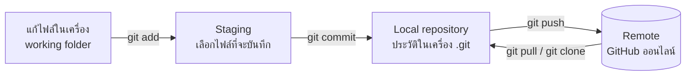
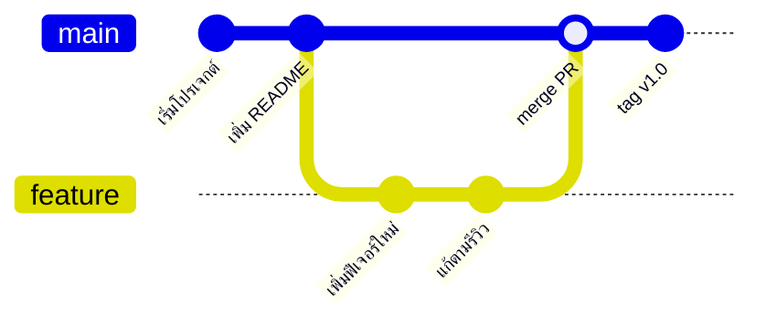
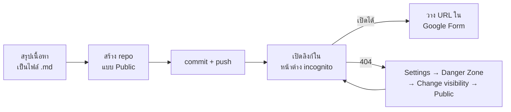

# Git, GitHub และ Markdown สำหรับมือใหม่

🏠 [หน้าหลัก](../README.md) · 📖 [คำศัพท์](glossary.md)

> **บทนี้เรียนอะไร:** เครื่องมือพื้นฐาน 3 อย่างที่ใช้ส่งงานและเก็บเอกสารตลอดหลักสูตร ND69 คือ Git (เก็บประวัติไฟล์), GitHub (ที่เก็บออนไลน์) และ Markdown (ภาษาเขียนเอกสาร)
> เนื้อหาเหมือนกันทั้ง ND1, ND2 และ ND3 จึงรวมไว้ที่นี่ที่เดียว

## ทำไมต้องรู้

- งานทุกชิ้นของหลักสูตรต่อจากนี้ **ส่งเป็นลิงก์ GitHub**
- ทำงานกับเพื่อนร่วมทีมได้โดยไม่ต้องส่งไฟล์ไปมา เพราะทุกคนเห็นประวัติเดียวกันว่าใครแก้อะไร เมื่อไร
- AI agent (เช่น Claude Code, Copilot, Cursor) ทำงานผ่าน Git ตลอดเวลา ถ้าเราไม่เข้าใจเบื้องหลัง เราจะสั่งและตรวจงานของ AI ไม่ได้
- ถ้าวันหนึ่ง AI ล่ม เรายังต้องทำงานต่อเองได้

## 1. แยกให้ออก: Git ≠ GitHub ≠ GitHub Desktop

| ชื่อ | คืออะไร | เปรียบเทียบ |
|---|---|---|
| **Git** | โปรแกรม version control เก็บประวัติการแก้ไขไฟล์ทุกครั้ง ย้อนกลับเวอร์ชันเก่าได้ | สมุดบันทึกว่าแก้อะไรไปเมื่อไร |
| **GitHub** | บริการออนไลน์ที่เก็บ repository ของ Git (เป็นของ Microsoft) ทางเลือกอื่นเช่น Bitbucket, GitLab | Google Drive สำหรับ Git |
| **GitHub Desktop** | แอปพลิเคชันแบบคลิกได้ ไม่ต้องพิมพ์คำสั่ง | File Explorer ที่รู้จัก Git |
| **GitHub CLI (`gh`)** | คำสั่งใน terminal สำหรับใช้ฟีเจอร์ของ GitHub เช่น login, สร้าง repo | มาคู่กับ Git เหมือน npm มากับ Node.js |

## 2. ภาพรวมการทำงาน



- **Local** = โฟลเดอร์ในเครื่องเรา ประวัติทั้งหมดอยู่ในโฟลเดอร์ซ่อน `.git` (ต้องเปิดดูไฟล์ซ่อนถึงจะเห็น)
- **Remote** = สำเนาบน GitHub
- ต้องคอย sync สองฝั่งให้ตรงกัน: ทุกเช้าก่อนเริ่มงานให้ `git pull` เพราะคนอื่นหรือ AI อาจแก้ไว้แล้ว

## 3. เลือกวิธีใช้ที่เหมาะกับเรา

| วิธี | เหมาะกับ |
|---|---|
| **GitHub Desktop** | คนที่ไม่ใช่โปรแกรมเมอร์ ไม่ชอบ command line |
| **Command line (CLI)** | โปรแกรมเมอร์ และคนที่ใช้ AI agent เพราะ agent สั่งคำสั่งได้แต่คลิกแอปไม่ได้ |
| **หน้าเว็บ GitHub** | แก้ไฟล์เล็ก ๆ หรืออัปโหลดไฟล์ได้เลยโดยไม่ต้องติดตั้งอะไร |

## 4. เริ่มต้นแบบ command line

**ติดตั้ง**
- Windows: ติดตั้ง **Git Bash** (มาพร้อม Git) ทำให้ใช้คำสั่งแบบ Linux/Mac ได้ แนะนำให้ตั้งเป็น terminal หลักใน VS Code
- Mac / Linux: มี Git อยู่แล้ว
- ติดตั้ง GitHub CLI จาก [cli.github.com](https://cli.github.com)

**ตรวจว่าพร้อม และตั้งค่าครั้งแรก**
```bash
git --version          # เห็นเลขเวอร์ชัน = ติดตั้งแล้ว
gh --version
gh auth login          # login GitHub ครั้งเดียว ไม่ต้องป้อนรหัสทุกครั้ง
git config --global user.name  "ชื่อของเรา"
git config --global user.email "อีเมลที่ใช้กับ GitHub"
```

**สร้าง repository ใหม่และส่งขึ้น GitHub**
```bash
mkdir my-notes && cd my-notes
git init -b main                 # เริ่ม repo พร้อม branch ชื่อ main
echo "# My Notes" > README.md    # สร้างไฟล์แรก
git status                       # ดูว่ามีไฟล์ไหนเปลี่ยน
git add README.md                # เลือกไฟล์ที่จะบันทึก
git commit -m "Add README"       # บันทึกลงประวัติในเครื่อง
gh repo create my-notes --public --source . --push   # สร้าง repo บน GitHub แล้ว push
```

**คำสั่งที่ใช้บ่อย**

| คำสั่ง | ใช้ทำอะไร |
|---|---|
| `git status` | ดูสถานะไฟล์ |
| `git diff` | ดูว่าแก้อะไรไปบ้าง |
| `git log` | ดูประวัติ commit |
| `git clone <url>` | ดึง repo ทั้งก้อนมาไว้ในเครื่อง (ไปทำต่อที่เครื่องอื่น) |
| `git pull` | ดึงของใหม่จาก GitHub มาให้เครื่องเราเป็นปัจจุบัน |
| `git push` | ส่งของในเครื่องขึ้น GitHub |
| `git branch` | ดู / สร้าง branch |
| `git help` | ลืมคำสั่งเมื่อไรก็พิมพ์อันนี้ |

> 💡 ไม่ต้องจำทั้งหมด จำแค่ `git help` และถาม AI ได้เสมอ

## 5. เริ่มต้นแบบ GitHub Desktop (ไม่ต้องพิมพ์คำสั่ง)

| ปุ่ม / การกระทำ | ผลที่ได้ |
|---|---|
| **Clone** | สร้างสำเนา repo **พร้อมประวัติ** ลงเครื่อง (ต่างจาก Download ZIP ที่ทำงานต่อกับ Git ไม่ได้) |
| **Save** (ในโปรแกรมแก้ไฟล์) | บันทึกไฟล์ — **ยังไม่ใช่ commit** |
| **Commit** | บันทึกการเปลี่ยนแปลงที่เลือกลงประวัติ **ในเครื่อง** |
| **Push** | ส่ง commit ขึ้น GitHub |
| **Fetch** | ดูว่า GitHub มีของใหม่ไหม **แต่ยังไม่รวมเข้าไฟล์ในเครื่อง** |
| **Pull** | รับของใหม่แล้วรวมเข้าเครื่อง |

**ทีละขั้น**
1. GitHub Desktop → **File → Clone repository** → เลือก repo ของเรา (หรือวาง URL) → เลือกโฟลเดอร์ปลายทาง เช่น `Documents/GitHub/my-notes` (อย่าเลือกโฟลเดอร์ที่มีงานอื่นอยู่)
2. **Repository → Open in Visual Studio Code** แล้วแก้ไฟล์ → Save
3. กลับ Desktop แท็บ **Changes** — ตรวจรายการไฟล์และ diff เลือกเฉพาะไฟล์ที่ต้องการ
4. กรอก **Summary** (ข้อความ commit สั้น ๆ เช่น `docs: add week 01 summary`) → **Commit to main**
5. เปิดเว็บดู — **ยังเป็นของเดิม** เพราะยังไม่ได้ push
6. กด **Push origin** → รีเฟรชเว็บ เห็นของใหม่
7. ถ้ามีคนแก้บนเว็บ (หรือเราแก้จากเครื่องอื่น) → **Fetch origin** → **Pull origin** → ไฟล์ในเครื่องอัปเดต

> ตรวจ **Current Repository** และ **Current Branch** ที่แถบด้านบนทุกครั้งก่อนเริ่มงาน

**แก้ conflict** — เมื่อสอง branch แก้บรรทัดเดียวกัน ไฟล์จะมีเครื่องหมายแบบนี้:
```text
<<<<<<< ฝั่งหนึ่ง
Workshop title: GitHub for Beginners
=======
Workshop title: GitHub Hands-On
>>>>>>> อีกฝั่ง
```
1. อ่านทั้งสองฝั่งแล้ว **ตกลงข้อความสุดท้าย** (เช่น `Workshop title: GitHub Hands-On for Beginners`)
2. **ลบเครื่องหมาย `<<<<<<<`, `=======`, `>>>>>>>` ทั้งหมด** แล้ว Save
3. กลับ Desktop → **Continue merge / Commit merge** → Push

> Conflict **ไม่ได้แปลว่าข้อมูลพัง** — แค่ต้องให้คนตัดสินใจ

**ย้อนงานที่ push ไปแล้ว (Revert)** — แท็บ **History** → คลิกขวาที่ commit → **Revert Changes in Commit** → Push · revert = **สร้าง commit ใหม่ที่ย้อนผล** โดยไม่ลบ commit เก่า · ⚠️ ถ้าเผลอ commit รหัสผ่าน / API key การ revert **ไม่ลบออกจากประวัติ** ต้องเปลี่ยน key นั้นทันที

## 6. คำศัพท์ที่จะเจอบน GitHub



- **Commit** = จุดบันทึก 1 ครั้ง พร้อมข้อความสั้น ๆ ว่าทำอะไร (commit message)
- **Diff** = เทียบก่อน/หลัง สี **เขียว = เพิ่ม** สี **แดง = ลบ** · Git มองการแก้เป็น *ทั้งบรรทัด* แก้ตัวอักษรเดียวก็เห็นทั้งบรรทัดเปลี่ยน → อย่าเขียนบรรทัดยาวเกินไป
- **Branch** = ทางแยกสำหรับลองทำอะไรใหม่โดยไม่กระทบงานหลัก (`main`)
- **Issue** = ใบงาน/ไอเดีย/รายงาน bug ที่โยนเข้าไปให้ทีม (คนหรือ AI) รับไปทำ ใส่ label และ assign คนรับผิดชอบได้
- **Pull Request (PR)** = ขอรวมงานจาก branch เข้า `main` ทีมรีวิวก่อน แล้วค่อย **merge** · สีเขียว = ยังเปิดอยู่ · สีม่วง = merge แล้ว
- **Conflict** = สองคนแก้บรรทัดเดียวกัน (A ใส่ "hello" B ใส่ "world") เจ้าของโค้ดต้องตัดสินเองว่าเอาอันไหน AI ตัดสินแทนไม่ได้เพราะไม่รู้ว่าเราต้องการอะไร
- **Tag / Release** = ป้ายเวอร์ชัน (v1.0, beta) และไฟล์ให้ผู้ใช้ดาวน์โหลด เช่น installer
- **Public / Private** = ใครเห็น repo ได้บ้าง ตั้งได้ที่ Settings → Danger Zone → Change visibility

## 7. ส่งงาน Mini-Project ทีละขั้น


1. สรุปเนื้อหาที่เรียนลงไฟล์ Markdown (ใช้ AI ช่วยได้ แต่ควรอ่านทวนเอง) — กำหนดผู้อ่านเอง เช่น ตัวเอง เพื่อนร่วมทีม มือใหม่
2. สร้าง repo ใหม่ในบัญชีตัวเอง ตั้งเป็น **Public** (ชื่อ repo ตั้งอะไรก็ได้)
3. commit + push ไฟล์สรุป (และรูปถ้ามี)
4. **ทดสอบลิงก์ในหน้าต่าง incognito** (ไม่ได้ login) — ถ้าเปิดไม่ได้ ผู้ตรวจ (ทั้งคนและ AI agent) ก็เปิดไม่ได้ = ถือว่ายังไม่ส่ง
5. วาง URL ในฟอร์มของแต่ละหลักสูตร — ลง 3 หลักสูตรต้องส่ง 3 ครั้ง · ส่งเป็นลิงก์โฟลเดอร์หรือลิงก์ branch ได้
6. งานที่ไม่เหมาะกับ GitHub (เช่นคลิปบอร์ดไฟกะพริบ) ฝากไว้ YouTube แบบ Unlisted หรือ Google Drive แบบ "ทุกคนที่มีลิงก์" แล้วใส่ลิงก์ใน README — **ห้ามตั้งเป็น Private**

## 8. Markdown เบื้องต้น

Markdown คือข้อความธรรมดาที่ใส่สัญลักษณ์นิดหน่อยแล้วแสดงผลสวยบน GitHub เหมาะกับยุค AI มาก เพราะ AI อ่านและเขียนได้ดี

| อยากได้ | พิมพ์ | ผลลัพธ์ |
|---|---|---|
| หัวข้อ | `# ใหญ่` · `## รอง` | หัวข้อขนาดต่าง ๆ |
| ตัวหนา | `**คำ**` | **คำ** |
| ลิงก์ | `[ข้อความ](https://...)` | ลิงก์ที่คลิกได้ |
| รายการ | `- ข้อ` · `1. ข้อ` · `- [ ] ทำ` | bullet / ตัวเลข / checkbox |
| กล่องข้อความ | `> หมายเหตุ` | ข้อความเยื้อง |
| ตาราง | `\| ก \| ข \|` แล้วบรรทัดถัดไป `\|---\|---\|` | ตาราง |
| โค้ด | ` ```python ` … ` ``` ` | กล่องโค้ดพร้อมสีตามภาษา (ต้องระบุภาษา) |
| แผนภาพ | ` ```mermaid ` … ` ``` ` | flowchart / sequence diagram |

- **Mermaid** ไม่ใช่ส่วนหนึ่งของ Markdown แต่ GitHub วาดให้ได้ เปลี่ยนทิศ flowchart ได้ด้วย `LR` (ซ้าย→ขวา) หรือ `TB` (บน→ล่าง)
- ฝึกได้ที่ [StackEdit](https://stackedit.io) (มีปุ่มเหมือน Word ไม่ต้องจำ syntax) หรือใน VS Code ที่แก้และ preview พร้อมกัน (`Ctrl+Shift+V`)

## 9. เทคนิคทำเอกสารด้วย AI

- แยกเนื้อหาเป็นหลายไฟล์ตามบท ไม่ยัดไว้ไฟล์เดียว AI อ่านง่ายและเปลือง token น้อยกว่า
- ใน VS Code กด **Shift ค้าง** แล้วลากไฟล์มาวาง จะได้ลิงก์ไปไฟล์นั้นอัตโนมัติ
- สั่ง AI ทีละขั้น เช่น "เพิ่มสารบัญ" → "เพิ่มปุ่มกลับหน้าหลัก/บทถัดไป" แล้วอ่านผลไปด้วย ดีกว่าสั่งทีเดียวได้ 500 บรรทัดที่ไม่ได้อ่าน
- บอก AI ก่อนว่า **เราเป็นใคร** และเขียนให้ใครอ่าน ผลลัพธ์จะตรงกับงานเรามากกว่า
- ทำเอกสารทั่วไปใช้ chat ฟรีก็พอ เก็บโมเดลแพงไว้งานเขียนโค้ดหนัก ๆ
- **อย่าพิมพ์รหัสผ่าน API key หรือข้อมูลบัตรลงในแชท AI** ให้ใส่เองผ่าน command line
- ดูตัวอย่างไฟล์กำกับ agent และ Prompt Template สำหรับแต่ละสายได้ที่ [ตัวอย่าง AGENTS.md และ Prompt Template](ai-agent-templates.md)

## 10. ปัญหาที่พบบ่อย

| อาการ | สาเหตุ / วิธีแก้ |
|---|---|
| คนอื่นเปิดลิงก์ repo ไม่ได้ (404) | repo เป็น Private → เปลี่ยนเป็น Public · ทดสอบด้วยหน้าต่าง **incognito** ที่ไม่ได้ login |
| `git status` บอกว่าไม่ใช่ git repository | ยังไม่ได้ `cd` เข้าโฟลเดอร์ repo |
| push แล้วโดนปฏิเสธ (rejected) | บน GitHub มีของใหม่กว่า → `git pull` ก่อนแล้วค่อย push |
| ถามรหัสผ่านทุกครั้ง | ยังไม่ได้ `gh auth login` |
| commit มีชื่อ/โลโก้ AI ติดมา | AI agent ใส่เอง ถ้าต้องการคุมเองให้ commit ผ่าน command line |
| Save แล้วเว็บไม่เปลี่ยน | ยังไม่ได้ commit + push |
| Fetch แล้วไฟล์ไม่เปลี่ยน | Fetch ไม่รวมงาน ต้อง Pull ด้วย และตรวจว่าอยู่ branch ที่ถูก |
| ไม่เห็น branch บนเว็บ | branch ยังอยู่แค่ในเครื่อง → Publish branch / push |
| สลับ branch ไม่ได้เพราะมีงานค้าง | commit งานที่ต้องเก็บก่อน อย่ากด Discard โดยไม่อ่าน |
| รูปหรือลิงก์ใน README เสีย | ตรวจ path เทียบกับตำแหน่งไฟล์ .md ตัวพิมพ์เล็ก-ใหญ่ และไฟล์ถูก push จริงไหม |
| เผลอ commit รหัสผ่าน / key | เปลี่ยน key ทันที แจ้งผู้ดูแล — revert ไม่ลบประวัติ |

## แหล่งอ้างอิง

- คู่มือของผู้สอน: [GitHub Hands-On: A Practical Guide for Beginners](https://github.com/drsanti/github-hands-on) — [บท GitHub Desktop](https://github.com/drsanti/github-hands-on/blob/main/lessons/04-github-desktop/README.md) · [บท Conflict และกู้คืนงาน](https://github.com/drsanti/github-hands-on/blob/main/lessons/07-conflicts-and-recovery/README.md) · [ปัญหาที่พบบ่อย](https://github.com/drsanti/github-hands-on/blob/main/appendix/troubleshooting.md)
- การบรรยาย Online Week 05 ของ ND1 / ND2 / ND3 (14–15 พ.ย. 2026)
- โจทย์ Mini-Project #1: [ND1](https://github.com/drsanti/kmutt-nd69/blob/main/nd1/docs/week06/README.md) · [ND2](https://github.com/drsanti/kmutt-nd69/blob/main/nd2/docs/week06/README.md) · [ND3](https://github.com/drsanti/kmutt-nd69/blob/main/nd3/docs/week06/README.md)
- [GitHub Docs](https://docs.github.com/) · [Mermaid](https://mermaid.js.org/)

---
🏠 [หน้าหลัก](../README.md) · [ND1](../nd1/README.md) · [ND2](../nd2/README.md) · [ND3](../nd3/README.md)
