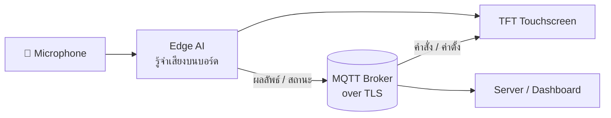
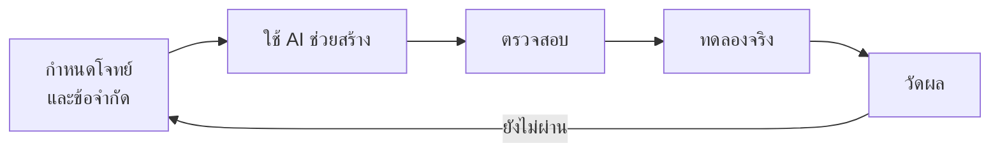

# บทที่ 1 — พื้นฐาน Edge AI และ IoT ในยุค AI

🏠 [หน้าหลัก](../README.md) · 📚 [สารบัญ ND1](README.md) · ถัดไป ➡ [บทที่ 2](02-freertos-ai-agents.md)

> **บทนี้เรียนอะไร:** Edge AI และ IoT คืออะไร วิศวกรยุคที่ AI เขียนโค้ดได้ต้องมีทักษะอะไร และภาพรวมโปรเจกต์ที่หลักสูตร ND1 จะพาทำ

## ทำไมสำคัญ

AI ช่วยออกแบบวงจร เขียน firmware และทำสไลด์ได้แล้ว แต่ **AI สนใจแค่ "ผลลัพธ์ที่ถูก" ไม่สนวิธีการ** และจะ *ไม่ทำ* เรื่องที่เราไม่ได้พูดถึง
- ไม่พูดเรื่องพลังงาน → ได้อุปกรณ์ที่กินแบตกว่าคู่แข่ง
- ไม่พูดเรื่อง security → ได้ MQTT แบบไม่เข้ารหัส ใครก็ส่ง/อ่านข้อมูลข้ามอุปกรณ์ได้

ดังนั้นวิศวกรต้องรู้ **คำสำคัญ (keyword)** ที่ต้องสั่ง AI ตรวจงานของ AI ได้ และพาของจาก "ของเล่น" ไปถึง "ผลิตภัณฑ์ที่ขายได้"

## แนวคิดหลัก

### Edge AI กับ IoT
- **IoT (Internet of Things)** = อุปกรณ์ที่เชื่อมต่อเครือข่ายเพื่อส่งข้อมูลและรับคำสั่ง
- **Edge AI** = ให้ AI ประมวลผล *บนตัวอุปกรณ์เอง* ไม่ต้องส่งข้อมูลไป cloud ทุกครั้ง (ในโลกหุ่นยนต์เรียก Embodied AI) ข้อดีคือเร็ว ใช้เน็ตน้อย และข้อมูลไม่ต้องออกจากเครื่อง

### โปรเจกต์ของ ND1
อุปกรณ์ ESP32-S3 ที่ฟังเสียงผ่านไมโครโฟน ใช้ Edge AI ตีความ แสดงผลบนจอสัมผัส และคุยกับ server อย่างปลอดภัย

แบ่งงานเป็น 6 ส่วน:

| # | ส่วน | ประเด็นที่ต้องคิด |
|---|---|---|
| 1 | Audio & Edge AI | ความแม่นยำ, latency |
| 2 | FreeRTOS & UI | UI ต้องไม่ค้างรอเน็ต |
| 3 | Communication | เน็ตหลุด, ส่งซ้ำ, ทำงาน offline |
| 4 | Security & Identity | TLS, certificate, สิทธิ์ของแต่ละอุปกรณ์ |
| 5 | Remote Configuration | เปลี่ยนค่าจากระยะไกล |
| 6 | OTA & Diagnostics | อัปเดต firmware ผ่านเน็ต, rollback ถ้าพัง |

### จาก Hobby สู่ Product
| | Prototype (ของเล่น) | Product (ของขาย) |
|---|---|---|
| พลังงาน | เสียบไฟตลอด | ต้องประหยัด ใช้แบตได้นาน |
| ความปลอดภัย | ไม่มี | key/certificate, secure boot, เพิกถอนสิทธิ์ได้ |
| เสถียรภาพ | ทำงานได้ตอนเดโม | รับมือเน็ตหลุด ไฟดับระหว่างอัปเดต |
| หลังการขาย | — | อัปเดตได้ วินิจฉัยปัญหาได้จากระยะไกล |

วงจรชีวิตของอุปกรณ์ที่ต้องคิดให้ครบ: **ลงทะเบียน → เชื่อมต่อ → ใช้งาน → อัปเดต → เลิกใช้งาน**

## วิธีทำงานกับ AI แบบวิศวกร

- **วาดก่อนเขียน** — block diagram, state diagram, timing diagram ช่วยให้ AI ไม่หลงทาง (ผู้สอนเรียกว่าวาง ADR / architecture ก่อน)
- **อ่านโค้ดให้ออก** ไม่จำเป็นต้องพิมพ์เร็ว เช่น ถ้าห่วงเรื่อง memory ต้องสั่งห้าม dynamic allocation แล้วตรวจได้ว่า AI ทำตามจริง
- เปรียบเหมือนหัวหน้าที่เก่ง สั่งลูกน้องที่อึดแต่ไม่คิดเอง

## ปัญหาที่พบบ่อย

| อาการ | สาเหตุ |
|---|---|
| ของที่ AI ทำ "ใช้ได้" แต่กินแบต / ไม่ปลอดภัย | ไม่ได้ระบุข้อกำหนดเรื่องนั้นตอนสั่ง |
| เดโมได้ แต่ใช้งานจริงพัง | ไม่ได้ทดสอบกรณีขอบ เช่น เน็ตหลุด, certificate ผิด, ไฟดับระหว่าง OTA |

## คำศัพท์ในบท
[Edge AI](../common/glossary.md#edge-ai) · [IoT](../common/glossary.md#iot) · [MQTT](../common/glossary.md#mqtt) · [TLS](../common/glossary.md#tls) · [OTA](../common/glossary.md#ota) · [Firmware](../common/glossary.md#firmware) · [Provisioning](../common/glossary.md#provisioning)

## แหล่งอ้างอิง
- เอกสารผู้สอน ND01 Week 01: [kmutt-nd69/nd1/docs/week01](https://github.com/drsanti/kmutt-nd69/blob/main/nd1/docs/week01/README.md)

---
🏠 [หน้าหลัก](../README.md) · 📚 [สารบัญ ND1](README.md) · ถัดไป ➡ [บทที่ 2 — บอร์ด ES3C28P และ FreeRTOS](02-freertos-ai-agents.md)
