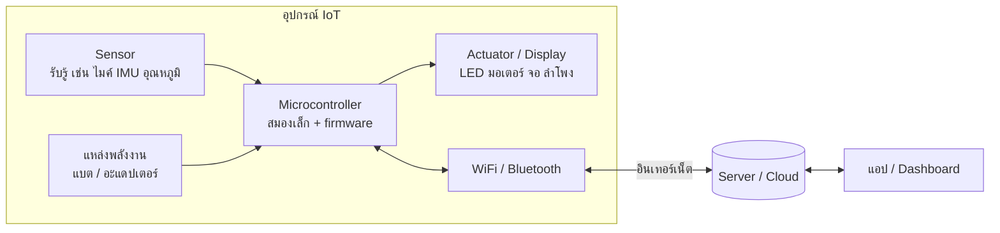
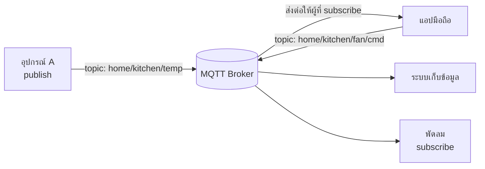
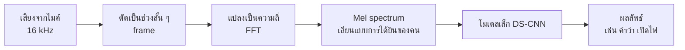
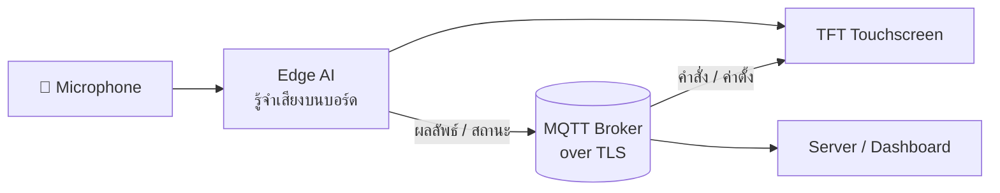
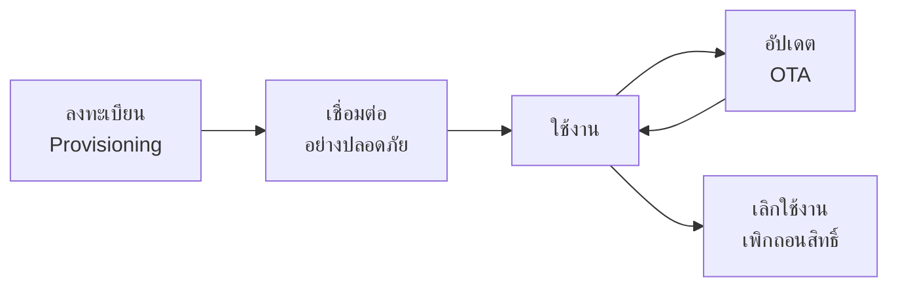
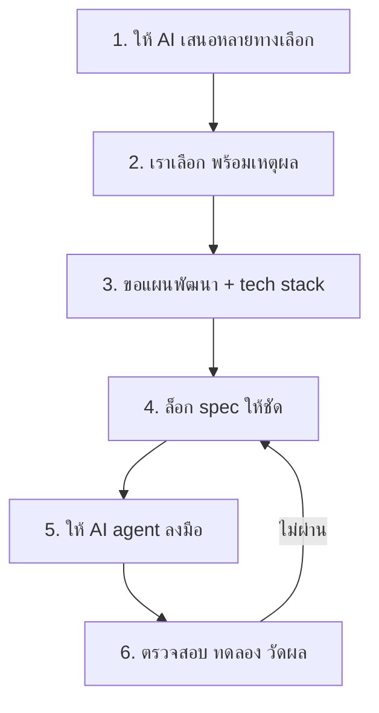

# บทที่ 1 — พื้นฐาน Edge AI และ IoT ในยุค AI

🏠 [หน้าหลัก](../README.md) · 📚 [สารบัญ ND1](README.md) · ถัดไป ➡ [บทที่ 2](02-freertos-ai-agents.md)

> **บทนี้เรียนอะไร:** Edge AI และ IoT คืออะไร อุปกรณ์ IoT หนึ่งชิ้นประกอบด้วยอะไรบ้าง ทำไมของที่ "ทำงานได้" ยังไม่ใช่ "ผลิตภัณฑ์" และวิศวกรต้องทำงานกับ AI อย่างไรให้ได้ของที่ใช้งานจริงได้
>
> **ก่อนอ่าน:** ไม่ต้องมีพื้นฐานอะไร · **เวลาอ่าน:** ~30 นาที

## สารบัญบทนี้
1. [ทำไมเรื่องนี้สำคัญ](#1-ทำไมเรื่องนี้สำคัญ)
2. [IoT คืออะไร และอุปกรณ์หนึ่งชิ้นมีอะไรบ้าง](#2-iot-คืออะไร-และอุปกรณ์หนึ่งชิ้นมีอะไรบ้าง)
3. [Edge AI ต่างจาก Cloud AI อย่างไร](#3-edge-ai-ต่างจาก-cloud-ai-อย่างไร)
4. [โปรเจกต์ตลอดหลักสูตร ND1](#4-โปรเจกต์ตลอดหลักสูตร-nd1)
5. [จาก Hobby สู่ Product](#5-จาก-hobby-สู่-product)
6. [4 ทักษะที่ทำให้วิศวกร IoT โดดเด่น](#6-4-ทักษะที่ทำให้วิศวกร-iot-โดดเด่น)
7. [ทำงานกับ AI แบบวิศวกร](#7-ทำงานกับ-ai-แบบวิศวกร)
8. [สรุปท้ายบทและแบบฝึกคิด](#8-สรุปท้ายบทและแบบฝึกคิด)

---

## 1. ทำไมเรื่องนี้สำคัญ

ทุกวันนี้ AI ช่วยออกแบบวงจรง่าย ๆ วาดลาย PCB เขียน firmware และทำสไลด์ได้แล้ว — เร็วกว่าที่หลายคนคาดไว้ งาน "ใช้แรง" อย่างการพิมพ์โค้ดจึงถูกแทนที่ได้ง่าย

แต่มีสิ่งหนึ่งที่ผู้สอนย้ำตลอดหลักสูตร:

> **AI สนใจแค่ "ผลลัพธ์ที่ถูก" ไม่สนวิธีการ และจะไม่ทำเรื่องที่เราไม่ได้พูดถึง**

ตัวอย่างที่เกิดขึ้นจริง:

| เราสั่ง AI ว่า | AI ให้มา | สิ่งที่ขาดเพราะเราไม่ได้พูด |
|---|---|---|
| "ทำอุปกรณ์วัดเสียงแล้วส่งค่าขึ้น server" | ส่งด้วย MQTT พอร์ต 1883 | ไม่มีการเข้ารหัส (TLS) ใครก็ดักอ่าน หรือส่งข้อมูลปลอมเข้า topic ของคนอื่นได้ |
| "ให้ทำงานด้วยแบตเตอรี่" | โค้ดที่ทำงานเต็มกำลังตลอด | ไม่ได้ใช้โหมดประหยัดพลังงาน แบตหมดเร็วกว่าคู่แข่ง |
| "เก็บค่าตั้งไว้ถาวร" | เก็บในตัวแปรใน RAM | ถอดปลั๊กแล้วค่าหาย เพราะไม่ได้ใช้หน่วยความจำถาวร |

ผู้สอนเปรียบว่า **เราคือหัวหน้าที่เก่ง ส่วน AI คือลูกน้องที่อึดมากแต่ไม่คิดเอง** — หัวหน้าต้องรู้ว่าจะสั่งอะไร ตรวจงานเป็น และรับผิดชอบผลลัพธ์ เพราะเรารู้ spec งบประมาณ เวลา และข้อจำกัดดีที่สุด

ในตลาดงาน การเขียนใน resume ว่า "ใช้ AI เป็น" ไม่มีค่าแล้ว (เหมือนเขียนว่า "ใช้คอมพิวเตอร์เป็น") สิ่งที่บริษัทต้องการคือคนที่ **วางสถาปัตยกรรม เขียน test case และรีวิวงาน** ได้ — คนเดียวที่ใช้ AI เก่ง ๆ อาจทำงานแทนทีม junior ได้หลายคน

---

## 2. IoT คืออะไร และอุปกรณ์หนึ่งชิ้นมีอะไรบ้าง

**IoT (Internet of Things)** คืออุปกรณ์ที่ต่อเครือข่ายเพื่อส่งข้อมูลและรับคำสั่ง เช่น เซนเซอร์อุณหภูมิในโรงงาน ปลั๊กไฟอัจฉริยะ ระบบรดน้ำต้นไม้

อุปกรณ์ IoT หนึ่งชิ้นมีส่วนประกอบหลักแบบนี้:

| ส่วน | หน้าที่ | ในหลักสูตรนี้ |
|---|---|---|
| **Microcontroller (MCU)** | คอมพิวเตอร์ขนาดเล็กในชิปเดียว รันโปรแกรมที่เรียกว่า **firmware** | ESP32-S3 |
| **Sensor** | วัดค่าจากโลกจริง | ไมโครโฟน, จอสัมผัส, IMU (บางรุ่น) |
| **Actuator / Output** | ทำให้เกิดผลในโลกจริง | จอ, ลำโพง, RGB LED |
| **การสื่อสาร** | ส่ง/รับข้อมูล | WiFi, Bluetooth, USB |
| **พลังงาน** | จ่ายไฟ | แบตเตอรี่ Li-ion + วงจรชาร์จ |

### การสื่อสารแบบ MQTT (เข้าใจแบบง่าย)

IoT นิยมใช้ **MQTT** ซึ่งทำงานแบบ **publish / subscribe** ผ่านตัวกลางที่เรียกว่า **broker** — คล้ายกลุ่มแชท:

- ผู้ส่งไม่ต้องรู้ว่าใครรับ ผู้รับไม่ต้องรู้ว่าใครส่ง — แค่ตกลง **ชื่อ topic** กัน
- ในระดับผลิตภัณฑ์ต้องมี **TLS** (เข้ารหัส) และ **Topic ACL** (กำหนดว่าอุปกรณ์ไหนส่ง/อ่าน topic ไหนได้) ไม่งั้นอุปกรณ์หนึ่งอาจไปสั่งงานอุปกรณ์ของคนอื่นได้
- ผู้สอนเตรียม MQTT server ที่มี TLS ไว้ให้ใช้จริงในช่วง workshop

---

## 3. Edge AI ต่างจาก Cloud AI อย่างไร

**Edge AI** คือการให้ AI ประมวลผล **บนตัวอุปกรณ์เอง** ("edge" = ขอบของเครือข่าย ใกล้ผู้ใช้) แทนการส่งข้อมูลดิบขึ้น cloud ทุกครั้ง ในโลกหุ่นยนต์มีคำที่ใกล้เคียงกันว่า **Embodied AI** (AI ที่อยู่ในร่างกายของเครื่อง)

| | Cloud AI | Edge AI |
|---|---|---|
| ประมวลผลที่ | server | บนอุปกรณ์ |
| ความเร็วในการตอบสนอง | ขึ้นกับเน็ต | เร็ว ไม่ต้องรอเน็ต |
| ใช้งานตอนเน็ตหลุด | ไม่ได้ | ได้ |
| ความเป็นส่วนตัว | ข้อมูลดิบ (เช่นเสียง) ออกจากเครื่อง | ส่งแค่ผลลัพธ์ เช่น "ได้ยินคำว่า เปิดไฟ" |
| ขนาดโมเดล | ใหญ่ได้ (LLM) | ต้องเล็กมาก (หลัก KB) |

> ตัวอย่างที่ดีของ Edge AI: แทนที่จะส่งเสียงทั้งหมดขึ้น cloud อุปกรณ์ส่งแค่ **ข้อมูลสรุป** ว่า "ตรวจพบเสียงไอ 3 ครั้งในชั่วโมงนี้" — ประหยัดเน็ต ประหยัดพลังงาน และไม่ละเมิดความเป็นส่วนตัว

### ทำไมเลือกไมโครโฟนเป็นเซนเซอร์หลัก
ผู้สอนเลือกเสียงเพราะ **ท้าทายกว่า** เซนเซอร์อุณหภูมิ/ความชื้น (ซึ่งใช้แค่ if-else ก็พอ):
- ต้องสุ่มสัญญาณ (sampling) 16,000 ครั้งต่อวินาที (16 kHz — ขั้นต่ำสำหรับเสียงพูดคือ 8 kHz)
- ต้องแปลงสัญญาณไปอยู่ใน **โดเมนความถี่** ก่อนให้โมเดลดู
- จำแนกได้หลายแบบ: เสียงพูด เสียงเครื่องจักร เสียงปรบมือ เสียงไอ

ภาพรวมขั้นตอน (รายละเอียดการสร้างโมเดลอยู่ใน ND2):

---

## 4. โปรเจกต์ตลอดหลักสูตร ND1

เป้าหมายคืออุปกรณ์ **ESP32-S3** ที่ฟังเสียง → ตีความด้วย Edge AI → แสดงผลบนจอสัมผัส → คุยกับ server อย่างปลอดภัย

แบ่งงานเป็น 6 ส่วน แต่ละส่วนมีคำถามที่ต้องตอบให้ได้:

| # | ส่วน | คำถามที่ต้องคิด |
|---|---|---|
| 1 | **Audio & Edge AI** | แม่นแค่ไหน? ตอบสนองช้าแค่ไหน (latency)? ใช้ RAM เท่าไร? |
| 2 | **FreeRTOS & UI** | ถ้าเน็ตช้า จอจะค้างไหม? (UI ต้องไม่รอเน็ต) |
| 3 | **Communication** | เน็ตหลุดแล้วเกิดอะไร? ข้อมูลซ้ำ / หายไหม? ทำงาน offline ได้ไหม? |
| 4 | **Security & Identity** | อุปกรณ์พิสูจน์ตัวตนอย่างไร? certificate ผิดแล้วเป็นอย่างไร? |
| 5 | **Remote Configuration** | เปลี่ยนค่าจากระยะไกลได้ไหม? ใครมีสิทธิ์เปลี่ยน? |
| 6 | **OTA & Diagnostics** | อัปเดต firmware ผ่านเน็ตได้ไหม? ไฟดับระหว่างอัปเดตแล้วเครื่องตายไหม? |

**โจทย์ทดสอบ** ที่ใช้ตรวจว่าเป็นผลิตภัณฑ์จริง: ถอดเน็ต · ใส่ certificate ผิด · ลองใช้สิทธิ์ข้ามอุปกรณ์ · ตัดไฟระหว่าง OTA

### ใช้ 2 core อย่างมืออาชีพ
ESP32-S3 มี 2 core ผู้สอนยกตัวอย่างการออกแบบระดับผลิตภัณฑ์:
- **Core 0** ทำงานพลังงานต่ำ เฝ้าฟังเสียงอยู่ตลอด
- เมื่อเสียงเข้าเงื่อนไข (เช่นดังเกินระดับ) ค่อย **ปลุก Core 1** มารัน AI
- ไม่ต้องรันเต็มกำลัง 24 ชั่วโมง → ประหยัดแบตได้มาก

---

## 5. จาก Hobby สู่ Product

ทุกคนเริ่มจากงานอดิเรกได้ แต่ต้องเปลี่ยนวิธีคิดเมื่อจะทำของขาย:

| ด้าน | Prototype (ของเล่น / เดโม) | Product (ของขายได้) |
|---|---|---|
| **การออกแบบ** | ทำให้ทำงานก่อน | เริ่มจาก requirement และข้อจำกัด |
| **พลังงาน** | เสียบไฟตลอด | ใช้แบตได้นาน → เปลี่ยนทั้ง system และ software design |
| **ความปลอดภัย** | ไม่มี | ต้องสมมติว่า "ใครก็มีอุปกรณ์ตัวนี้ได้" → key/certificate, secure boot, เพิกถอนสิทธิ์ได้ |
| **เสถียรภาพ** | มีคนกด reset ให้ | ไม่มีใครกด reset ให้ พังครั้งเดียวเสียชื่อ |
| **หลังการขาย** | — | อัปเดตได้ วินิจฉัยปัญหาจากระยะไกลได้ |

> **Mock-up ≠ Production-ready** — UI หน้าตาเหมือนกันได้ แต่เบื้องหลังต่างกันมาก

**วงจรชีวิตของอุปกรณ์** ที่ต้องคิดให้ครบตั้งแต่วันแรก:

### "พื้นฐาน" ในยุค AI หมายถึงอะไร
ผู้สอนนิยามใหม่ว่า เราไม่จำเป็นต้องคำนวณอิเล็กตรอนในรอยต่อ PN ด้วยมือ แต่ต้อง:
- **รู้ว่าทำไม** AI ออกแบบแบบนั้น และ **จับได้** เมื่อ AI ลืมสิ่งสำคัญ เช่น impedance matching หรือความยาวลายทองแดงที่ต้องเท่ากันของสัญญาณความเร็วสูง (SPI, DDR)
- **วัดและพิสูจน์** ได้ — ทักษะลงมือ เช่น จับมิเตอร์ วัดวงจร ยังสำคัญ
- **เข้าใจสาเหตุ → วัดและพิสูจน์ → แก้ถูกจุด** — คุณค่าที่บริษัทต้องการคือลดเครื่องเสีย ลดต้นทุนบริการ และส่งมอบงานที่เชื่อถือได้

---

## 6. 4 ทักษะที่ทำให้วิศวกร IoT โดดเด่น

| # | ทักษะ | ทำไมสำคัญ | ตัวอย่างคำถาม |
|---|---|---|---|
| 1 | **Communication** | เครือข่ายจริงไม่เคยสมบูรณ์ | เน็ตหลุดแล้ว reconnect อย่างไร? ส่งซ้ำแล้วข้อมูลซ้ำไหม? |
| 2 | **Cybersecurity** | อุปกรณ์อยู่ในมือคนอื่น | เก็บ key อย่างไร? Secure Boot? ถ้าเครื่องถูกขโมยจะเพิกถอนสิทธิ์อย่างไร? |
| 3 | **OTA (Over-The-Air update)** | ระบบรดน้ำ 20 จุดยังเดินไปเสียบสายได้ แต่ 100 จุดไม่ไหว | ตรวจลายเซ็นของ firmware ไหม? ถ้าอัปเดตพังกลับเวอร์ชันเดิมได้ไหม (rollback)? |
| 4 | **Device Provisioning** | ต้องดูแลอุปกรณ์หลักพันหลักหมื่นตัว | ลงทะเบียนเครื่องใหม่อย่างไร? (เหมือนสแกน QR ลงทะเบียนกล้องวงจรปิด) |

นอกจากนี้ต้อง **ทำตามมาตรฐานของอุตสาหกรรม** ที่เราทำงานอยู่ เช่น เครื่องมือแพทย์มีมาตรฐานเฉพาะ

---

## 7. ทำงานกับ AI แบบวิศวกร

### ขั้นตอนออกแบบร่วมกับ AI

### หลักปฏิบัติ
- **วาดก่อนเขียน** — block diagram, state diagram, timing diagram ช่วยให้ทั้งคนและ AI ไม่หลงทาง ผู้สอนเรียกว่าวาง **architecture / ADR (Architecture Decision Record)** ก่อน
- **สั่งเป็นข้อกำหนดที่ตรวจได้** เช่น "ห้ามใช้ dynamic allocation (`malloc`)" แล้วต้อง **ตรวจได้** ว่า AI ทำตามจริง
- **อ่านโค้ดให้ออก** สำคัญกว่าพิมพ์เร็ว
- **ใช้ AI ทีละส่วน** — ผู้สอนกำหนดแม้แต่ชื่อฟังก์ชันเอง แล้วให้ AI พิมพ์ตามดีไซน์ ไม่ใช่สั่งเอาทั้งก้อน
- **"หมวก 2 ใบ"** — โหมดพัฒนาตัวเอง (หยุดถาม AI จนกว่าจะเข้าใจ) กับโหมดทำงาน (ต้องส่งงาน) อย่าผสมกันจนงานไม่จบ
- **สมองเหมือนกล้ามเนื้อ** — ไม่ใช้ก็ฝ่อ ความรู้พื้นฐานมาจากการอ่านหนังสือและลงมือทำ

### วิธีเรียนของ ND1
- ใช้ **FreeRTOS** เป็นแกน — เข้าใจ RTOS ตัวหนึ่งแล้วย้ายไปตัวอื่นได้ ต่างกันแค่ syntax
- ฝึกบน **simulator บน PC** ได้ก่อน ไม่มีบอร์ดก็เรียนได้ (บทที่ 3)
- ไม่เน้นพิมพ์โค้ด — มีโค้ดตั้งต้นให้ แล้วใช้ AI ปรับ

---

## 8. สรุปท้ายบทและแบบฝึกคิด

### สรุป
- IoT = อุปกรณ์ที่ต่อเน็ต · Edge AI = AI ที่คิดบนตัวอุปกรณ์เอง
- ของที่ "ทำงานได้" ยังไม่ใช่ผลิตภัณฑ์ ต้องคิดเรื่องพลังงาน ความปลอดภัย เสถียรภาพ และการอัปเดต
- AI ทำตามที่สั่ง และไม่ทำสิ่งที่ไม่ได้สั่ง → ต้องรู้ keyword และตรวจงานเป็น

### แบบฝึกคิด (ไม่ต้องเขียนโค้ด)
1. เลือกอุปกรณ์ IoT รอบตัว 1 ชิ้น (เช่น กริ่งประตูอัจฉริยะ) แล้วระบุ sensor / MCU / actuator / การสื่อสาร / พลังงาน
2. ถ้าอุปกรณ์นั้นถูกขโมย ผู้ผลิตควรทำอะไรได้บ้าง?
3. เขียนประโยคสั่ง AI ให้สร้าง firmware ส่งค่าอุณหภูมิขึ้น server โดยระบุข้อกำหนดเรื่อง **พลังงาน** และ **ความปลอดภัย** ให้ครบ

## คำศัพท์ในบท
[Edge AI](../common/glossary.md#edge-ai) · [IoT](../common/glossary.md#iot) · [MQTT](../common/glossary.md#mqtt) · [TLS](../common/glossary.md#tls) · [OTA](../common/glossary.md#ota) · [Firmware](../common/glossary.md#firmware) · [Provisioning](../common/glossary.md#provisioning)

## แหล่งอ้างอิง
- เอกสารผู้สอน ND01 Week 01: [kmutt-nd69/nd1/docs/week01](https://github.com/drsanti/kmutt-nd69/blob/main/nd1/docs/week01/README.md) และสไลด์ประกอบการบรรยาย
- การบรรยาย Online ND1 Week 01 (10 ต.ค. 2026)
- [MQTT.org](https://mqtt.org/) — แนะนำโปรโตคอล MQTT

---
🏠 [หน้าหลัก](../README.md) · 📚 [สารบัญ ND1](README.md) · ถัดไป ➡ [บทที่ 2 — บอร์ด ES3C28P และ FreeRTOS](02-freertos-ai-agents.md)
