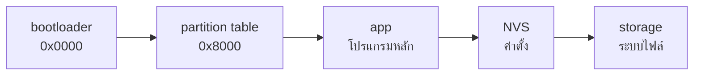
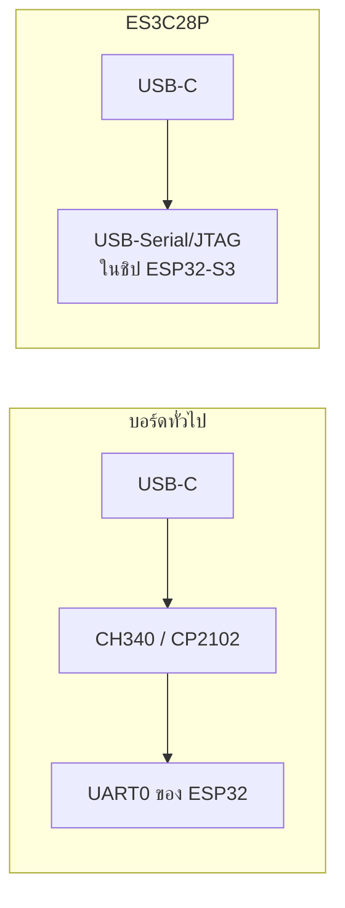
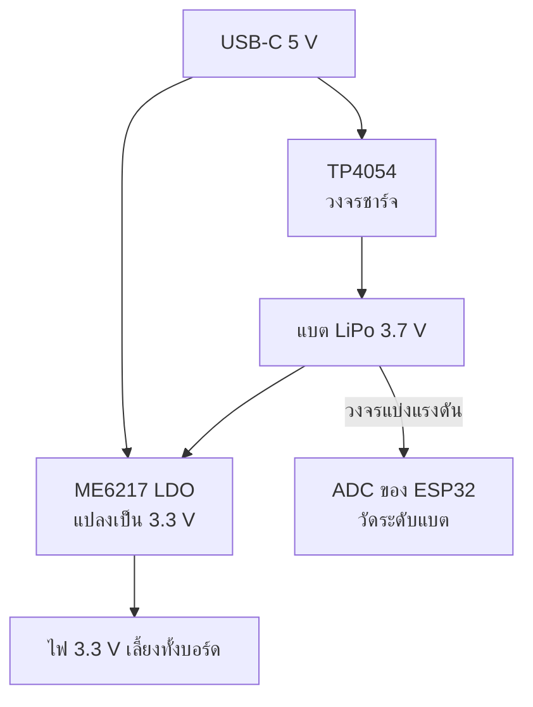
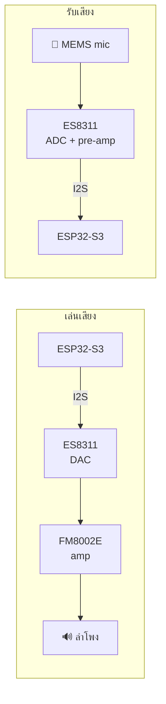

# บทที่ 2 — รู้จักบอร์ด ES3C28P (ESP32-S3) ตั้งแต่ชิปถึงอุปกรณ์รอบตัว

🏠 [หน้าหลัก](../README.md) · 📚 [สารบัญ ND1](README.md) · ⬅ [บทที่ 1](01-edge-ai-iot-basics.md) · ถัดไป ➡ [บทที่ 3](03-esp-idf-hello-world.md)

> **บทนี้เรียนอะไร:** ชิป ESP32-S3 มีอะไรบ้าง หน่วยความจำแต่ละชนิดต่างกันอย่างไร อุปกรณ์บนบอร์ด (จอ, touch, เสียง, LED, แบต) ต่อกับชิปอย่างไร ขาไหนว่างให้ใช้ และกับดักที่ AI coding มักพลาดเมื่อทำงานกับฮาร์ดแวร์
>
> **ก่อนอ่าน:** [บทที่ 1](01-edge-ai-iot-basics.md) · **เวลาอ่าน:** ~60 นาที (อ่านทีละส่วนได้)

## สารบัญบทนี้
1. [ทำไมต้องรู้จักฮาร์ดแวร์ทั้งที่มี AI](#1-ทำไมต้องรู้จักฮาร์ดแวร์ทั้งที่มี-ai)
2. [ชิป ESP32-S3R8](#2-ชิป-esp32-s3r8)
3. [หน่วยความจำ 6 ชนิด](#3-หน่วยความจำ-6-ชนิด)
4. [หน่วยความจำในมุมของ firmware](#4-หน่วยความจำในมุมของ-firmware)
5. [USB บนบอร์ดนี้ และกับดัก "เปิดพอร์ตแล้วบอร์ดรีเซ็ต"](#5-usb-บนบอร์ดนี้-และกับดัก-เปิดพอร์ตแล้วบอร์ดรีเซ็ต)
6. [ระบบไฟและแบตเตอรี่](#6-ระบบไฟและแบตเตอรี่)
7. [จอ ILI9341 และ touch FT6336](#7-จอ-ili9341-และ-touch-ft6336)
8. [ระบบเสียง: codec + amp + ไมค์](#8-ระบบเสียง-codec--amp--ไมค์)
9. [RGB LED WS2812 และ RMT](#9-rgb-led-ws2812-และ-rmt)
10. [แผนที่ขา: ขาไหนว่าง ขาไหนห้ามแตะ](#10-แผนที่ขา-ขาไหนว่าง-ขาไหนห้ามแตะ)
11. [กับดักของ AI coding กับฮาร์ดแวร์](#11-กับดักของ-ai-coding-กับฮาร์ดแวร์)
12. [เทคนิคใช้ AI ช่วยเรียนบทนี้](#12-เทคนิคใช้-ai-ช่วยเรียนบทนี้)
13. [สรุปและแบบฝึก](#13-สรุปและแบบฝึก)

---

## 1. ทำไมต้องรู้จักฮาร์ดแวร์ทั้งที่มี AI

AI เขียนโค้ดให้ "ทำงานได้" แต่ **ไม่สนว่าข้อมูลควรอยู่ในหน่วยความจำส่วนไหน** หรือ **ขาไหนห้ามใช้** ผลคือ:
- อุปกรณ์ช้าโดยไม่รู้สาเหตุ
- ข้อมูลหายตอนถอดปลั๊ก
- เครื่องค้างเป็นพัก ๆ เพราะหน่วยความจำไม่พอ

ผู้สอนบอกว่า **คีย์เวิร์ดเรื่อง memory สำคัญกว่าการเขียนโปรแกรม** — ก่อนซื้อชิปหรือออกแบบระบบต้องดู SRAM, PSRAM, Flash และความเร็วบัสก่อน เพราะ **ระบบเร็วได้เท่าจุดที่ช้าที่สุด (คอขวด)**

---

## 2. ชิป ESP32-S3R8

บอร์ด ES3C28P ใช้ชิป **ESP32-S3R8** โดยตรง (ไม่ใช่ module สำเร็จรูป) — วงจรเสาอากาศออกแบบบน PCB เอง

> 📌 **หมายเหตุเรื่องรุ่นบอร์ด (ES3C28P vs WS28P):** บทนี้เจาะลึกฮาร์ดแวร์ของบอร์ด **Ternion ES3C28P (`es3c28p`)** ที่มีไมโครโฟนและ RGB LED (WS2812) บนบอร์ด แต่ใน Workshop Onsite ([บทที่ 4](04-onsite-firmware-workshop.md)) ผู้เรียนบางส่วนจะได้รับบอร์ด **Waveshare ESP32-S3-Touch-LCD-2.8 (`ws28p`)** ซึ่งเป็นค่าเริ่มต้นของ repo workshop — ทั้งสองรุ่นใช้ชิป ESP32-S3R8 และจอ 2.8 นิ้วเหมือนกัน แต่ `ws28p` **ไม่มีไมโครโฟนและ RGB LED** (เปลี่ยนเป็น IMU, RTC และลำโพง stereo แทน) ขา GPIO เฉพาะของไมค์/LED ในบทนี้จึงใช้ไม่ได้กับ `ws28p`

### อ่านชื่อรุ่นให้เป็น
ชื่อชิปบอกว่ามีหน่วยความจำอะไรอยู่ข้างใน — สำคัญมากเวลาสั่งซื้อบอร์ดหรือชิป

| ชื่อ | ความหมาย |
|---|---|
| `ESP32-S3` (ไม่มีต่อท้าย) | ไม่มี PSRAM / flash ในตัว |
| `ESP32-S3R2` | PSRAM 2 MB แบบ quad |
| **`ESP32-S3R8`** | **PSRAM 8 MB แบบ octal** ← บอร์ดเรา |
| `ESP32-S3R8V` | PSRAM 8 MB ใช้ไฟ 1.8 V (ไม่ใช่ 3.3 V แบบทั่วไป) |
| module `…N16R8` | `N16` = flash 16 MB, `R8` = PSRAM 8 MB |

บอร์ดเรามี spec เทียบเท่า module **N16R8** = flash 16 MB + PSRAM 8 MB

### Spec หลักที่ควรรู้

| หมวด | ค่า | หมายความว่า |
|---|---|---|
| CPU | Xtensa LX7 **2 core**, 32-bit, สูงสุด 240 MHz | ทำงาน 2 อย่างพร้อมกันได้จริง |
| SRAM ในชิป | 512 KB | หน่วยความจำทำงานที่เร็วที่สุด |
| PSRAM | 8 MB | หน่วยความจำเสริม ใหญ่แต่ช้ากว่า |
| Flash | 16 MB (ชิปแยกบนบอร์ด) | เก็บโปรแกรมและข้อมูลถาวร |
| WiFi | 2.4 GHz 802.11 b/g/n | ไม่รองรับ 5 GHz |
| Bluetooth | **BT 5.0 LE เท่านั้น** | ไม่มี Bluetooth Classic (สเปกบอร์ดจีนหลายเจ้าเขียนผิด) |
| ไฟเลี้ยง | 3.0–3.6 V | ขา GPIO ทนได้แค่ 3.3 V |
| USB | USB OTG + USB-Serial/JTAG ในชิป | เสียบสายเข้าชิปได้ตรง ๆ |

อุปกรณ์ภายในชิปที่จะเจอบ่อย: UART×3, SPI×2, I2C×2, I2S×2, **RMT**, PWM (LEDC), ADC×2, SDIO, USB

### ESP32 รุ่นอื่นต่างกันอย่างไร
- core ของ Espressif มี 2 ตระกูล: **Xtensa** (S2, S3) และ **RISC-V** (รุ่นใหม่ ๆ เกือบทั้งหมด)
- **S3** = 2 core + WiFi + Bluetooth + คำสั่งเร่ง AI → เหมาะกับ Edge AI ขนาดเล็ก
- **P4** = แรงกว่ามาก เหมาะ computer vision แต่ **ไม่มี WiFi/Bluetooth** ต้องคู่กับชิปซีรีส์ C (C3/C5/C6) ทำหน้าที่สื่อสาร
- เหตุผลที่หลักสูตรเลือก S3: ครบทั้งประมวลผล AI และการสื่อสารในชิปเดียว

---

## 3. หน่วยความจำ 6 ชนิด

คำว่า "memory" บน ESP32 มีหลายชนิดที่ชื่อคล้ายกัน วิธีไม่สับสนคือแยกด้วย **2 แกน**:

| | **Volatile** (ไฟดับ = หาย) | **Non-volatile** (ไฟดับก็อยู่) |
|---|---|---|
| **ในชิป (internal)** | **SRAM** 512 KB — เร็วที่สุด<br>**RTC memory** 16 KB | **ROM** 384 KB — อ่านอย่างเดียว<br>**eFuse** — เขียนได้ครั้งเดียว |
| **นอกชิป (external)** | **PSRAM** 8 MB — ช้ากว่า ผ่าน cache | **Flash** 16 MB — เขียนได้จำกัดรอบ |

> **RAM** เป็นชื่อครอบครัวของหน่วยความจำแบบ volatile — SRAM และ PSRAM คือ "สายพันธุ์" ใน RAM

### SRAM (512 KB) — หน่วยความจำตัวจริง
- อยู่บนชิปเดียวกับ CPU เข้าถึงได้ทุก clock
- ทำ **atomic operation** ได้ และ **DMA** (ให้อุปกรณ์อย่าง SPI/I2S ย้ายข้อมูลเองโดยไม่ผ่าน CPU) ได้
- 512 KB ฟังดูเยอะ แต่ถูกแย่งใช้: stack ของทุก task + heap + DMA buffer + โค้ดที่ต้องเร็ว
- กรณีจริงบนบอร์ดนี้: ก่อนเปิด PSRAM, WiFi + network stack กิน SRAM จนเหลือแค่ 3–8 KB → การเชื่อมต่อตาย

### RTC memory (16 KB) — รอดจาก deep sleep
- อยู่ในส่วนไฟเลี้ยงที่ยังทำงานตอนชิปหลับลึก (deep sleep)
- ใช้จำค่าข้ามรอบการหลับ เช่น ตัวนับ หรือ flag ว่า "เพิ่งตื่นจาก sleep หรือเปิดเครื่องใหม่"

### PSRAM (8 MB) — RAM เสริมที่ช้ากว่า
- อยู่ใน package เดียวกับชิป (ตัว "R8") แต่เชื่อมผ่าน bus ภายนอกและ **cache**
- อ่านเขียนเหมือน memory ปกติ แต่ถ้าข้อมูลไม่อยู่ใน cache ต้องวิ่งไปที่ bus → ช้ากว่ามาก
- **ห้ามใช้กับ atomic operation และ DMA buffer**
- เหมาะกับของใหญ่ที่ไม่ต้องเร็ว: frame buffer ของจอ, buffer เสียง, buffer เครือข่าย, หน่วยความจำของ TLS
- บทเรียนจากบอร์ดนี้: **PSRAM ไม่ใช่ของแถม มันคือเงื่อนไขให้ network stack รอด** — เปิด PSRAM แล้ว heap เหลือ ~8.3 MB การเชื่อมต่อนิ่งทันที

### Flash (16 MB) — ที่เก็บถาวร และบ้านของโค้ด
- เก็บ bootloader, โปรแกรม, ค่าตั้ง, ระบบไฟล์, ไฟล์ OTA
- ข้อจำกัด: ต้อง **ลบเป็นก้อน (sector 4 KB) ก่อนเขียน** และเขียนซ้ำได้ราว 100,000 รอบต่อ sector → **ห้ามใช้แทน RAM หรือเขียน log ทุกรอบลูป**
- CPU **รันโค้ดจาก flash ได้โดยตรง** ผ่านกลไก **XIP (Execute In Place)** ที่ map flash เข้ามาในพื้นที่ address เดียวกับหน่วยความจำ

### ROM (384 KB) — firmware จากโรงงาน
- เขียนมาตั้งแต่ผลิต แก้ไม่ได้
- มี bootloader ขั้นแรก และ **download mode** → นี่คือเหตุผลที่ "กดปุ่ม BOOT แล้ว flash ใหม่ได้เสมอ" ทำพังจากซอฟต์แวร์ไม่ได้

### eFuse — หน่วยความจำทางเดียว
- เปลี่ยน bit จาก 0 เป็น 1 ได้ครั้งเดียว ย้อนไม่ได้
- เก็บ MAC address, ค่า calibration ของ ADC (ทำให้วัดแรงดันแบตได้แม่น), key สำหรับ flash encryption และ secure boot
- ⚠️ เขียนผิด = ชิปเปลี่ยนพฤติกรรม **ถาวร**

### ตัวอย่างคำนวณ: ทำไมจอต้องใช้ PSRAM
จอ 240×320 พิกเซล สี RGB565 (16 บิต = 2 ไบต์ต่อพิกเซล)

```text
240 × 320 × 2 = 153,600 ไบต์ ≈ 150 KB ต่อ 1 ภาพ (frame buffer)
```
ถ้าทำ double buffering (วาดภาพถัดไประหว่างที่จอแสดงภาพปัจจุบัน) ต้องใช้ 300 KB — เกินครึ่งของ SRAM ทั้งหมด จึงต้องไปอยู่ PSRAM ซึ่งช้ากว่า ทำให้ได้ราว **5–15 fps** เท่านั้น ทำ animation ลื่น ๆ ไม่ได้ — นี่คือการคิดระดับ **system design** ที่ต้องเริ่มจาก requirement (ขนาดจอ, refresh rate, ใช้ library อะไร, DMA เร็วพอไหม)

---

## 4. หน่วยความจำในมุมของ firmware

### Region ที่ compiler เห็น
compiler/linker ไม่เห็นคำว่า SRAM/PSRAM ตรง ๆ แต่เห็นเป็น **region**:

| Region | อยู่ที่ | ใส่อะไร |
|---|---|---|
| `DRAM` | SRAM | ตัวแปร global/static, heap |
| `IRAM` | SRAM | โค้ดที่ต้องเร็ว เช่น interrupt handler (`IRAM_ATTR`) |
| `IROM` | Flash (XIP) | โค้ดทั่วไปเกือบทั้งหมด |
| `DROM` | Flash | ค่าคงที่ ตาราง ข้อความ |
| `RTC` | RTC memory | ข้อมูลข้าม deep sleep |

หลักการ: **ค่าเริ่มต้นให้ทุกอย่างอยู่ใน flash** แล้วยกขึ้นมาอยู่ในชิปเฉพาะเมื่อมีเหตุผล (interrupt, DMA buffer)

### Stack กับ Heap
- **Stack** — แต่ละ task มีของตัวเอง ใช้เก็บตัวแปรในฟังก์ชัน ถ้า **ล้น = crash ทันที**
- **Heap** — พื้นที่ที่ขอด้วย `malloc` / คืนด้วย `free` บน ESP-IDF heap กระจายอยู่ทั้ง SRAM และ PSRAM

### `malloc` บน ESP32 ไม่เหมือนที่อื่น
ขอหน่วยความจำตาม **ความสามารถ (capability)** ได้:

```c
void *a = malloc(1024);                                   // อาจได้ PSRAM
void *b = heap_caps_malloc(n, MALLOC_CAP_INTERNAL);       // บังคับใน SRAM
void *c = heap_caps_malloc(n, MALLOC_CAP_DMA);            // SRAM ที่ใช้กับ DMA ได้
void *d = heap_caps_malloc(n, MALLOC_CAP_SPIRAM);         // บังคับ PSRAM
```
> **กฎเหล็ก:** buffer ที่จะให้ DMA ใช้ ต้องขอด้วย `MALLOC_CAP_DMA` ถ้าหลุดไปอยู่ PSRAM อุปกรณ์จะเงียบหรือพังโดยไม่มี error บอก

### Partition table — แผนที่ของ flash
flash ถูกแบ่งเป็นช่วง ๆ:



ลำดับตอนเปิดเครื่อง: **ROM → bootloader → อ่าน partition table → โหลด app → รัน**
- **OTA** ทำได้เพราะมีช่อง app 2 ช่อง (`ota_0` / `ota_1`): เขียนเวอร์ชันใหม่ลงช่องที่ไม่ได้ใช้ สลับตัวชี้ แล้ว reboot — ถ้าพังก็สลับกลับได้

### NVS — ที่เก็บค่าตั้งแบบ key-value
- partition พิเศษเก็บคู่ `key → value` ลง flash พร้อมกระจายการเขียนให้ flash ไม่สึกจุดเดียว (wear leveling)
- ใช้เก็บ WiFi SSID/password, ค่าตั้งของผู้ใช้, ตัวนับต่าง ๆ
- ถ้าสั่ง AI ว่า "เก็บถาวร" แล้ว AI เก็บในตัวแปร → **หายเมื่อถอดปลั๊ก** ต้องสั่งให้ชัดว่า **ใช้ NVS**

---

## 5. USB บนบอร์ดนี้ และกับดัก "เปิดพอร์ตแล้วบอร์ดรีเซ็ต"

บอร์ดทั่วไปมีชิปแปลง USB เป็น serial (CH340, CP2102) แต่ **ES3C28P ไม่มี** — สาย USB-C ต่อเข้า USB ในตัวชิป (GPIO19/20) ตรง ๆ



ผลที่ตามมา:
- คอมเห็นพอร์ตเป็น **USB CDC-ACM** (serial จำลองผ่าน USB) — Windows 10 ขึ้นไปมีไดรเวอร์ในตัว
- หลัง flash firmware ใหม่ พอร์ตอาจ **หายไปชั่วครู่แล้วกลับมา** หรือไม่กลับมา ขึ้นกับว่า firmware เปิด USB ไว้หรือไม่
- **ทุกครั้งที่โปรแกรมเปิด serial port บอร์ดจะรีบูต** — เพราะสายควบคุม DTR/RTS ถูกต่อเข้าวงจร auto-reset ไปที่ขา EN (reset) และ IO0 (BOOT) → ถ้าเห็นบอร์ดรีสตาร์ตทุกครั้งที่เปิด monitor ไม่ใช่บั๊ก
- ถ้าเปิดโหมด USB หลายช่อง (multi-channel CDC) บางครั้งต้อง **กดปุ่มเข้า boot mode เอง** (AI มักงงเพราะคุ้นกับบอร์ดรุ่นอื่น)

---

## 6. ระบบไฟและแบตเตอรี่



| จุด | แรงดัน | สิ่งที่ต้องระวัง |
|---|---|---|
| USB-C | 5 V | เป็นทั้งไฟและข้อมูล |
| แบต LiPo | 3.0–4.2 V | TP4054 ชาร์จได้เฉพาะแบต 1 เซลล์ 3.7 V |
| ไฟหลัก | 3.3 V | อุปกรณ์ทุกตัวบนบอร์ดใช้เส้นนี้ |
| **ขา GPIO** | **3.3 V** | **ไม่ทน 5 V** — sensor 5 V ต้องผ่านวงจรแปลงระดับ (level shifter) |

**อาการไฟไม่พอ** — ตอน WiFi ส่งข้อมูล ชิปดึงกระแสหลายร้อย mA ช่วงสั้น ๆ ถ้าไฟตก (droop):
- **ไฟหลังจอกะพริบ/หรี่** ← สัญญาณแรกที่เห็น
- WiFi หลุดหรือเชื่อมต่อไม่ได้
- ชิปรีเซ็ตเอง (brownout)

---

## 7. จอ ILI9341 และ touch FT6336

### จอ ILI9341V (2.8 นิ้ว 240×320 IPS)
- **ILI9341** คือชิปควบคุมจอที่อยู่ในตัวจอ — MCU ไม่ได้วาดพิกเซลเอง แต่ "สั่ง" ชิปนี้
- ในชิปจอมี **GRAM** (หน่วยความจำภาพ) ของตัวเอง เขียนภาพครั้งเดียวภาพค้างบนจอ ไม่ต้อง refresh จาก MCU
- ต่อผ่าน **SPI** (4 เส้น + ขา DC):

| สัญญาณ | GPIO | หน้าที่ |
|---|---|---|
| SCK | 12 | สัญญาณนาฬิกา |
| MOSI | 11 | ข้อมูล MCU → จอ |
| CS | 10 | เลือกชิป |
| **DC** | 46 | 0 = ส่ง **คำสั่ง**, 1 = ส่ง **ข้อมูล** |
| Backlight | 45 | เปิดไฟหลังจอ ปรับความสว่างด้วย PWM ได้ |

การวาดภาพ 1 ครั้ง = 3 คำสั่ง: กำหนดช่วงคอลัมน์ (CASET) → ช่วงแถว (PASET) → เขียนพิกเซล (RAMWR)

**ปัญหาจอที่เจอบ่อยเวลาให้ AI เขียน** เพราะจอแต่ละรุ่นเริ่มพิกัด 0 และเรียงสีต่างกัน:
- ภาพกลับสี (ขาว↔ดำ)
- สีสลับ (แดงกลายเป็นฟ้า) — เรียง RGB / BGR ผิด
- ภาพกลับด้านเหมือนส่องกระจก

> วิธีแก้: **ให้ datasheet และตัวอย่างโค้ดกับ AI ก่อนเสมอ** ยอมเสีย token ครั้งแรกดีกว่าแก้วนไปมา

### Touch FT6336G
- touch แบบ capacitive (แบบมือถือ) รองรับหลายจุด
- ต่อผ่าน **I2C** — **ใช้บัสเดียวกับ audio codec** (SDA=16, SCL=15)
- เมื่อ 2 task ใช้บัสเดียวกันพร้อมกัน ข้อมูลจะชนกัน → ต้องใช้ **mutex** กันการแย่ง (บทที่ 3)

ผู้สอนเลือก **ไม่ใช้ library ใหญ่อย่าง LVGL** ในการสอนเบื้องต้น เพราะกิน memory ที่อยากเก็บไว้ใช้กับ AI — ใช้ library เล็ก ๆ ที่เขียนเองแทน

---

## 8. ระบบเสียง: codec + amp + ไมค์

เสียงไม่ได้ออกจาก ESP32 ตรง ๆ แต่ผ่าน 3 ชิป:



- **ES8311** = audio codec รวมตัวแปลงดิจิทัล→อนาล็อก (เล่น) และอนาล็อก→ดิจิทัล (รับ) ไว้ในชิปเดียว
- **FM8002E** = ภาคขยายเสียงขับลำโพง · **เปิดด้วย GPIO1 แบบ active-low** (ดึงลงเพื่อเปิด) — ลืมเปิด = เสียงไม่ออก ทั้งที่อย่างอื่นถูกหมด

### I2C กับ I2S ต่างกันอย่างไร (มือใหม่สับสนบ่อย)

| | **I2C** | **I2S** |
|---|---|---|
| ใช้ทำ | **สั่งงาน** ตั้งค่า register, ความดัง, เปิด/ปิด | **ขนข้อมูลเสียง** จริง |
| ความเร็ว | ต่ำ (kHz) | สูง (MHz) |
| ขาบนบอร์ดนี้ | SDA 16 / SCL 15 (ใช้ร่วมกับ touch) | MCLK 4, BCLK 5, WS 7, DOUT 8, DIN 6 |

> จำง่าย ๆ: **I2C บอก codec ว่าทำอะไร · I2S ขนเสียงจริง**

ในคลาสใช้เสียง **16 kHz, 16 บิต** · codec มีวงจรกรองและปรับความดังอัตโนมัติ (AGC) คุณภาพพอสำหรับเสียงพูด แต่ไม่เหมาะกับเสียงนอกย่านเสียงพูด (เช่นเสียงมอเตอร์ความถี่สูง)

---

## 9. RGB LED WS2812 และ RMT

- **WS2812** คือ LED สีที่มีชิปขับอยู่ในตัว ต่อพ่วงกันได้หลายดวงบน **สายเดียว**
- ส่งข้อมูล 24 บิตต่อดวง เรียงเป็น **G-R-B (เขียว-แดง-น้ำเงิน) ไม่ใช่ R-G-B** — ส่งสีผิดลำดับ = สีเพี้ยน
- บิต 0 กับ 1 แยกกันด้วย **ความกว้างของพัลส์** (ระดับไมโครวินาที) คลาดได้ไม่เกินราว ±150 ns

```text
bit 0: high ~0.4 µs → low ~0.85 µs
bit 1: high ~0.8 µs → low ~0.45 µs
reset: low > 50 µs  (จบเฟรม)
```

### ทำไมเขียนโค้ดสลับขาเองไม่ได้ (bit-bang)
CPU ถูกแย่งเวลาโดย interrupt, การสลับ task และ cache miss → จังหวะเพี้ยน บนบอร์ดนี้ **ทุกครั้งที่จอวาดภาพด้วย DMA ไฟ LED กะพริบผิดเห็นได้ชัด**

**ทางแก้คือ RMT** — อุปกรณ์ในชิปที่สร้างพัลส์ตามจังหวะที่กำหนดเองโดยไม่ใช้ CPU

> กฎที่ควรจำ: **เมื่อระบบมี DMA / interrupt เยอะ งานที่ต้องจังหวะเป๊ะต้องให้ฮาร์ดแวร์ทำ ไม่ใช่ CPU**

> ⚠️ ระวัง infographic ผิด — ภาพสรุปที่ AI สร้างอาจเขียนลำดับ RGB ผิด สมองคนชอบเชื่อภาพมากกว่าตัวหนังสือ ต้องเช็กกับ datasheet เสมอ

---

## 10. แผนที่ขา: ขาไหนว่าง ขาไหนห้ามแตะ

อุปกรณ์บนบอร์ดใช้ขาไปเกือบหมด **เหลือขาว่างให้ผู้ใช้แค่ 4 ขา** ที่ช่องต่อขยาย:

| GPIO | ใช้ได้เป็น |
|---|---|
| **2** | GPIO, ADC, UART1 TX |
| **3** | GPIO, ADC, UART1 RX |
| **14** | GPIO, ADC, SPI |
| **21** | GPIO, SPI |

และช่อง **UART0** แยก (TX 43 / RX 44)

| อยากต่อ | ใช้ขา | หมายเหตุ |
|---|---|---|
| sensor แบบ UART | 2, 3 | |
| SPI ตัวที่สอง | 2, 3, 14, 21 | ใช้คู่กับ UART1 ไม่ได้ |
| I2C บัสใหม่ | 2, 3 | แยกจากบัสของ touch + codec |
| สัญญาณอนาล็อก | 2, 3, 14 | ไม่เกิน 3.3 V |

**ขาที่ห้ามแตะ:**
| ขา | ใช้โดย |
|---|---|
| 26–37 | flash + PSRAM — **ห้ามใช้เด็ดขาด** ไม่ใช่แค่ "ไม่แนะนำ" |
| 19, 20 | USB |
| 10–13, 45, 46 | จอ |
| 0 | ปุ่ม BOOT (กดตอนเปิดเครื่อง = เข้า download mode) |
| 1 | เปิด/ปิด amp เสียง |
| 42 | RGB LED |
| 38–41, 47, 48 | microSD |

---

## 11. กับดักของ AI coding กับฮาร์ดแวร์

| AI มักทำ | ผลที่ตามมา | ที่ถูกควรเป็น |
|---|---|---|
| วางตัวแปรที่ใช้ใน interrupt ไว้ที่ไหนก็ได้ | ช้า หรือ crash ตอนเขียน flash | โค้ด interrupt ใช้ `IRAM_ATTR` |
| "เก็บถาวร" ไว้ในตัวแปร | ถอดปลั๊กแล้วหาย | ใช้ **NVS** |
| `malloc` buffer ให้ DMA ธรรมดา | อุปกรณ์เงียบ ไม่มี error | `heap_caps_malloc(..., MALLOC_CAP_DMA)` |
| ใช้ขาที่ดูว่าง (เช่น 33) | flash/PSRAM พัง บอร์ดไม่บูต | ดูแผนที่ขาก่อน |
| เดาค่าเริ่มต้นของจอ | สีเพี้ยน ภาพกลับด้าน | ให้ datasheet ก่อน |
| สลับขา GPIO เองเพื่อขับ LED | สีเพี้ยนตอนจอวาด | ใช้ RMT |
| ต่อ sensor 5 V ตรง | ขาเสีย | level shifter |

ผู้สอนเตือนว่า **AI coding อันตรายกว่าเขียนเองในแง่หนึ่ง** เพราะกระบวนการคิดหายไป และแทบไม่มีใครรีวิวโค้ดที่ AI เขียนทุกบรรทัด ต้องสั่งให้ชัด "เหมือนสั่งเด็ก" เช่น *ห้ามใช้ malloc · ตรงนี้ใช้ mutex ไม่ใช่ semaphore*

---

## 12. เทคนิคใช้ AI ช่วยเรียนบทนี้

ผู้สอนแนะนำวิธีใช้ AI อ่านเอกสาร:
- **โยนลิงก์ Markdown ให้ NotebookLM / ChatGPT / Claude** ทำ mind map หรือ infographic ได้ ข้อเท็จจริงทางเทคนิคแม่นเกือบหมด แต่ลำดับเนื้อหาอาจสลับ
- **ให้ AI เขียนเป็นภาษาอังกฤษก่อนแล้วค่อยแปล** ผลออกมาดีกว่าสั่งเป็นภาษาไทยตั้งแต่ต้น (ใน repo ผู้สอนมีโฟลเดอร์ `EN` สำหรับเอาไปให้ AI)
- **อย่าสั่งแค่ "สรุป"** — สรุปเหมาะกับคนที่รู้อยู่แล้ว ถ้ากำลังเรียนให้ขอ **แบบละเอียด พร้อม use case และข้อควรระวัง** เหมือนอ่าน textbook (เช่น สรุปว่า "8 MB OPI" ไม่บอกอะไรถ้าไม่รู้ว่า OPI คืออะไร)
- เจนภาพ: เลี่ยงภาษาไทยในภาพ (ตัวอักษรเพี้ยน) และอย่าบังคับธีม/สี/เงามากเกินไป

---

## 13. สรุปและแบบฝึก

### สรุป
- ESP32-S3R8 = 2 core, SRAM 512 KB, PSRAM 8 MB, Flash 16 MB, WiFi + BLE 5
- แยกหน่วยความจำด้วย 2 แกน: **ในชิป/นอกชิป** × **หายเมื่อไฟดับ/ไม่หาย**
- ของเล็กที่ต้องเร็ว → SRAM · ของใหญ่ → PSRAM · ของถาวร → Flash/NVS · DMA → SRAM เท่านั้น
- I2C = สั่งงาน, I2S = ขนเสียง, SPI = จอ, RMT = LED
- ขาว่างมีแค่ 4 ขา (2, 3, 14, 21) และ GPIO ทนแค่ 3.3 V

### แบบฝึก
1. ถ้าต้องการเก็บข้อความ log 1,000 บรรทัดก่อนส่งขึ้น server ควรเก็บไว้ที่หน่วยความจำไหน? ถ้าต้องจำจำนวนครั้งที่เปิดเครื่องล่ะ?
2. คำนวณ frame buffer ของจอ 320×480 สี RGB565 — ใส่ใน SRAM ได้ไหม?
3. อยากต่อ sensor อุณหภูมิแบบ I2C เพิ่ม ควรใช้ขาไหน และทำไมไม่ควรใช้บัสเดียวกับ touch?
4. เสียงไม่ออกจากลำโพง แต่ codec ตอบสนองทาง I2C ปกติ — ควรตรวจอะไรก่อน?

## คำศัพท์ในบท
[ESP32-S3](../common/glossary.md#esp32-s3) · [SRAM / PSRAM](../common/glossary.md#sram--psram) · [NVS](../common/glossary.md#nvs) · [I2C](../common/glossary.md#i2c) · [I2S](../common/glossary.md#i2s) · [ESP-IDF](../common/glossary.md#esp-idf) · [Datasheet](../common/glossary.md#datasheet) · [PWM](../common/glossary.md#pwm)

## แหล่งอ้างอิง
- เอกสารผู้สอน ND1 Week 02 (15 บท): [lessons/README.md](https://github.com/drsanti/kmutt-nd69/blob/main/nd1/docs/week02/lessons/README.md) — โดยเฉพาะ
  [01 ชิป](https://github.com/drsanti/kmutt-nd69/blob/main/nd1/docs/week02/lessons/01-esp32s3r8-the-chip.md) ·
  [03 memory](https://github.com/drsanti/kmutt-nd69/blob/main/nd1/docs/week02/lessons/03-memory-types.md) ·
  [04 memory ในมุม firmware](https://github.com/drsanti/kmutt-nd69/blob/main/nd1/docs/week02/lessons/04-memory-firmware-view.md) ·
  [06 USB](https://github.com/drsanti/kmutt-nd69/blob/main/nd1/docs/week02/lessons/06-usb-serial-caveat.md) ·
  [10 เสียง](https://github.com/drsanti/kmutt-nd69/blob/main/nd1/docs/week02/lessons/10-audio-chain.md) ·
  [13 แผนที่ขา](https://github.com/drsanti/kmutt-nd69/blob/main/nd1/docs/week02/lessons/13-expansion-pins.md)
- การบรรยาย Online ND1 Week 02 (17 ต.ค. 2026)
- [ESP32-S3 Datasheet (Espressif)](https://www.espressif.com/sites/default/files/documentation/esp32-s3_datasheet_en.pdf)

---
🏠 [หน้าหลัก](../README.md) · 📚 [สารบัญ ND1](README.md) · ⬅ [บทที่ 1](01-edge-ai-iot-basics.md) · ถัดไป ➡ [บทที่ 3 — ESP-IDF และ FreeRTOS](03-esp-idf-hello-world.md)
