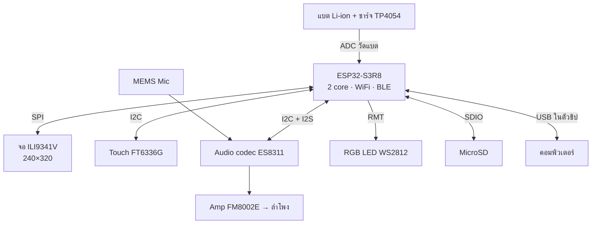

# บทที่ 2 — บอร์ด ES3C28P (ESP32-S3) และการใช้ AI อย่างมีวินัย

🏠 [หน้าหลัก](../README.md) · 📚 [สารบัญ ND1](README.md) · ⬅ [บทที่ 1](01-edge-ai-iot-basics.md) · ถัดไป ➡ [บทที่ 3](03-esp-idf-hello-world.md)

> **บทนี้เรียนอะไร:** บอร์ดที่ใช้ในหลักสูตรมีอะไรบ้าง ทำไมเรื่อง memory สำคัญกว่าการเขียนโค้ด และกับดักที่ AI coding มักพลาดเมื่อทำงานกับฮาร์ดแวร์

## ทำไมสำคัญ

AI เขียนโค้ดให้ทำงานได้ แต่ **ไม่สนว่าข้อมูลควรวางไว้ใน memory ส่วนไหน** ผลคืออุปกรณ์ช้า หรือข้อมูลหายตอนถอดปลั๊ก คนที่เข้าใจฮาร์ดแวร์จะสั่งและตรวจ AI ได้ถูกจุด

## แนวคิดหลัก

### บอร์ด ES3C28P
ชิปหลักคือ **ESP32-S3R8** — 2 core, มี WiFi + Bluetooth และคำสั่งช่วยเร่งงาน AI · มี PSRAM 8 MB ในตัว

ข้อสังเกตของบอร์ดนี้:
- **USB อยู่ในชิปเลย** ไม่ต้องมีชิปแปลง USB-UART (CH340, CP210x) เสียบสายแล้วใช้ได้ทันที · ข้อเสีย: บางโหมดต้องกดปุ่มเข้า boot mode เอง
- Touch และ audio codec **ใช้บัส I2C เส้นเดียวกัน** → ต้องจัดการการแย่งใช้ด้วย mutex (ดูบทที่ 3)
- RGB LED WS2812 ต่อพ่วงหลายดวงบนสายเดียว ข้อมูลเรียงเป็น **G-R-B ไม่ใช่ R-G-B** — ต้องเช็ค datasheet ไม่ใช่เชื่อภาพ infographic
- มีขาว่างให้ต่อขยายไม่กี่ขา และมีพอร์ต I2C ให้ต่อ sensor เพิ่ม

### Memory สำคัญกว่าการเขียนโปรแกรม

| ชนิด | ลักษณะ | ใช้ทำอะไร |
|---|---|---|
| **SRAM (internal)** | เร็วที่สุด แต่เล็ก | ตัวแปรที่ใช้บ่อย, stack |
| **IRAM** | ส่วนหนึ่งของ SRAM สำหรับโค้ดที่ต้องเร็ว | interrupt handler |
| **PSRAM (external)** | ใหญ่ (8 MB) แต่ช้ากว่า | frame buffer จอ, โมเดล AI ที่ใหญ่ |
| **Flash** | เก็บถาวร | โปรแกรม (firmware) |
| **NVS** | พื้นที่เก็บถาวรใน Flash แบบ key-value | ค่าตั้ง (เช่น WiFi password) ที่ต้องอยู่หลังถอดปลั๊ก |

- ระบบเร็วได้เท่าจุดที่ช้าที่สุด (คอขวด) — โมเดล AI ที่ใหญ่เกิน SRAM ต้องไปอยู่ใน PSRAM ทำให้ inference ช้าลง
- ตัวอย่างการคำนวณ: จอ 240×320 สี RGB565 (16 บิต/พิกเซล) ใช้ frame buffer ≈ 240 × 320 × 2 = **150 KB** ถ้าอยู่ใน PSRAM จะได้ราว 5–15 fps เท่านั้น
- ESP32 รุ่นอื่น: **P4** แรงกว่าเหมาะ computer vision แต่ไม่มี WiFi/Bluetooth ต้องคู่กับชิปซีรีส์ C

### กับดักของ AI coding กับฮาร์ดแวร์

| AI มักทำ | ที่ถูกควรเป็น |
|---|---|
| วางตัวแปรที่ใช้ใน interrupt ไว้ที่ไหนก็ได้ | วางใน IRAM |
| "เก็บถาวร" ไว้ใน RAM | ใช้ NVS (non-volatile) |
| ใช้ `malloc` ตามสะดวก | ห้าม dynamic allocation ถ้าห่วงเรื่องความเสถียร |
| เดาค่าเริ่มต้นของจอ | ให้ datasheet + ตัวอย่างโค้ดกับ AI ก่อนเสมอ |

ปัญหาจอที่เจอบ่อยเวลาให้ AI เขียน: ภาพกลับสี (ขาว↔ดำ), สีสลับ (แดงเป็นฟ้า), ภาพกลับด้านเหมือนส่องกระจก — เพราะจอแต่ละรุ่นเริ่มพิกัด 0 ต่างกัน

### เทคนิคใช้ AI ช่วยเรียน
- อย่าสั่งแค่ "สรุป" เพราะสรุปเหมาะกับคนที่รู้อยู่แล้ว ให้ขอแบบละเอียด พร้อม use case และข้อควรระวัง เหมือนอ่าน textbook
- ให้ AI เขียนเป็นภาษาอังกฤษก่อนแล้วค่อยแปล ผลลัพธ์ดีกว่าสั่งเป็นภาษาไทยตั้งแต่ต้น
- สั่ง AI ให้ชัดเหมือนสั่งเด็ก เช่น "ห้ามใช้ malloc" "ตรงนี้ใช้ mutex ไม่ใช่ semaphore"

## ขั้นตอนลงมือ — ติดตั้งเครื่องมือ
1. ติดตั้ง VS Code แล้วเพิ่ม extension **ESP-IDF** (`Ctrl+Shift+X` → ค้น "ESP-IDF")
2. `Ctrl+Shift+P` → "ESP-IDF: install" → มือใหม่เลือก **Easy** (~3 GB) · ถ้ารู้ว่าใช้แค่ ESP32-S3 เลือก Custom จะประหยัดที่ได้มาก
3. ใช้ **ESP-IDF v6.1**
4. ทดสอบ: สร้างโปรเจกต์ใหม่จาก template `hello_world` → กด **Trust** โฟลเดอร์ → build ผ่านถือว่าพร้อม (รายละเอียดในบทที่ 3)

## ปัญหาที่พบบ่อย

| อาการ | วิธีแก้ |
|---|---|
| `command not found` | ยังไม่ได้เพิ่ม PATH (environment) |
| extension ติดตั้งไม่ได้ | ดาวน์โหลดไฟล์ `.vsix` แล้วเลือก Install from VSIX |
| MacBook ไม่มีพอร์ต USB-A | เตรียมสาย USB-C ↔ USB-C หรือ adapter |
| สีของ LED ผิด | ข้อมูลต้องเรียง G-R-B |

## คำศัพท์ในบท
[ESP32-S3](../common/glossary.md#esp32-s3) · [SRAM / PSRAM](../common/glossary.md#sram--psram) · [NVS](../common/glossary.md#nvs) · [I2C](../common/glossary.md#i2c) · [I2S](../common/glossary.md#i2s) · [ESP-IDF](../common/glossary.md#esp-idf) · [Datasheet](../common/glossary.md#datasheet)

## แหล่งอ้างอิง
- เอกสารผู้สอน ND01 Week 02 (15 บท ตั้งแต่ชิปถึง firmware): [lessons/README.md](https://github.com/drsanti/kmutt-nd69/blob/main/nd1/docs/week02/lessons/README.md)
- ตารางขาที่ใช้ได้: [13-expansion-pins.md](https://github.com/drsanti/kmutt-nd69/blob/main/nd1/docs/week02/lessons/13-expansion-pins.md)

---
🏠 [หน้าหลัก](../README.md) · 📚 [สารบัญ ND1](README.md) · ⬅ [บทที่ 1](01-edge-ai-iot-basics.md) · ถัดไป ➡ [บทที่ 3 — ESP-IDF และ FreeRTOS บน PC](03-esp-idf-hello-world.md)
