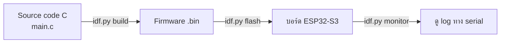
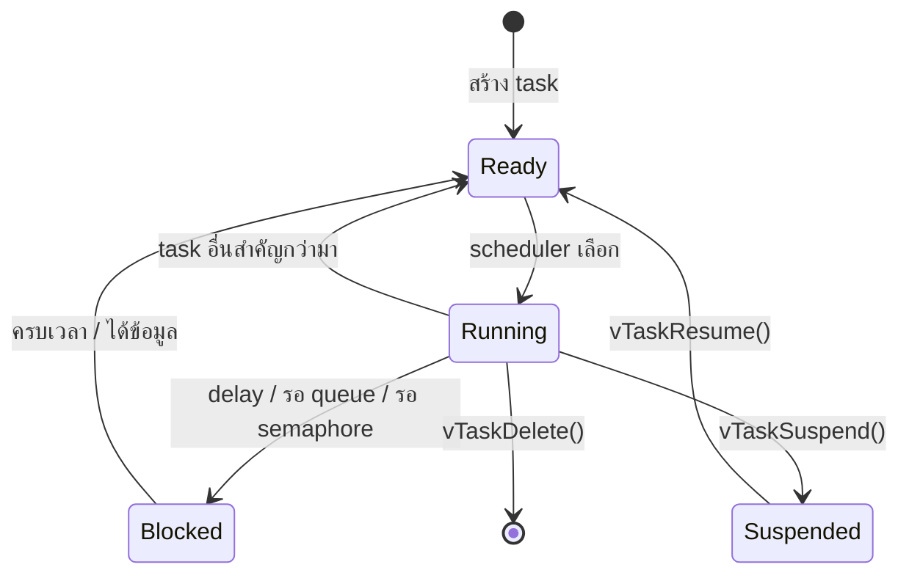

# บทที่ 3 — ESP-IDF, Hello World และ FreeRTOS บน PC

🏠 [หน้าหลัก](../README.md) · 📚 [สารบัญ ND1](README.md) · ⬅ [บทที่ 2](02-freertos-ai-agents.md) · ถัดไป ➡ [บทที่ 4](04-onsite-firmware-workshop.md)

> **บทนี้เรียนอะไร:** ตั้งค่า ESP-IDF ให้ใช้ผ่าน command line ได้ build โปรเจกต์ Hello World และเรียน FreeRTOS บนคอมพิวเตอร์ผ่าน simulator โดยยังไม่ต้องมีบอร์ด

## ทำไมสำคัญ

- **AI agent ทำงานด้วยคำสั่งใน terminal ไม่ได้คลิกปุ่ม** ถ้าเครื่องเราใช้ ESP-IDF ผ่าน command line ได้ agent จะวน loop *แก้โค้ด → build → flash → ทดสอบ* ให้อัตโนมัติ
- พัฒนา FreeRTOS บน PC **เร็วกว่าบอร์ดจริง 5–10 เท่า** (บนบอร์ดจริง compile ~1 นาที flash อีก ~30 วินาที) แล้วค่อยย้ายโค้ดเดียวกันไปรันบนบอร์ด

## แนวคิดหลัก

### เครื่องมือแต่ละชิ้นทำหน้าที่อะไร



- **ESP-IDF** = framework + compiler (GCC) + build system ของ Espressif
- **`idf.py`** = คำสั่งหลัก (build / flash / monitor / clean)
- **esptool** = ตัว flash · **OpenOCD** = debugger · มาพร้อม toolchain ทั้งหมด
- **PATH** = รายชื่อโฟลเดอร์ที่ terminal ใช้หาคำสั่ง · script `export` ของ ESP-IDF ตั้ง PATH ให้ชั่วคราวใน terminal นั้น ปิดหน้าต่างแล้วหาย

### FreeRTOS คืออะไร
**RTOS (Real-Time Operating System)** แบ่งงานเป็นหลาย **task** ที่ทำงานสลับกันตามลำดับความสำคัญ (priority) เช่น task อ่านเสียง, task วาดจอ, task ส่งเน็ต ทำให้ UI ไม่ค้างแม้เน็ตจะช้า

สถานะของ task (RTOS เป็นคนสลับให้ ไม่ใช่เรา):



- `for(;;)` ในโค้ด task = วนไม่รู้จบ เหมือน `while(1)`
- เมื่อ 2 core หรือหลาย task ใช้ทรัพยากรเดียวกัน (เช่นบัส I2C ของ touch กับ codec) ต้องป้องกัน **race condition** ด้วย **mutex**
- **Sequence diagram** ใช้อธิบายว่าใครคุยกับใครตามลำดับเวลา ส่วน **state diagram / FSM** ใช้ออกแบบพฤติกรรม firmware

### Board twin — บอร์ดจำลองบน PC
repo [freertos-pc-workshops](https://github.com/drsanti/freertos-pc-workshops) มีโปรแกรม **board twin** ที่หน้าตาเหมือนบอร์ดจริง โค้ด FreeRTOS ที่รันบน PC ส่งสถานะ (LED, ปุ่ม, ADC, เสียง) ไปที่ board twin ผ่าน TCP


## ขั้นตอนลงมือ

**1. เปิด terminal ที่ตั้งค่า ESP-IDF แล้ว และตรวจ**
```bash
idf.py --version      # เห็นเวอร์ชัน = พร้อม
idf.py doctor         # ตรวจสภาพแวดล้อม (ถ้ามี)
```

**2. Build / flash / monitor โปรเจกต์ Hello World**
```bash
cd path/to/hello_world          # โฟลเดอร์ที่มีไฟล์ CMakeLists.txt
idf.py set-target esp32s3       # ระบุชิป ครั้งแรกครั้งเดียว
idf.py build                    # ครั้งแรกช้าเป็นนาที ครั้งต่อไปเร็ว
idf.py -p COM17 flash monitor   # เปลี่ยน COM ตามเครื่อง (Mac: ls /dev/cu.*)
```
หยุด monitor ด้วย `Ctrl+]`

**3. ลอง FreeRTOS บน PC**
```bash
git clone https://github.com/drsanti/freertos-pc-workshops.git
cd freertos-pc-workshops
./run ch90      # smoke test — กดปุ่ม เปลี่ยน ADC ดูผลใน board twin
./run ch01      # เริ่มเรียนทีละบท อ่าน README ของบทคู่กับ main.c
```
บท 1–12 คือพื้นฐานที่พอใช้งานทั่วไป · **บท 8 และ 9 สำคัญมาก** คนทำ firmware และ AI มักพลาดที่นี่

## ปัญหาที่พบบ่อย

| อาการ | วิธีแก้ |
|---|---|
| Windows: toolchain พังใน Git Bash | ใช้ **PowerShell** สำหรับ `idf.py` และ `export.ps1` |
| PowerShell ไม่ยอมรัน script | ตั้ง execution policy (ถาม AI พร้อมข้อความ error) |
| Mac/Linux รัน script ไม่ได้ | `chmod +x ชื่อไฟล์` |
| Git Bash หา `cmake` ไม่เจอ | Git Bash เป็น environment แยก ต้องเพิ่ม `export PATH=...` ใน `~/.bashrc` แล้ว `source ~/.bashrc` |
| `idf.py` หาไม่เจอ | ยังไม่ได้ activate ที่ **โฟลเดอร์ ESP-IDF** (`IDF_PATH`) ไม่ใช่โฟลเดอร์แม่ |
| board twin จอเป็นสีเทา | ยังไม่ได้รัน firmware / ยังไม่เชื่อมต่อ |

> 💡 เลือกวิธีทำงานแบบเดียวให้ใช้ได้ก่อน — terminal **หรือ** ปุ่มใน VS Code extension อย่าผสมกัน

## คำศัพท์ในบท
[FreeRTOS](../common/glossary.md#freertos) · [Task](../common/glossary.md#task) · [Mutex](../common/glossary.md#mutex) · [Race condition](../common/glossary.md#race-condition) · [PATH](../common/glossary.md#path) · [Flash](../common/glossary.md#flash-firmware) · [Board twin](../common/glossary.md#board-twin)

## แหล่งอ้างอิง
- เอกสารผู้สอน ND01 Week 03: [lessons/README.md](https://github.com/drsanti/kmutt-nd69/blob/main/nd1/docs/week03/lessons/README.md) · [install-esp-idf.md](https://github.com/drsanti/kmutt-nd69/blob/main/nd1/docs/week03/lessons/install-esp-idf.md)
- [freertos-pc-workshops](https://github.com/drsanti/freertos-pc-workshops)
- [ESP-IDF Programming Guide](https://docs.espressif.com/projects/esp-idf/en/latest/esp32s3/)

---
🏠 [หน้าหลัก](../README.md) · 📚 [สารบัญ ND1](README.md) · ⬅ [บทที่ 2](02-freertos-ai-agents.md) · ถัดไป ➡ [บทที่ 4 — Workshop Onsite](04-onsite-firmware-workshop.md)
