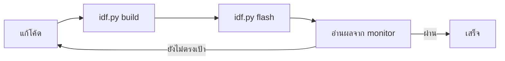
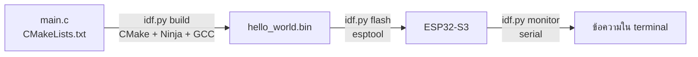
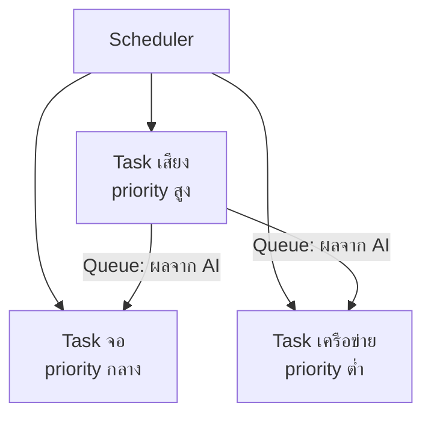
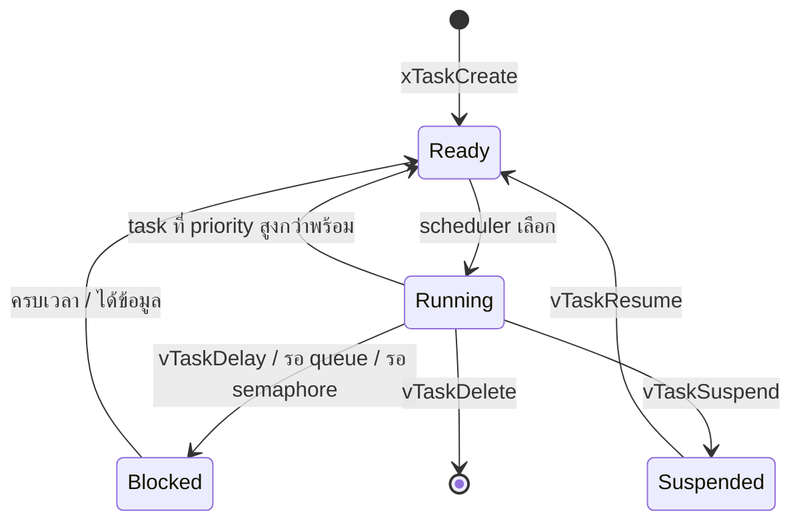

# บทที่ 3 — ESP-IDF, Hello World, Embedded C และ FreeRTOS บน PC

🏠 [หน้าหลัก](../README.md) · 📚 [สารบัญ ND1](README.md) · ⬅ [บทที่ 2](02-freertos-ai-agents.md) · ถัดไป ➡ [บทที่ 4](04-onsite-firmware-workshop.md)

> **บทนี้เรียนอะไร:** ติดตั้ง ESP-IDF ให้ใช้ผ่าน command line ได้ build และ flash โปรแกรมแรก เข้าใจว่า C บนไมโครคอนโทรลเลอร์ต่างจากบน PC อย่างไร และเรียน FreeRTOS (task, queue, mutex) บนคอมพิวเตอร์ผ่าน simulator ก่อนลงบอร์ดจริง
>
> **ก่อนอ่าน:** [บทที่ 2](02-freertos-ai-agents.md) · พื้นฐานภาษา C เล็กน้อย · **เวลาอ่าน:** ~60 นาที + ลงมือ 1–2 ชั่วโมง

## สารบัญบทนี้
1. [ทำไมต้องใช้ command line](#1-ทำไมต้องใช้-command-line)
2. [ESP-IDF ประกอบด้วยอะไร](#2-esp-idf-ประกอบด้วยอะไร)
3. [ติดตั้ง ESP-IDF](#3-ติดตั้ง-esp-idf)
4. [โปรเจกต์แรก: Hello World](#4-โปรเจกต์แรก-hello-world)
5. [C บน embedded ต่างจาก C บน PC อย่างไร](#5-c-บน-embedded-ต่างจาก-c-บน-pc-อย่างไร)
6. [FreeRTOS: แนวคิดหลัก](#6-freertos-แนวคิดหลัก)
7. [FreeRTOS บน PC ด้วย board twin](#7-freertos-บน-pc-ด้วย-board-twin)
8. [แก้ปัญหาที่พบบ่อย](#8-แก้ปัญหาที่พบบ่อย)
9. [ใช้ AI อย่างมีวินัย](#9-ใช้-ai-อย่างมีวินัย)
10. [สรุปและแบบฝึก](#10-สรุปและแบบฝึก)

---

## 1. ทำไมต้องใช้ command line

วิธีทั่วไปคือกดปุ่ม Build / Flash / Monitor ใน VS Code extension — ไม่ผิด ใช้ได้ แต่:

- **AI agent (Claude Code, Codex, Copilot) ทำงานด้วยคำสั่งใน terminal ไม่ได้คลิกปุ่ม**
- ถ้าเครื่องเราสั่ง `idf.py build` ได้ agent จะวน loop ให้อัตโนมัติ:



> เลือกวิธีทำงานประจำ **อย่างเดียว** ให้ใช้ได้ก่อน — terminal (ค่าเริ่มต้นของคอร์ส) **หรือ** ปุ่มใน VS Code อย่าผสมกันจนกว่าทั้งสองจะใช้ได้แยกกัน

---

## 2. ESP-IDF ประกอบด้วยอะไร

**ESP-IDF** (Espressif IoT Development Framework) คือชุดเครื่องมือทางการของ Espressif



| ชิ้นส่วน | หน้าที่ |
|---|---|
| **framework** | ไลบรารีและไดรเวอร์ทั้งหมด (WiFi, FreeRTOS, SPI, I2S ...) |
| **toolchain (GCC)** | compiler แปลง C เป็นภาษาเครื่องของ Xtensa |
| **CMake + Ninja** | ระบบ build จัดลำดับการคอมไพล์ |
| **`idf.py`** | คำสั่งหลักที่ห่อทุกอย่างไว้ (build / flash / monitor / menuconfig) |
| **esptool** | ตัวเขียน firmware ลงบอร์ด |
| **OpenOCD** | debugger |
| **Python environment** | เครื่องมือหลายตัวเขียนด้วย Python มากับการติดตั้ง |

### 3 path ที่ต้องแยกให้ออก

| ชื่อ | คืออะไร | ตัวอย่าง (Windows) |
|---|---|---|
| **โฟลเดอร์แม่** | ที่เก็บการติดตั้ง | `D:\dev\esp` |
| **Framework (`IDF_PATH`)** | ตัว ESP-IDF จริง มี `export.ps1` และ `tools/idf.py` | `D:\dev\esp\v6.1\esp-idf` |
| **Project root** | โปรเจกต์ของเรา มี `CMakeLists.txt` และ `main/` | `...\nd1\docs\week03\lessons\esp32-s3` |

> ต้อง activate ที่ **framework** ไม่ใช่โฟลเดอร์แม่ — ผิดตรงนี้คือสาเหตุอันดับหนึ่งของ `idf.py not found`

ผู้สอนแนะนำให้ติดตั้งไว้ไดรฟ์ D หรือโฟลเดอร์ของตัวเอง แทนค่าเริ่มต้นในไดรฟ์ C ที่มักกลายเป็นกองของเก่า

### PATH คืออะไร (สำคัญมาก)
**PATH** คือรายชื่อโฟลเดอร์ที่ terminal ใช้ค้นหาคำสั่ง เมื่อพิมพ์ `idf.py` ระบบจะไล่หาในโฟลเดอร์ทุกตัวใน PATH ถ้าไม่เจอจะได้ `command not found`
- script `export.ps1` / `export.sh` ของ ESP-IDF **เพิ่ม PATH ชั่วคราวใน terminal หน้าต่างนั้น** ปิดหน้าต่างแล้วหาย — AI agent ทำแบบนี้เช่นกัน
- เพิ่มถาวรใน System Environment Variables ได้ แต่ผู้สอนไม่ค่อยทำ เพราะเปลี่ยนเวอร์ชันบ่อยแล้วลืม ให้ error เตือนดีกว่า
- ตรวจว่าคำสั่งถูกหาเจอที่ไหน: `where idf.py` (Windows) / `which idf.py` (Mac/Linux)

---

## 3. ติดตั้ง ESP-IDF

มี 2 เส้นทาง เลือก **อย่างใดอย่างหนึ่ง**:

| เส้นทาง | เหมาะกับ |
|---|---|
| **A — script ของคอร์ส (แนะนำ)** | อยากทำตามขั้นตอน copy-paste ที่ตรงกับ repo ของผู้สอน |
| **B — EIM (ESP-IDF Installation Manager)** | ชอบตัวติดตั้งแบบหน้าต่างของ Espressif |

ใช้ **ESP-IDF v6.1** (stable) — คนใช้ AI agent สั่งว่า "ติดตั้ง ESP-IDF 6.1 สำหรับ ESP32-S3" ได้เลย

### Windows
> ⚠️ **ใช้ PowerShell เท่านั้น** (แนะนำ PowerShell 7) สำหรับทุกคำสั่งของ ESP-IDF — **ห้ามใช้ Git Bash** เพราะ MSYS/MinGW ทำให้เครื่องมือของ Espressif ปฏิเสธหรือทำงานผิด

```powershell
# ตัวอย่างเส้นทาง A (ดูขั้นตอน W1–W6 ในเอกสารผู้สอน)
git clone -b v6.1 --recursive https://github.com/espressif/esp-idf.git D:\dev\esp\v6.1\esp-idf
cd D:\dev\esp\v6.1\esp-idf
.\install.ps1 esp32s3      # ติดตั้ง tools เฉพาะ ESP32-S3 ประหยัดพื้นที่
. .\export.ps1             # activate ใน terminal นี้
idf.py --version           # เห็นเวอร์ชัน = สำเร็จ
```

### macOS / Linux
```bash
git clone -b v6.1 --recursive https://github.com/espressif/esp-idf.git ~/esp/esp-idf
cd ~/esp/esp-idf
./install.sh esp32s3
. ./export.sh
idf.py --version
```

### ทางเลือก: ผ่าน VS Code extension
1. `Ctrl+Shift+X` ค้น **ESP-IDF** แล้วติดตั้ง
2. `Ctrl+Shift+P` → "ESP-IDF: Configure ESP-IDF Extension" หรือ "install"
3. มือใหม่เลือก **Easy** (~3 GB) · ถ้ารู้ว่าใช้แค่ ESP32-S3 เลือก **Custom** แล้วเลือกเฉพาะชิปนี้ (ประหยัดเหลือหลักร้อย MB · ถ้าลงทุกชิปอาจกินถึง ~17 GB)
4. ถ้า extension ติดตั้งไม่ได้ ดาวน์โหลดไฟล์ `.vsix` จาก Marketplace แล้วเลือก **Install from VSIX**

---

## 4. โปรเจกต์แรก: Hello World

โปรแกรมพิมพ์ `Hello world!` ข้อมูลชิป และ heap ที่เหลือ แล้วนับถอยหลังรีสตาร์ตวนไปเรื่อย ๆ

### โครงสร้างโปรเจกต์
```text
esp32-s3/
├── CMakeLists.txt          ← ประกาศโปรเจกต์
├── sdkconfig.defaults      ← ค่าเริ่มต้น (เลือก ESP32-S3)
└── main/
    ├── CMakeLists.txt      ← บอกว่าไฟล์ .c ไหนต้อง compile
    └── hello_world_main.c  ← มีฟังก์ชัน app_main() จุดเริ่มต้นของโปรแกรม
```
ไฟล์ `build/` และ `sdkconfig` สร้างขึ้นเองในเครื่อง ไม่เก็บใน Git

### ขั้นตอน
**1) เปิด terminal ที่ project root แล้ว activate**
```powershell
..\scripts\start-esp-idf.cmd        # Windows (script ของคอร์สตั้ง PATH ให้)
```
```bash
bash ../scripts/start-esp-idf.sh    # macOS / Linux
```
รอจนขึ้น **ESP-IDF ready**

**2) Build**
```bash
idf.py set-target esp32s3   # ครั้งแรกครั้งเดียว (ถ้าสั่งซ้ำจะ reset config)
idf.py build                # ครั้งแรกช้าเป็นนาที (compile หลายร้อยไฟล์) ครั้งต่อไปเร็ว
```
เห็น `Project build complete` = สำเร็จ ได้ไฟล์ `build/hello_world.bin`

**3) หาพอร์ตแล้ว flash + monitor**

| ระบบ | หาพอร์ต | คำสั่ง |
|---|---|---|
| Windows | Device Manager → Ports (COM & LPT) | `idf.py -p COM5 flash monitor` |
| macOS | `ls /dev/cu.*` | `idf.py -p /dev/cu.usbmodemXXXX flash monitor` |
| Linux | `ls /dev/ttyUSB* /dev/ttyACM*` | `idf.py -p /dev/ttyACM0 flash monitor` |

ผลที่ควรเห็น:
```text
Hello world!
This is esp32s3 chip with 2 CPU core(s), WiFi/BLE, ...
Minimum free heap size: ... bytes
Restarting in 10 seconds...
```
ออกจาก monitor ด้วย **`Ctrl+]`**

**ลองแก้:** เปลี่ยนข้อความใน `printf` เป็นชื่อตัวเอง → `idf.py build flash monitor` อีกครั้ง — build ครั้งที่สองจะเหลือไม่กี่ขั้นและเร็วมาก

---

## 5. C บน embedded ต่างจาก C บน PC อย่างไร

| บน PC | บนไมโครคอนโทรลเลอร์ |
|---|---|
| RAM หลาย GB | SRAM 512 KB — `malloc` พลาด = ระบบตาย |
| มี OS คอยกันโปรแกรมพัง | bug หน่วยความจำจุดเดียวล้มทั้งระบบ |
| ฮาร์ดแวร์ซ่อนอยู่หลัง driver | **register คือหน่วยความจำ** อ่านเขียนผ่าน address |
| โปรแกรมไหลทางเดียว | interrupt กับ task หลายตัวแย่งตัวแปรเดียวกันได้ |

### `volatile` — keyword ที่สำคัญที่สุด
```c
volatile bool button_pressed = false;   // interrupt เปลี่ยนค่านี้ได้เอง

void IRAM_ATTR on_button(void *arg) {   // interrupt handler
    button_pressed = true;
}

while (!button_pressed) { }             // ถ้าไม่ใส่ volatile compiler อาจ "จำ" ค่าเดิมไว้ → วนไม่จบ
```
- ใช้กับตัวแปรที่ **interrupt / ฮาร์ดแวร์ / core อื่น** เปลี่ยนได้
- bug แบบนี้มักไม่เกิดตอน debug แต่เกิดตอน build แบบ optimize
- `volatile` **ไม่ได้ทำให้ปลอดภัยจากการแย่งกัน** (ไม่ใช่ atomic) — ต้องใช้ mutex / critical section

### Bit manipulation — ภาษาของฮาร์ดแวร์
register หนึ่งตัวมีหลาย field ต้องแก้ทีละบิตโดยไม่ทับบิตอื่น:
```c
REG |=  (1 << 3);    // set   bit 3
REG &= ~(1 << 3);    // clear bit 3
REG ^=  (1 << 3);    // toggle bit 3
int b = (REG >> 3) & 1;   // อ่าน bit 3
```

### ระบุขนาดของ type ให้ชัด
```c
#include <stdint.h>
uint8_t  len;     // 0–255
uint16_t crc;
int32_t  sample;  // ใช้แทน int เมื่อขนาดสำคัญ เช่น ข้อมูลที่ส่งทางสาย
```

### วินัยเรื่องหน่วยความจำ
- **ใช้ static allocation เป็นค่าเริ่มต้น** — buffer ขนาดคงที่ประกาศเป็น `static` จะเห็นการใช้ RAM ตั้งแต่ตอน compile
- `malloc` ใช้ได้แต่ระวัง **fragmentation** (heap แตกเป็นชิ้นเล็กจนขอก้อนใหญ่ไม่ได้ แม้รวมแล้วจะพอ) — มืออาชีพมักขอครั้งเดียวตอนเริ่มแล้วไม่คืน
- array ใหญ่ในฟังก์ชัน = **stack ล้น** เงียบ ๆ แล้ว crash
- `static const` ตารางค่าคงที่ไปอยู่ใน flash แทน RAM

### กฎของ interrupt (ISR)
- **ห้ามรอ** (ไม่มี delay, ไม่รอ queue, ไม่ printf ยาว ๆ)
- **ห้าม malloc / free**
- โค้ดต้องอยู่ใน IRAM (`IRAM_ATTR`)
- **ทำแค่บันทึกเหตุการณ์แล้วส่งต่อให้ task** (deferred work) — นี่คือหัวใจของ firmware ที่ดี

### โครงสร้างข้อมูลที่ต้องเป็น
- **Ring buffer** — buffer วงกลมสำหรับข้อมูลที่ไหลไม่หยุด (serial, เสียง) ผู้เขียนเขียนวน ผู้อ่านอ่านตาม
- **State machine** — firmware เป็น "ลูปรอเหตุการณ์" ไม่ใช่โปรแกรมทำทีละบรรทัดจนจบ

---

## 6. FreeRTOS: แนวคิดหลัก

### ทำไมต้องมี RTOS
โปรแกรมแบบ "ลูปเดียว" (`while(1)` ทำทุกอย่าง) จะติดปัญหาเมื่อมีหลายงานที่จังหวะต่างกัน เช่น อ่านเสียงทุก 1 ms, วาดจอทุก 33 ms, ส่งเน็ตเมื่อมีข้อมูล — ถ้างานหนึ่งรอ งานอื่นค้างหมด

**RTOS (Real-Time Operating System)** แบ่งงานเป็นหลาย **task** ที่ scheduler สลับให้ทำงานตาม **priority** — งานด่วนได้ CPU ก่อนเสมอ



### Task และสถานะ
```c
void blink_task(void *arg) {
    for (;;) {                                  // วนไม่รู้จบ เหมือน while(1)
        gpio_set_level(LED, 1);
        vTaskDelay(pdMS_TO_TICKS(500));         // หลับ 500 ms → CPU ไปทำ task อื่น
        gpio_set_level(LED, 0);
        vTaskDelay(pdMS_TO_TICKS(500));
    }
}

void app_main(void) {
    xTaskCreate(blink_task, "blink", 2048, NULL, 5, NULL);
    //          ฟังก์ชัน      ชื่อ   stack  arg  priority
}
```


- **Running** = กำลังใช้ CPU · **Ready** = พร้อม รอคิว CPU · **Blocked** = รอเวลาหรือรอข้อมูล · **Suspended** = ถูกสั่งหยุดแบบไม่มีเงื่อนไข
- สถานะเหล่านี้ **RTOS เป็นคนสลับ** ไม่ใช่เรา — เราแค่เรียก API ที่ทำให้ task เข้าสู่สถานะนั้น

### เครื่องมือสื่อสารระหว่าง task

| เครื่องมือ | ใช้เมื่อ | ตัวอย่าง |
|---|---|---|
| **Queue** | ส่งข้อมูลจาก task หนึ่งไปอีก task (copy ข้อมูล ปลอดภัย) | task เสียงส่งผล AI ให้ task จอ |
| **Binary semaphore** | ส่งสัญญาณ "เกิดเหตุแล้ว" | interrupt ปลุก task |
| **Mutex** | กันไม่ให้ 2 task ใช้ทรัพยากรเดียวกันพร้อมกัน | บัส I2C ที่ touch กับ codec ใช้ร่วมกัน |
| **Critical section** | ช่วงสั้นมากที่ห้ามถูกขัด | แก้ตัวแปรที่ interrupt ใช้ด้วย |
| **Software timer** | เรียกฟังก์ชันตามเวลา | กะพริบ LED ทุก 1 วินาที |
| **Event group** | รอหลายเงื่อนไขพร้อมกัน | รอ "WiFi ต่อแล้ว" **และ** "ได้เวลาแล้ว" |
| **Task notification** | สัญญาณเบา ๆ ไปยัง task เดียว (เร็วที่สุด) | ปลุก task เฉพาะตัว |

ตัวอย่าง queue:
```c
QueueHandle_t q = xQueueCreate(8, sizeof(int));   // เก็บได้ 8 ค่า

// ผู้ส่ง
int level = 42;
xQueueSend(q, &level, portMAX_DELAY);

// ผู้รับ (หลับรอจนมีข้อมูล ไม่กิน CPU)
int got;
if (xQueueReceive(q, &got, portMAX_DELAY) == pdTRUE) { /* ใช้ got */ }
```

ตัวอย่าง mutex ป้องกันบัส I2C:
```c
SemaphoreHandle_t i2c_lock = xSemaphoreCreateMutex();

xSemaphoreTake(i2c_lock, portMAX_DELAY);   // ขอกุญแจ
read_touch();                              // ใช้บัส
xSemaphoreGive(i2c_lock);                  // คืนกุญแจ
```

### Race condition คืออะไร
เมื่อ 2 task (หรือ 2 core) อ่าน-แก้-เขียนตัวแปรเดียวกันพร้อมกัน เช่น `count++` ซึ่งจริง ๆ คือ 3 ขั้น (อ่าน → บวก → เขียน) ถ้าอีก task แทรกตรงกลาง ค่าจะหาย — ผลเพี้ยนแบบสุ่ม หาสาเหตุยากมาก → แก้ด้วย mutex หรือ critical section

### วาดก่อนเขียน
- **Sequence diagram** — ใครคุยกับใคร ตามลำดับเวลา (เช่น `app_main` สร้าง task แล้ว start scheduler) ใช้คุยได้กับทุกทีม
- **State diagram / FSM** — ออกแบบพฤติกรรม firmware
- **Timing diagram** — เห็นว่า task ไหนได้ CPU ตอนไหน

---

## 7. FreeRTOS บน PC ด้วย board twin

repo [freertos-pc-workshops](https://github.com/drsanti/freertos-pc-workshops) ให้เรียน **FreeRTOS ตัวจริง (API เดียวกับบนบอร์ด)** บนคอมพิวเตอร์ พร้อมโปรแกรม **board twin** ที่หน้าตาเหมือนบอร์ด


### ทำไมเรียนบน PC ก่อน
- **เร็วกว่าบนบอร์ด 5–10 เท่า** — บนบอร์ดจริง compile ~1 นาที + flash ~30 วินาทีทุกครั้ง
- ไม่ต้องพกบอร์ด และโค้ดเดียวกันย้ายไปรันบนบอร์ดจริงได้
- AI agent อ่าน serial port แบบรอเหตุการณ์ไม่ได้ ต้องหน่วงเวลารอแล้วอ่านผล ถ้าไม่เจอก็รอซ้ำจน timeout — ทดสอบบน PC เร็วกว่ามาก

### ลงมือ
```bash
git clone https://github.com/drsanti/freertos-pc-workshops.git
cd freertos-pc-workshops/freertos     # ต้อง cd เข้า freertos/ ก่อน
bash setup.sh        # ครั้งเดียว (Windows cmd/PowerShell ใช้ setup.bat)
./run list           # ดูรายการบท
./run ch90           # smoke test: กดปุ่ม เปลี่ยน ADC ดูผลบน board twin
./run ch00           # เริ่มบทแรก
```
- ติดตั้ง board twin ก่อนจากโฟลเดอร์ `board-twin/` (Windows, macOS Apple Silicon, Linux)
- ขึ้น `permission denied` → `chmod +x run setup.sh`
- หยุดโปรแกรมด้วย `Ctrl+C`
- board twin เป็นสีเทา = ยังไม่มี firmware ต่อเข้ามา (เหมือนยังไม่เสียบปลั๊ก)
- Mac ต้องอนุญาตสิทธิ์ไมโครโฟนถ้าบทนั้นใช้เสียง

### ลำดับบทเรียน
| ช่วง | บท | เรียนอะไร |
|---|---|---|
| **พื้นฐาน** | ch00–05 | ทำไมต้อง RTOS · task กับ delay · สถานะของ task · scheduler · priority และการแย่ง CPU · time slicing และ starvation |
| **ฟีเจอร์** | ch06–13 | queue · binary semaphore · **mutex (ch08)** · **critical section (ch09)** · software timer · event group · task notification · capstone |
| **บอร์ด** | ch14–17, ch90 | GPIO output/input · UART · ADC และ PWM · board smoke test |
| **ขั้นสูง** | chA01… | priority inversion, deadlock, recursive mutex, ISR → queue ฯลฯ |

> **บท 8 (mutex) และ 9 (critical section) สำคัญมาก** — คนทำ firmware และ AI มักพลาดตรงนี้ · บท 1–12 พอสำหรับใช้งานทั่วไป

วิธีเรียนแต่ละบท: **อ่าน `lessons/chNN-*/docs/README.md`** (มี block diagram + sequence diagram) → อ่าน `main.c` → `./run chNN` → สังเกตผลบน board twin

---

## 8. แก้ปัญหาที่พบบ่อย

| อาการ | สาเหตุ | วิธีแก้ |
|---|---|---|
| `idf.py: command not found` | ยังไม่ activate หรือ activate ผิดโฟลเดอร์ | รัน `export` ที่ **framework (`IDF_PATH`)** |
| Windows: เครื่องมือ ESP-IDF error แปลก ๆ | รันใน Git Bash | ใช้ **PowerShell** |
| PowerShell ไม่ยอมรัน script | execution policy | ตั้ง policy ให้รัน script ได้ (ถาม AI พร้อมข้อความ error) |
| Mac/Linux: permission denied | ไฟล์ไม่มีสิทธิ์รัน | `chmod +x ชื่อไฟล์` |
| Git Bash หา `cmake` ไม่เจอ | Git Bash เป็น environment แยกจาก CMD/PowerShell | เพิ่ม `export PATH=...` ท้าย `~/.bashrc` แล้ว `source ~/.bashrc` |
| build ครั้งแรกนานมาก | compile dependency หลายร้อยไฟล์ | ปกติ ครั้งต่อไปเร็ว |
| flash ไม่ได้ / พอร์ตไม่ว่าง | serial monitor ตัวอื่นเปิดค้าง | ปิดโปรแกรมที่ใช้พอร์ตอยู่ |
| monitor ไม่มีข้อความ | console ตั้งไว้คนละช่อง / บอร์ดยังไม่รีเซ็ต | กด reset หรือตรวจ console interface ใน `menuconfig` |
| Linux เปิดพอร์ตไม่ได้ | ไม่มีสิทธิ์ | เพิ่มผู้ใช้เข้า group `dialout` |
| เปิด VS Code ใหม่แล้วตั้งค่าเดิมใช้ไม่ได้ | `.vscode/settings.json` มี path ของเครื่องอื่น | ตั้งค่า extension ใหม่บนเครื่องตัวเอง |

> เครื่องมือหลายตัวมีคำสั่งตรวจสุขภาพ: `idf.py doctor` (ถ้ามี), ESP-IDF: Doctor Command ใน VS Code — ใช้ก่อนถาม AI จะได้ข้อมูลครบ

---

## 9. ใช้ AI อย่างมีวินัย

- **ให้ AI แก้เฉพาะส่วน แล้วรีวิวก่อนกด accept** — ถ้าสั่งมั่ว โค้ดจะบวม AI อาจสร้างไฟล์ใหม่โดยไม่รู้ตัว กลายเป็นปัญหาสะสม
- **AI coding ประหยัดเวลาตอนเขียน แต่เพิ่มภาระดูแลระยะยาว**
- ตัวอย่างในโลกมักแยกเรื่อง (Bluetooth อย่างเดียว, ADC อย่างเดียว) พอรวมหลายส่วนจะตีกัน และ AI ไม่ค่อยเห็นตัวอย่างแบบรวม ถ้าไม่กำกับจะพาหลงทาง
- เจอ error ให้ copy ข้อความไปถาม AI และ **สั่งให้บันทึกวิธีแก้เป็นไฟล์ Markdown** ไว้อ้างอิงครั้งหน้า
- **บอก AI ว่าเครื่องเราเป็นอย่างไร** (OS, path ที่ติดตั้ง, shell ที่ใช้) ช่วยประหยัด token ช่วงเริ่มต้น
- เอกสารของผู้สอนเขียนแบบ **AI-agent friendly** — บอก agent ว่าตัวอย่างและ API อยู่ไหน agent จะทำงานเร็วและไม่เปลือง token
- "ถ้าเราอ่านโค้ดเข้าใจ ไม่ต้องกังวลว่า AI จะแย่งงาน ความน่ากลัวอยู่ที่เราไม่เข้าใจ"

---

## 10. สรุปและแบบฝึก

### สรุป
- ESP-IDF = framework + GCC + CMake/Ninja + `idf.py` + esptool — activate ที่ `IDF_PATH` แล้วใช้ `build → flash → monitor`
- Windows ใช้ PowerShell เท่านั้นสำหรับ ESP-IDF
- C บน embedded: `volatile`, ขนาด type ชัดเจน, static allocation, ISR ทำงานสั้นแล้วส่งต่อให้ task
- FreeRTOS: task + priority, สื่อสารด้วย queue, ป้องกันการแย่งด้วย mutex
- ฝึกบน PC ด้วย board twin ก่อน เร็วกว่า 5–10 เท่า

### แบบฝึก
1. Build และ flash Hello World แล้วเปลี่ยนข้อความเป็นชื่อตัวเอง
2. รัน `./run ch01` และ `./run ch04` แล้วอธิบายว่า priority มีผลต่อการทำงานอย่างไร
3. เขียน 2 task: task A กะพริบ LED, task B ส่งคำสั่ง "เปลี่ยนความเร็ว" ให้ task A ผ่าน queue (นี่คือตัวอย่างโจทย์ Mini-Project ที่ผู้สอนยกมา)
4. ทำไมตัวแปรที่ interrupt แก้ต้องเป็น `volatile` และทำไม `volatile` อย่างเดียวยังไม่พอ?

## คำศัพท์ในบท
[ESP-IDF](../common/glossary.md#esp-idf) · [FreeRTOS](../common/glossary.md#freertos) · [Task](../common/glossary.md#task) · [Mutex](../common/glossary.md#mutex) · [Race condition](../common/glossary.md#race-condition) · [PATH](../common/glossary.md#path) · [Flash](../common/glossary.md#flash-firmware) · [Board twin](../common/glossary.md#board-twin)

## แหล่งอ้างอิง
- เอกสารผู้สอน ND1 Week 03: [lessons/README.md](https://github.com/drsanti/kmutt-nd69/blob/main/nd1/docs/week03/lessons/README.md) · [install-esp-idf.md](https://github.com/drsanti/kmutt-nd69/blob/main/nd1/docs/week03/lessons/install-esp-idf.md) · [Hello World](https://github.com/drsanti/kmutt-nd69/blob/main/nd1/docs/week03/lessons/esp32-s3/README.md)
- [Embedded C + FreeRTOS review](https://github.com/drsanti/kmutt-nd69/blob/main/nd1/docs/week02/lessons/15-embedded-c-freertos-review.md) (ND1 Week 02 บทที่ 15)
- [freertos-pc-workshops](https://github.com/drsanti/freertos-pc-workshops) · [CURRICULUM.md](https://github.com/drsanti/freertos-pc-workshops/blob/main/CURRICULUM.md)
- การบรรยาย Online ND1 Week 03 (24 ต.ค. 2026)
- [ESP-IDF Programming Guide (ESP32-S3)](https://docs.espressif.com/projects/esp-idf/en/latest/esp32s3/) · [FreeRTOS documentation](https://www.freertos.org/Documentation/00-Overview)

---
🏠 [หน้าหลัก](../README.md) · 📚 [สารบัญ ND1](README.md) · ⬅ [บทที่ 2](02-freertos-ai-agents.md) · ถัดไป ➡ [บทที่ 4 — Workshop Onsite](04-onsite-firmware-workshop.md)
