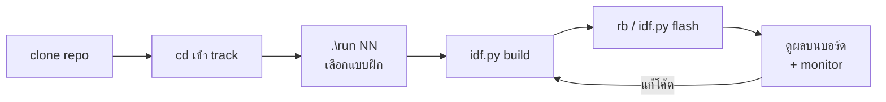

# บทที่ 4 — Workshop Onsite: บอร์ด IoT, Firmware และ Secured Edge AI

🏠 [หน้าหลัก](../README.md) · 📚 [สารบัญ ND1](README.md) · ⬅ [บทที่ 3](03-esp-idf-hello-world.md) · ถัดไป ➡ [Git, GitHub และ Markdown](../common/git-github-markdown.md)

> **บทนี้เรียนอะไร:** ลงมือกับบอร์ดจริงครั้งแรก — clone repo workshop เลือกแบบฝึก build และ flash ลงบอร์ด ESP32-S3 แล้วดูผลบนจอ LED และลำโพง

## ทำไมสำคัญ

สิ่งที่เรียนใน simulator ต้องพิสูจน์บนฮาร์ดแวร์จริง เพราะเรื่องอย่างสาย USB, พอร์ต COM, ไดรเวอร์ และเวลาจริงของ peripheral ไม่มีใน simulator

## แนวคิดหลัก

### โครงสร้าง repo workshop
แอปในแต่ละแบบฝึก "บาง" มาก เพราะงานหนัก (โปรโตคอล, codec, widget ของ UI, middleware) อยู่ใน library สำเร็จรูป `librobotos_fw.a` เราจึงโฟกัสที่ตรรกะของแบบฝึกได้

| Track | เนื้อหา |
|---|---|
| `demos/demo-labs` (ex01–17) | ตัวอย่าง UI / widget / การสื่อสาร |
| `labs/device-labs` (ex00–06) | ใช้อุปกรณ์บนบอร์ดทีละขั้น |
| `labs/special-labs` (ex01–06) | หัวข้อพิเศษของ FreeRTOS |
| `labs/rtos-labs` (ex00–15) | FreeRTOS เชิงลึก + เกมเป็นงานปิดท้าย |

รองรับบอร์ด 2 รุ่น: **ws28p** (Waveshare มี IMU, ลำโพง 2 ตัว) และ **es3c28p** (มีไมโครโฟน + RGB LED)

### ลำดับการทำงานในวัน Workshop



ตัวอย่างที่ได้ลองในวันนั้น: สร้างคลื่น sine / square / triangle แล้ว plot บนจอ · เอียงบอร์ดที่มี IMU แล้วจุดวิ่งตาม · เล่นเสียง stereo · สั่ง RGB LED · ปุ่มเปลี่ยนหน้า · ส่งข้อมูลผ่าน Bluetooth / WiFi

### Function chaining
เทคนิคต่อฟังก์ชันเป็นสายพาน (คล้าย middleware ใน Node.js หรือ function pointer ใน C) เช่น **sine generator → PWM → LED** ทำให้ประกอบพฤติกรรมใหม่ได้โดยไม่ต้องเขียนใหม่ทั้งหมด

## ขั้นตอนลงมือ

**สิ่งที่ต้องเตรียม**
- Notebook + ที่ชาร์จ
- สาย **USB-C ↔ USB-A ที่รับส่งข้อมูลได้** (สายชาร์จอย่างเดียวใช้ไม่ได้) ถ้าเครื่องมีแต่ USB-C ให้เตรียมตัวแปลง
- ติดตั้ง ESP-IDF จน `idf.py --version` ใช้ได้ และ build Hello World ผ่านมาก่อน (บทที่ 3)

**คำสั่ง (Windows PowerShell)**
```powershell
.\install.ps1 esp32s3        # ติดตั้ง tools สำหรับ ESP32-S3 (ครั้งแรก)
.\export.ps1                 # เปิด environment ของ ESP-IDF ทุกครั้งที่เปิด terminal ใหม่
git clone https://github.com/drsanti/firmware-esp32-s3-workshop.git
cd firmware-esp32-s3-workshop\labs\device-labs
.\run 01                     # เลือกแบบฝึก ex01
idf.py set-target esp32s3
idf.py build
idf.py -p COM17 flash monitor   # Mac: ls /dev/cu.* เพื่อหาชื่อพอร์ต
```

## ปัญหาที่พบบ่อย

| อาการ | วิธีแก้ |
|---|---|
| เสียบสายแล้วไม่เห็นพอร์ต | ใช้สายที่รับส่งข้อมูลได้ / ลองพอร์ตอื่น |
| flash ไม่ได้ | บางโหมดต้องกดปุ่ม BOOT ค้างแล้วกด RESET เพื่อเข้า boot mode |
| build ครั้งแรกนานมาก | ปกติ (คอมไพล์ dependency หลายร้อยไฟล์) ครั้งต่อไปเร็วขึ้น |
| แบบฝึกต้องการ LED แต่บอร์ดไม่มี | ตรวจรุ่นบอร์ด — ws28p ไม่มี LED/ไมค์ ส่วน es3c28p ไม่มี IMU |

## คำศัพท์ในบท
[Flash](../common/glossary.md#flash-firmware) · [IMU](../common/glossary.md#imu) · [PWM](../common/glossary.md#pwm) · [ESP-IDF](../common/glossary.md#esp-idf)

## แหล่งอ้างอิง
- repo workshop: [firmware-esp32-s3-workshop](https://github.com/drsanti/firmware-esp32-s3-workshop)

---
🏠 [หน้าหลัก](../README.md) · 📚 [สารบัญ ND1](README.md) · ⬅ [บทที่ 3](03-esp-idf-hello-world.md) · ถัดไป ➡ [บทที่ 5 — Git, GitHub และ Markdown](../common/git-github-markdown.md)
