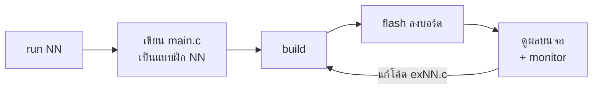

# บทที่ 4 — Workshop Onsite: Firmware บนบอร์ดจริงด้วย firmware-esp32-s3-workshop

🏠 [หน้าหลัก](../README.md) · 📚 [สารบัญ ND1](README.md) · ⬅ [บทที่ 3](03-esp-idf-hello-world.md) · ถัดไป ➡ [Git, GitHub และ Markdown](../common/git-github-markdown.md)

> **บทนี้เรียนอะไร:** ลงมือกับบอร์ด ESP32-S3 จริง — clone repo workshop ตั้งค่าเครื่องมือ `rb` เลือกแบบฝึกด้วย `run NN` แล้ว build + flash ลงบอร์ด ได้เห็น FreeRTOS ทำงานกับจอ ปุ่ม IMU และเสียงจริง พร้อมแบบฝึกทั้งหมด 4 track
>
> **ก่อนอ่าน:** [บทที่ 3](03-esp-idf-hello-world.md) — ต้อง build Hello World ผ่านแล้ว · **เวลา:** Workshop เต็มวัน (09:00–16:00)

## สารบัญบทนี้
1. [ทำไมต้องลงบอร์ดจริง](#1-ทำไมต้องลงบอร์ดจริง)
2. [สิ่งที่ต้องเตรียม](#2-สิ่งที่ต้องเตรียม)
3. [โครงสร้าง repo workshop](#3-โครงสร้าง-repo-workshop)
4. [ตั้งค่าครั้งแรกด้วย rb](#4-ตั้งค่าครั้งแรกด้วย-rb)
5. [เลือกแบบฝึกและ flash](#5-เลือกแบบฝึกและ-flash)
6. [แบบฝึก 4 track](#6-แบบฝึก-4-track)
7. [แนวคิดที่ได้จาก workshop](#7-แนวคิดที่ได้จาก-workshop)
8. [แก้ปัญหาที่พบบ่อย](#8-แก้ปัญหาที่พบบ่อย)
9. [สรุปและแบบฝึกต่อยอด](#9-สรุปและแบบฝึกต่อยอด)

---

## 1. ทำไมต้องลงบอร์ดจริง

สิ่งที่ simulator ให้ไม่ได้: สาย USB, ชื่อพอร์ต COM, ไดรเวอร์, จังหวะเวลาจริงของอุปกรณ์, ไฟตกตอน WiFi ทำงาน — ปัญหาจริงส่วนใหญ่เกิดตรงนี้ และ **ต้องพิสูจน์บนฮาร์ดแวร์เสมอ** ก่อนบอกว่าใช้ได้

---

## 2. สิ่งที่ต้องเตรียม

| อุปกรณ์ / ซอฟต์แวร์ | หมายเหตุ |
|---|---|
| Notebook + ที่ชาร์จ | ปลั๊กพ่วงถ้าสะดวก |
| สาย **USB-C ↔ USB-A ที่รับส่งข้อมูลได้** | สายชาร์จอย่างเดียวใช้ไม่ได้ · เครื่องที่มีแต่ USB-C ต้องเตรียมตัวแปลงหรือสาย USB-C ↔ USB-C |
| ESP-IDF v6.1 | `idf.py --version` ต้องใช้ได้ (บทที่ 3) |
| Git | สำหรับ clone repo |

บอร์ดที่ใช้มี 2 รุ่น (ได้รุ่นใดรุ่นหนึ่ง):

| รุ่น | ชื่อใน repo | มีอะไรเด่น |
|---|---|---|
| Waveshare ESP32-S3-Touch-LCD-2.8 | **`ws28p`** (ค่าเริ่มต้น) | **IMU**, RTC, ลำโพง 2 ตัว (stereo) — เหมาะงานหุ่นยนต์/วัดการเอียง |
| Ternion ES3C28P | **`es3c28p`** | **ไมโครโฟน + RGB LED** — เหมาะงานเสียง |

> ทั้งสองรุ่นใช้ชิป ESP32-S3 และจอ 2.8 นิ้วเหมือนกัน · ต้อง `set-target esp32s3` ทั้งคู่

---

## 3. โครงสร้าง repo workshop

แนวคิดหลักคือ **โค้ดแบบฝึกบางมาก** — งานหนัก (โปรโตคอลสื่อสาร, codec, widget ของจอ, middleware) อยู่ใน library สำเร็จรูป **`librobotos_fw.a`** ผู้เรียนจึงโฟกัสที่ตรรกะของแบบฝึกได้

```text
firmware-esp32-s3-workshop/
├── lib/ + include/         ← library สำเร็จรูป (librobotos_fw.a)
├── rbdev/                  ← เครื่องมือ CLI สำหรับ Windows / macOS / Linux
├── ports/boards/           ← แผนที่ขาของบอร์ดแต่ละรุ่น
├── labs/
│   ├── device-labs/        ← แบบฝึกอุปกรณ์ ex00–06 (ทำทีละ step)
│   ├── rtos-labs/          ← FreeRTOS เชิงลึก + เกม ex00–15
│   └── special-labs/       ← หัวข้อพิเศษ FreeRTOS ex01–06
└── demos/demo-labs/        ← ตัวอย่าง UI / widget / การสื่อสาร ex01–17
```

**หนึ่งโปรเจกต์ต่อหนึ่ง track** — สลับแบบฝึกด้วย `run NN` ซึ่งจะเขียนทับ `main/main.c` ให้ ไม่ต้องสร้างโปรเจกต์ใหม่

---

## 4. ตั้งค่าครั้งแรกด้วย rb

`rb` คือเครื่องมือ CLI ที่มากับ repo ช่วยจำพอร์ตและรุ่นบอร์ด (ไม่ต้องเพิ่มลง PATH ถาวร)

### Windows (ESP-IDF PowerShell)
```powershell
git clone https://github.com/drsanti/firmware-esp32-s3-workshop.git
cd firmware-esp32-s3-workshop

# ทำครั้งเดียวต่อหน้าต่าง — อนุญาตให้รัน script (.ps1)
Set-ExecutionPolicy -Scope Process -ExecutionPolicy Bypass

cd labs\device-labs
.\rb doctor                               # ตรวจเครื่องมือ + หาพอร์ต
.\rb config --port COM5 --board ws28p     # ใช้พอร์ตจาก doctor และรุ่นบอร์ดของเรา
```

### macOS / Linux
```bash
chmod +x rbdev/mac/rbdev rbdev/linux/rbdev rb ./labs/*/rb ./labs/*/run
ls /dev/cu.*                              # macOS — หาพอร์ต
cd labs/device-labs
./rb doctor
./rb config --port /dev/cu.usbmodemXXXX --board es3c28p   # Linux: /dev/ttyACM0
```
macOS ถ้า Gatekeeper บล็อก: คลิกขวา `rbdev/mac/rbdev` → Open หนึ่งครั้ง

> **`rb doctor`** = ไฟเขียวก่อนเริ่ม ถ้า doctor ผ่าน ส่วนใหญ่ build ได้

---

## 5. เลือกแบบฝึกและ flash

```powershell
.\run 00            # เลือก ex00 → build → flash
.\run 01 monitor    # เลือก ex01 → build → flash → เปิด monitor
```



เปลี่ยนรุ่นบอร์ดชั่วคราว:
```powershell
.\rb build --board es3c28p
.\rb flash --port COM6 --board es3c28p
.\rb reconfigure          # หลังสลับบอร์ด
```

ใช้ `idf.py` ตรง ๆ ก็ได้:
```powershell
idf.py -DBOARD=ws28p set-target esp32s3 build flash -p COM5 monitor
```

---

## 6. แบบฝึก 4 track

### Device labs — อุปกรณ์จริงทีละขั้น
แต่ละแบบฝึกแบ่งเป็น step (step-01 … step-05) ค่อย ๆ เพิ่มความสามารถ

| แบบฝึก | ทำอะไร |
|---|---|
| ex00 Hello Device | ทักทายอุปกรณ์ ไฟตอนบูต |
| ex01 Spirit Level | ระดับน้ำดิจิทัลจาก IMU |
| ex02 Motion Alarm | สัญญาณกันขโมยเมื่อบอร์ดถูกขยับ (arm / disarm) |
| ex03 Reaction Game | เกมวัดความไวพร้อมเสียงบอกคะแนน |
| ex04 Metronome | เครื่องเคาะจังหวะ ปรับ BPM |
| ex05 Vibration Scope | ดูการสั่นสะเทือนแบบกราฟ |
| ex06 Task Monitor | ดูสถานะ task และความลึกของ queue |

### RTOS labs — FreeRTOS เห็นผลบนจอ
| แบบฝึก | แนวคิด |
|---|---|
| ex00 | สร้าง task, `vTaskDelay`, ดูว่า task รันบน core ไหน (`xPortGetCoreID`) |
| ex01 | ปักหมุด task ไว้ core 0 / core 1 (`xTaskCreatePinnedToCore`) |
| ex02 | OS tick และ tick hook — ISR ต้องสั้น |
| ex03 | queue ข้าม core: อ่าน IMU บน core 0 → คำนวณบน core 1 → แสดงผล |
| ex04 | priority: task ที่ยอมคืน CPU (yield) vs task ที่กิน CPU ไม่ปล่อย (starvation) |
| ex05 | `vTaskSuspend` / `vTaskResume` ด้วยปุ่ม |
| ex06 | **mutex**: วาดบนผืนผ้าใบร่วมกัน ปิด mutex = เส้นเละ (race) เปิด = เส้นสะอาด |
| ex07 | counting semaphore: 4 worker แย่ง 2 ช่อง |
| ex08 | event group: รอบิต A **และ** B vs A **หรือ** B |
| ex09 | software timer แบบ auto-reload vs `vTaskDelay` |
| ex10 | ปุ่ม BOOT: polling vs แจ้งจาก ISR (`vTaskNotifyGiveFromISR`) |
| ex11–15 | **เกมปิดท้าย** ใช้ IMU: แข่งรถ, ทุบอิฐ, ยิงอวกาศ, Asteroids, Frogger |

### Special labs — หัวข้อพิเศษ (ซ้ำกับ rtos-labs บางส่วน)
mutex รอบการเล่นเสียง · ISR + notify · priority/starvation · counting semaphore · event group · auto-reload timer

### Demo labs — UI และการสื่อสาร
| ช่วง | ตัวอย่าง |
|---|---|
| ex01–09 | widget บนจอ: label, LED, terminal 6 task, switch, button, slider, checkbox, radio, ฟอร์มรวม |
| ex10, ex12, ex13 | ส่งข้อมูลออกจากบอร์ด: log, topic, parameter ที่ปรับจากคอมพิวเตอร์ได้ |
| ex11, ex14, ex15 | gauge, progress bar, กราฟแบบเลื่อน |
| ex16 | แสดงผล IMU (ระดับน้ำ + กราฟ) |
| ex17 | แสดงระดับเสียงจากไมค์ (มีโหมดจำลองถ้าบอร์ดไม่มีไมโครโฟน) |

---

## 7. แนวคิดที่ได้จาก workshop

### Function chaining
ต่อฟังก์ชันเป็นสายพาน (คล้าย middleware ใน Node.js หรือ function pointer ใน C) เช่น
```text
sine generator → PWM → LED
```
ประกอบพฤติกรรมใหม่ได้โดยไม่ต้องเขียนใหม่ทั้งหมด

### ใช้ 2 core อย่างตั้งใจ
แยกงานอ่าน sensor ไว้ core หนึ่ง งานคำนวณ/UI ไว้อีก core แล้วส่งข้อมูลข้ามด้วย queue (rtos-labs ex03) — แนวเดียวกับที่บทที่ 1 พูดถึงเรื่องประหยัดพลังงาน

### เห็น race condition ด้วยตา
แบบฝึก mutex canvas ทำให้เห็นชัดว่าเมื่อ 2 task วาดพร้อมกันโดยไม่มี mutex ภาพจะเละ — ปัญหาที่ปกติมองไม่เห็นในโค้ด

### ตรวจความสามารถของบอร์ดก่อนใช้
บอร์ดสองรุ่นมีอุปกรณ์ต่างกัน แบบฝึกที่ต้องใช้ IMU จะไม่ทำงานบนรุ่นที่ไม่มี IMU — ต้องรู้ว่าบอร์ดเรามีอะไร

---

## 8. แก้ปัญหาที่พบบ่อย

> 💡 **ปัญหาพื้นฐานเรื่อง Shell (PowerShell / Git Bash), สิทธิ์พอร์ต USB, PATH และ Gatekeeper** รวมวิธีแก้ไว้ที่ [คู่มือแก้ปัญหาพื้นฐาน (Troubleshooting)](../common/troubleshooting.md) — ตารางด้านล่างนี้เน้นปัญหาเฉพาะของบทนี้

| อาการ | วิธีแก้ |
|---|---|
| Windows: `not digitally signed` / `.ps1` ถูกบล็อก | `Set-ExecutionPolicy -Scope Process -ExecutionPolicy Bypass` ทุกครั้งที่เปิดหน้าต่างใหม่ |
| `No module named 'rich_click'` | Python environment ของ ESP-IDF ติดตั้งไม่ครบ → ไปที่ `IDF_PATH` รัน `install` แล้ว `export` ใหม่ แล้ว `rb doctor` อีกครั้ง |
| parse error ใน script | ไฟล์เก่า → `git pull` |
| macOS บล็อก `rbdev` | คลิกขวา → Open หนึ่งครั้ง |
| Linux: permission denied ที่ `/dev/tty*` | `sudo usermod -aG dialout $USER` แล้ว logout/login |
| เสียบสายแล้วไม่เห็นพอร์ต | ใช้สายที่รับส่งข้อมูลได้ / ลองพอร์ต USB อื่น |
| flash ไม่ได้ | ปิด monitor ตัวอื่น · บางกรณีกด BOOT ค้างแล้วกด RESET เพื่อเข้า download mode |
| แบบฝึกไม่มีผลกับอุปกรณ์ | รุ่นบอร์ดไม่ตรงกับที่ตั้งใน `rb config` |

---

## 9. สรุปและแบบฝึกต่อยอด

### สรุป
- repo workshop ใช้ library สำเร็จรูป ทำให้แบบฝึกสั้นและเน้นแนวคิด
- `rb doctor` → `rb config` → `run NN` คือ 3 คำสั่งหลัก
- rtos-labs ทำให้เห็นแนวคิด FreeRTOS (core, priority, mutex, semaphore, event group, timer, ISR) บนจอจริง

### แบบฝึกต่อยอด
1. รัน rtos-labs ex06 ทั้งแบบเปิดและปิด mutex แล้วอธิบายความต่าง
2. รัน ex04 แล้วสังเกตว่าเมื่อ task priority สูงไม่ยอม yield เกิดอะไรกับ task อื่น
3. แก้ device-labs ex04 (metronome) ให้เปลี่ยน BPM ด้วยการเอียงบอร์ด (ถ้าบอร์ดมี IMU)

## คำศัพท์ในบท
[Flash](../common/glossary.md#flash-firmware) · [IMU](../common/glossary.md#imu) · [PWM](../common/glossary.md#pwm) · [ESP-IDF](../common/glossary.md#esp-idf) · [Mutex](../common/glossary.md#mutex) · [Task](../common/glossary.md#task)

## แหล่งอ้างอิง
- repo workshop: [firmware-esp32-s3-workshop](https://github.com/drsanti/firmware-esp32-s3-workshop) · คู่มือ CLI [rbdev/README.md](https://github.com/drsanti/firmware-esp32-s3-workshop/blob/main/rbdev/README.md) · [CLASSROOM-SETUP.md](https://github.com/drsanti/firmware-esp32-s3-workshop/blob/main/CLASSROOM-SETUP.md)
- Workshop Onsite ครั้งที่ 1 ND1 (31 ต.ค. 2026) และสไลด์ประกอบ

---
🏠 [หน้าหลัก](../README.md) · 📚 [สารบัญ ND1](README.md) · ⬅ [บทที่ 3](03-esp-idf-hello-world.md) · ถัดไป ➡ [บทที่ 5 — Git, GitHub และ Markdown](../common/git-github-markdown.md)
