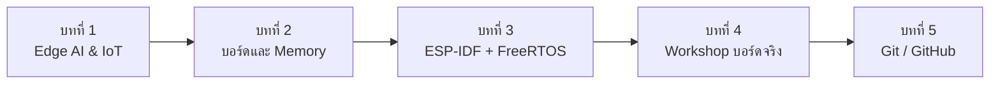

# ND1 — Edge AI และ AIoT สมัยใหม่

🏠 [หน้าหลัก](../README.md) · 📖 [คำศัพท์](../common/glossary.md)

> สรุปสิ่งที่เรียนใน **ND1: นักพัฒนา Edge AI และ AIoT สมัยใหม่** (KMUTT Non-Degree 2026) Week 01–05
> เขียนให้ **มือใหม่ที่ไม่เคยเรียนหลักสูตรนี้** อ่านแล้วเข้าใจภาพรวม และรู้ว่าต้องเริ่มจากตรงไหน

## หลักสูตรนี้เกี่ยวกับอะไร

สร้างอุปกรณ์ IoT ที่มี AI อยู่บนตัวเอง (Edge AI) ด้วยบอร์ด **ESP32-S3** เขียน firmware ด้วย **FreeRTOS** และออกแบบให้ใช้งานจริงได้ระดับผลิตภัณฑ์ — ประหยัดพลังงาน สื่อสารอย่างปลอดภัย และอัปเดตผ่านเน็ตได้ โดยใช้ AI ช่วยเขียนโค้ดอย่างมีวินัย

## สารบัญ

| บท | หัวข้อ | สัปดาห์ | เรียนอะไร |
|---|---|---|---|
| 1 | [พื้นฐาน Edge AI และ IoT ในยุค AI](01-edge-ai-iot-basics.md) | Week 01 | ภาพรวมโปรเจกต์, จาก Hobby สู่ Product, วิธีทำงานกับ AI |
| 2 | [รู้จักบอร์ด ES3C28P ตั้งแต่ชิปถึงอุปกรณ์](02-freertos-ai-agents.md) | Week 02 | ชิป, หน่วยความจำ 6 ชนิด, จอ / เสียง / LED / แบต, แผนที่ขา, กับดัก AI |
| 3 | [ESP-IDF, Hello World และ FreeRTOS บน PC](03-esp-idf-hello-world.md) | Week 03 | build/flash/monitor, task state, board twin |
| 4 | [Workshop Onsite: Firmware บนบอร์ดจริง](04-onsite-firmware-workshop.md) | Week 04 | repo workshop, เลือกแบบฝึก, flash ลงบอร์ด |
| 5 | [Git, GitHub และ Markdown](../common/git-github-markdown.md) | Week 05 | เครื่องมือส่งงานและเขียนเอกสาร (ใช้ร่วมกันทุกหลักสูตร) |

## เครื่องมือที่ต้องติดตั้ง

| เครื่องมือ | ใช้ทำอะไร | ตรวจว่าพร้อม |
|---|---|---|
| [VS Code](https://code.visualstudio.com/) + extension ESP-IDF | แก้โค้ดและสั่ง build | เปิด Command Palette แล้วเห็นคำสั่ง ESP-IDF |
| ESP-IDF v6.1 | compiler + build system | `idf.py --version` |
| Git (+ Git Bash บน Windows) | เก็บโค้ดและส่งงาน | `git --version` |
| สาย USB รับส่งข้อมูล | ต่อบอร์ด | เห็นพอร์ต COM / `/dev/cu.*` |

## ถ้ามีเวลาน้อย อ่านแค่นี้
1. AI ทำตามที่สั่ง และ **ไม่ทำสิ่งที่ไม่ได้สั่ง** — ต้องรู้ keyword เช่น พลังงาน, TLS, NVS, mutex
2. **Memory** กำหนดความเร็วและความเสถียรของอุปกรณ์มากกว่าการเขียนโค้ด
3. ทำให้ทุกอย่างรันผ่าน **command line** ได้ AI agent จะช่วยได้เต็มที่
4. ฝึก FreeRTOS บน PC ก่อน แล้วค่อยย้ายไปบอร์ดจริง

## แหล่งอ้างอิงหลัก
- เอกสารของผู้สอน (ผศ.ดร.สันติ นุราช มจธ.): [github.com/drsanti/kmutt-nd69 — ND1](https://github.com/drsanti/kmutt-nd69/blob/main/nd1/README.md)

---
🏠 [หน้าหลัก](../README.md) · [ND2](../nd2/README.md) · [ND3](../nd3/README.md)
