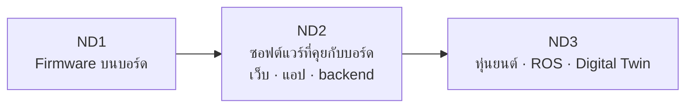
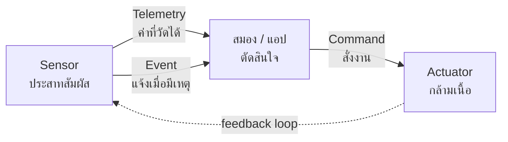
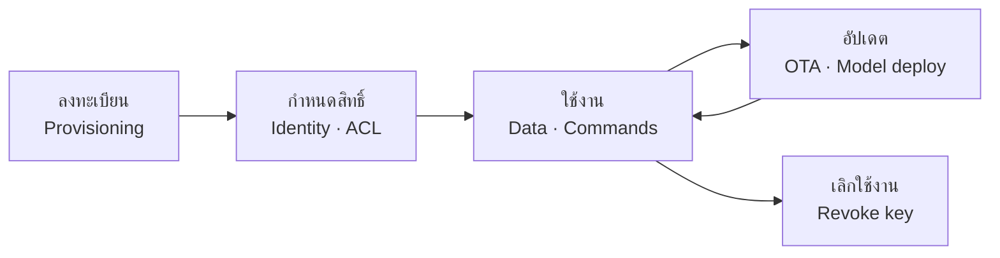
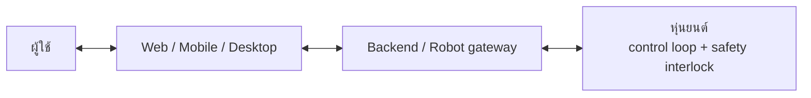
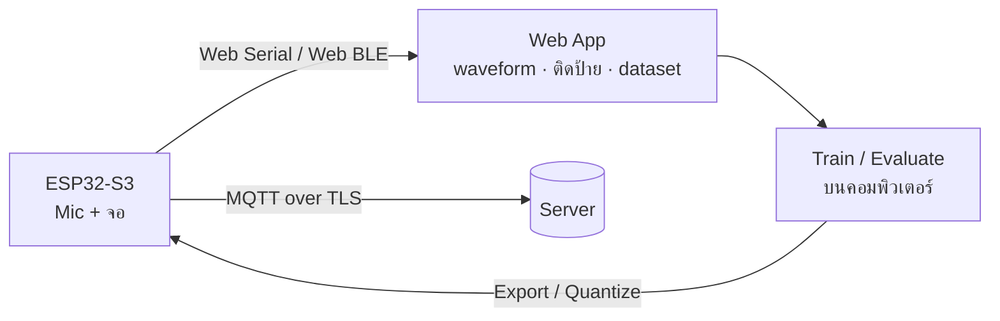

# บทที่ 1 — Full-stack ที่คุยกับฮาร์ดแวร์: Web/Mobile Apps สำหรับ IoT และ Edge

🏠 [หน้าหลัก](../README.md) · 📚 [สารบัญ ND2](README.md) · ถัดไป ➡ [บทที่ 2](02-dev-tools-ai-agents.md)

> **บทนี้เรียนอะไร:** นักพัฒนา full-stack ยุคต่อไปต้องทำอะไรเพิ่มเมื่อซอฟต์แวร์ต้องคุยกับ sensor เครื่องจักร และหุ่นยนต์ รู้จักรูปแบบข้อมูล 3 แบบ ระบบจัดการอุปกรณ์ตลอดอายุการใช้งาน และภาพรวมโปรเจกต์ AI เสียงที่ ND2 จะพาทำ
>
> **ก่อนอ่าน:** พื้นฐานเว็บ (HTML / JavaScript) เล็กน้อย · **เวลาอ่าน:** ~40 นาที

## สารบัญบทนี้
1. [ทำไม full-stack ต้องคุยกับฮาร์ดแวร์](#1-ทำไม-full-stack-ต้องคุยกับฮาร์ดแวร์)
2. [ขอบเขตของ ND2](#2-ขอบเขตของ-nd2)
3. [ระบบควบคุม 3 ส่วน และข้อมูล 3 แบบ](#3-ระบบควบคุม-3-ส่วน-และข้อมูล-3-แบบ)
4. [จาก "จัดการผู้ใช้" สู่ "จัดการอุปกรณ์"](#4-จาก-จัดการผู้ใช้-สู่-จัดการอุปกรณ์)
5. [UI/UX และแอปสำหรับงานวิศวกรรม](#5-uiux-และแอปสำหรับงานวิศวกรรม)
6. [Full-stack ในโลกหุ่นยนต์](#6-full-stack-ในโลกหุ่นยนต์)
7. [โปรเจกต์ ND2: จากเสียงสู่โมเดล AI](#7-โปรเจกต์-nd2-จากเสียงสู่โมเดล-ai)
8. [ทำงานกับ AI ให้ได้สเปกที่ถูก](#8-ทำงานกับ-ai-ให้ได้สเปกที่ถูก)
9. [สรุปและแบบฝึกคิด](#9-สรุปและแบบฝึกคิด)

---

## 1. ทำไม full-stack ต้องคุยกับฮาร์ดแวร์

- AI เขียน UI, API และ backend ได้เกือบหมดแล้ว **งานเขียนโค้ดระดับ junior/กลางจึงแข่งกับ AI ได้ยาก**
- งานใหม่อยู่ฝั่ง **Edge AI และหุ่นยนต์ (Embodied AI)** ที่ฮาร์ดแวร์มีบทบาทสูง — อะไรที่ตีความเป็นตัวเลขได้ ซอฟต์แวร์ก็จัดการได้
- เมื่อก่อนเราเรียก API ได้ข้อมูลกลับมาแล้วจบที่หน้าจอ ต่อไป **ข้อมูลต้องจบที่โลกจริง** — การเคลื่อนที่ แรง อุณหภูมิ — จึงต้องรู้จักพารามิเตอร์ทางกล เช่น มุม ความร้อน แบตเตอรี่ การสั่น เสียงผิดปกติ
- ก้าวแรกคือ **เข้าถึงฮาร์ดแวร์ให้ได้** (บทที่ 2–4)

> หัวใจของ ND2 คือ **"เข้าใจระบบ"** — syntax จำเป็นนิดหน่อย แต่ต้องอ่านโค้ดออก วิเคราะห์ ออกแบบใหม่ และสั่งแก้ได้ เหมือน senior รีวิวโค้ดของ junior

---

## 2. ขอบเขตของ ND2

- ต่อจาก ND1 แต่เป็น **ซอฟต์แวร์ล้วน ไม่ต้องเขียน firmware** (มี firmware สำเร็จรูปให้)
- มุ่งสู่อุตสาหกรรมและ Industry 4.0 ที่หุ่นยนต์เข้ามาแทนแรงงาน
- บทบาทของเราคือ **integrator** — คนที่ต่อระบบหลายส่วนให้ทำงานร่วมกัน

### พื้นฐานที่ยังต้องมี
- build / run / install / ตั้งค่า environment ได้เอง
- รู้ **tech stack** พอจะกำกับ AI เช่น ควรใช้ Redis, MongoDB หรือ PostgreSQL เมื่อไร เพราะระบบจริงไม่ได้อยู่ลำพัง
- **Security** — TLS, ความน่าเชื่อถือของข้อมูล
- **Robustness** — ระบบต้องรับมือความผิดพลาดเองได้ ไม่ใช่โยน error 504/404 ใส่ผู้ใช้
- แอปยุคใหม่ควรมี **ความสามารถ AI อยู่ข้างใน** เช่น API หรือ MCP ให้ผู้ใช้เลือก LLM ของตัวเองได้

---

## 3. ระบบควบคุม 3 ส่วน และข้อมูล 3 แบบ

ทุกระบบที่คุยกับโลกจริงมีโครงเดียวกัน:

| แบบ | ทิศทาง | ตัวอย่าง |
|---|---|---|
| **Telemetry** | อุปกรณ์ → แอป | ค่าระดับเสียง, อุณหภูมิ, ตำแหน่งข้อต่อ |
| **Command** | แอป → อุปกรณ์ | เปิดไฟ, สั่งเคลื่อนที่, เปลี่ยนความถี่กะพริบ |
| **Event** | อุปกรณ์แจ้งเองเมื่อมีเหตุ | กดปุ่ม, แบตต่ำ, ตรวจพบเสียงไอ |

แนวคิด Event เหมือนกับที่ใช้ใน IoT protocol, ROS, firmware, webhook, การแจ้งเตือนของ YouTube, Server-Sent Events, pub/sub

### เลิกใช้ polling
**Polling** = ถามค่าซ้ำทุก ๆ วินาที เช่น ถามมุมข้อต่อหุ่นยนต์ทุกวินาทีแล้วได้ 120° ซ้ำเดิม → เปลืองพลังงาน แบนด์วิดท์ และจำนวนธุรกรรม
**ที่ดีกว่า** = ให้อุปกรณ์ส่ง event มาเองเมื่อค่าเปลี่ยน

### ส่งข้อมูล ไม่ใช่ข้อมูลดิบ
ตัวอย่างงานจริง เช่น นับเสียงไอของผู้ป่วยติดเตียง หรือตรวจจับเด็กร้อง — อุปกรณ์ปกติส่ง **information** (เสียงอะไร ดังแค่ไหน กี่ครั้ง) ไม่ส่งเสียงดิบทั้งหมด

---

## 4. จาก "จัดการผู้ใช้" สู่ "จัดการอุปกรณ์"

| ยุค | ระบบหลังบ้านดูแลอะไร |
|---|---|
| เว็บทั่วไป | ผู้ใช้, รหัสผ่าน, SSO |
| IoT | backend คุยกับอุปกรณ์ผ่าน MQTT / CoAP |
| **ต่อไป** | **Device Lifecycle Management** — ดูแลอุปกรณ์ตั้งแต่เกิดจนเลิกใช้ |

องค์ประกอบของแพลตฟอร์ม IoT:

| # | ส่วน | ทำอะไร |
|---|---|---|
| 1 | Device Manager | รายการอุปกรณ์ทั้งหมด สถานะ |
| 2 | Provisioning & Identity | ลงทะเบียนเครื่องใหม่ ใส่ certificate |
| 3 | TLS MQTT & Permissions | เข้ารหัส + **Topic ACL** (อุปกรณ์ไหนใช้ topic ไหนได้) |
| 4 | Data & Commands | เก็บ telemetry ส่งคำสั่ง |
| 5 | OTA & Model Deployment | อัปเดต firmware และโมเดล AI |
| 6 | Operations & Audit | ตรวจสอบย้อนหลังว่าใครทำอะไร |

พื้นฐานที่แพลตฟอร์มต้องคิด: **multi-tenancy** (หลายลูกค้าในระบบเดียว), **versioning** ของ API/schema, จำกัดทรัพยากรต่ออุปกรณ์, **backpressure** (ข้อมูลมาเร็วเกินรับไหว)

### Workshop provisioning ใน ND2
บอร์ดที่แจกจะทำตัวเป็น "เครื่องจักร" ให้ลอง:
- เปลี่ยน key / ลงทะเบียนเครื่อง (provision)
- **เปิดฟีเจอร์ตามแพ็กเกจ** — basic / pro / pro plus บนฮาร์ดแวร์ตัวเดียวกัน
- security ขั้นต่ำคือ **TLS** ระดับหุ่นยนต์ต้อง **mutual TLS** (ทั้งสองฝั่งพิสูจน์ตัวตนกัน)

---

## 5. UI/UX และแอปสำหรับงานวิศวกรรม

- **เข้าใจผู้ใช้และ workflow** ก่อนออกแบบหน้าจอ — ส่งภาพ UI ให้ AI สร้างเป็น HTML/React ได้แล้ว
- **พื้นฐานของแอป**: state machine, validation, testing
- **Visualization** — แสดงข้อมูลเป็นกราฟ time series แทนให้คนนั่งอ่าน log
- **Visual debugging** — เห็น timeline, queue, buffer overflow บนจอ
- **Real-time parameter tuning** — ปรับค่าของฮาร์ดแวร์ทันทีด้วยปุ่ม/slider **ไม่ต้องแก้ไฟล์ config แล้ว restart** · ในระบบ Physical AI ผู้ปรับอาจเป็น AI เอง เราแค่สร้างระบบรองรับ
- **ความถูกต้องและความไว้วางใจ** — แยกให้ชัดระหว่าง "ค่าที่สั่ง" (requested) กับ "ค่าที่อุปกรณ์ใช้จริง" (applied) — UI ที่โชว์ค่าที่สั่งแต่อุปกรณ์ยังไม่ได้ใช้ ทำให้ผู้ใช้เข้าใจผิด
- **Monitoring เครื่องจักร** เปลี่ยนจากดูสุขภาพ CPU/disk ของ server เป็นดูสถานะเครื่องจักรแต่ละตัว พร้อม assistant แจ้งเตือน
- **Agent-in-the-loop debug** — ให้ AI กดทดสอบ UI เอง ผ่าน MCP หรือเครื่องมืออัตโนมัติ
- UI เปลี่ยนตามโหมดผู้ใช้: debug / user / admin / config
- แอปบางส่วนในอนาคตจะถูก **AI ใช้เป็น service** (ไม่ต้องสวย) แต่ UI สำหรับคนยังจำเป็น

---

## 6. Full-stack ในโลกหุ่นยนต์

- **control loop และ safety interlock อยู่ที่ระบบควบคุมของหุ่นยนต์** ไม่ใช่ที่แอป — แอปห้ามเป็นตัวเดียวที่ทำให้หุ่นหยุด
- ต้องรู้จักหุ่นยนต์ขั้นพื้นฐาน: มี sensor อะไร ส่งสัญญาณอย่างไร และรู้จัก **ROS** (ลงลึกใน ND3)
- งานด้าน mission & fleet (สั่งงานหุ่นหลายตัว), visualization & debugging, security & operations
- security สำคัญมากในธุรกิจไฟฟ้า ประปา และการทหาร
- ตลาดหุ่นยนต์โตเร็ว — แนะนำให้ศึกษา **มอเตอร์ BLDC และการคุมแบบ FOC** เพราะเป็นหัวใจของข้อต่อหุ่นยนต์ humanoid

---

## 7. โปรเจกต์ ND2: จากเสียงสู่โมเดล AI

### ขั้นตอน
| ขั้น | ทำอะไร | หมายเหตุ |
|---|---|---|
| 1. เก็บข้อมูล | อัดเสียงจากไมค์บนบอร์ด (หรือไมโครโฟนของคอมพิวเตอร์ผ่าน Web Audio API ถ้ายังไม่มีบอร์ด) | ตัด "ช่วงที่มีเสียงพูด" อัตโนมัติด้วย VAD และคัดคุณภาพ |
| 2. ติดป้าย | บอกว่าเสียงแต่ละช่วงคือคำอะไร | ข้อมูลผิด = โมเดลผิด |
| 3. แบ่งข้อมูล | train / validation / test | ทดสอบกับข้อมูลที่โมเดลไม่เคยเห็น |
| 4. สร้าง feature | แปลงเป็นโดเมนความถี่: FFT → Mel filterbank → log → normalize | ต้องใช้ขั้นตอนเดียวกันทั้งตอนฝึกสอนโมเดลและตอนใช้งานจริง |
| 5. เทรน | โมเดล **DS-CNN** สำหรับจับคำสั่ง (keyword spotting) | |
| 6. ส่งออก | แปลงและ **quantize** ให้เล็ก | โมเดลบนบอร์ด < 20 KB |
| 7. ใช้งานบนบอร์ด | buffer → feature → inference → threshold/smoothing → แสดงผล/MQTT | วัด latency และ RAM จริง |

### ข้อคิดสำคัญ
- **ตัวชี้ขาดคือคุณภาพข้อมูล ไม่ใช่ algorithm** — "โยนหนังสือผิดเล่มให้ AI มันก็ทำตามหนังสือนั้น"
- **ไม่ใช้ LLM บนบอร์ด** — ไม่เอาช้างมาจับตั๊กแตน อุปกรณ์อุตสาหกรรมทำงานเฉพาะทาง แค่ 20 คำสั่งก็สร้างโมเดลเองได้ ไม่ต้องรอโมเดลสำเร็จรูป
- ในตัวอย่างเครื่องมือ สัญญาณจากไมโครโฟนจะผ่านกว่า 30 ขั้นก่อนถึง neural network — ไม่ได้สอนสร้างเครื่องมือ แต่สอน **เบื้องหลัง**
- **"เปลี่ยนจากผู้ใช้เป็นผู้สร้าง"** — จะขายบอร์ดได้ต้องมีเครื่องมือที่ทำให้ผู้ใช้สร้างโมเดลง่าย ไม่ใช่ให้ไปฝึกสอนโมเดลเองใน Google Colab
- ประยุกต์ได้หลายงาน: ตรวจจับเสียงหมาเห่า เด็กร้อง ผู้ป่วยไอ เสียงเครื่องจักรผิดปกติ

### ความท้าทายเรื่อง real-time
ไมค์สุ่มสัญญาณ 16,000 ครั้ง/วินาที แต่จอ refresh ได้แค่ราว 60–120 ครั้ง/วินาที → ต้องมีเทคนิคแยกช่องทาง **data / control / real-time** และลดข้อมูลก่อนวาด

---

## 8. ทำงานกับ AI ให้ได้สเปกที่ถูก

- AI ทำ API/backend ได้หมด แต่ **เราต้องออกแบบก่อน**
- เวลา AI ไม่มั่นใจจะถามกลับ (plan mode) — **ตัวเลือกที่เรากดคือสเปก** ถ้าเลือกผิด เช่นใช้ MongoDB ทำ buffer แทน Redis แอปยังทำงานได้แต่เปลืองทรัพยากร เพราะ AI สนแค่ผลลัพธ์
- ตั้งกฎให้ AI **ถามเมื่อความมั่นใจต่ำกว่า 95%**
- รู้ workflow ทั้งหมด: ติดตั้ง → เก็บข้อมูล → protocol → database → ขนาด server → load balance → deploy → ระบบดูแลตัวเอง แล้วให้ AI agent ทำตาม spec
- **"โค้ดที่เราไม่ได้เขียนเอง อย่าแก้เอง ให้ AI แก้"** — แต่ต้องรู้ว่าแต่ละไฟล์/โฟลเดอร์ทำอะไร ไม่งั้นแก้บั๊กเล็ก ๆ ต้องให้ AI สแกนหลายพันไฟล์ เผา token มหาศาล
- ค่า token สูงขึ้นเรื่อย ๆ ถ้าคอมพิวเตอร์แรงพอสามารถใช้ local model ช่วยเขียนโค้ดได้ · **ไม่จำเป็นต้องซื้อ AI มาเรียนหลักสูตรนี้** มีคอมพิวเตอร์ก็พอ

---

## 9. สรุปและแบบฝึกคิด

### สรุป
- Full-stack ยุคต่อไปต้องคุยกับฮาร์ดแวร์ และทำหน้าที่ integrator
- ข้อมูลระหว่างแอปกับอุปกรณ์มี 3 แบบ: **telemetry, command, event** — เลี่ยง polling
- แพลตฟอร์ม IoT ต้องดูแลอุปกรณ์ตลอดอายุ: provisioning → สิทธิ์ → ใช้งาน → อัปเดต → เพิกถอน
- AI เสียงบนอุปกรณ์: ข้อมูลดีสำคัญกว่าโมเดลเก่ง และโมเดลต้องเล็ก

### แบบฝึกคิด
1. ระบบตู้แช่เย็นในร้านค้า 500 ตู้ — ระบุ telemetry, command และ event อย่างละ 2 ตัวอย่าง
2. ถ้าใช้ polling ถามอุณหภูมิทุก 1 วินาที จาก 500 ตู้ ต่อวันจะมีกี่คำขอ? ใช้ event แทนได้อย่างไร?
3. ถ้าตู้หนึ่งถูกขโมย แพลตฟอร์มต้องทำอะไรได้บ้าง?

## คำศัพท์ในบท
[IoT](../common/glossary.md#iot) · [MQTT](../common/glossary.md#mqtt) · [TLS](../common/glossary.md#tls) · [Telemetry / Command / Event](../common/glossary.md#telemetry--command--event) · [Provisioning](../common/glossary.md#provisioning) · [Edge AI](../common/glossary.md#edge-ai)

## แหล่งอ้างอิง
- เอกสารผู้สอน ND2 Week 01: [kmutt-nd69/nd2/docs/week01](https://github.com/drsanti/kmutt-nd69/blob/main/nd2/docs/week01/README.md) และสไลด์ประกอบการบรรยาย
- การบรรยาย Online ND2 Week 01 (10 ต.ค. 2026)

---
🏠 [หน้าหลัก](../README.md) · 📚 [สารบัญ ND2](README.md) · ถัดไป ➡ [บทที่ 2 — เข้าถึงฮาร์ดแวร์จากเบราว์เซอร์](02-dev-tools-ai-agents.md)
