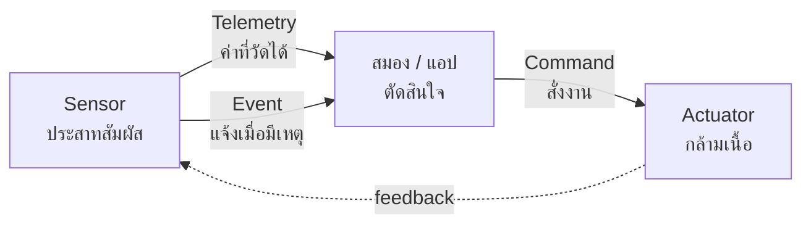
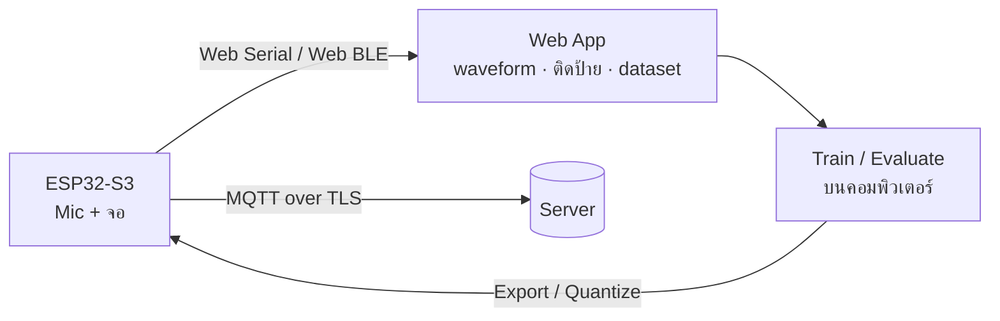

# บทที่ 1 — Full-stack ที่คุยกับฮาร์ดแวร์: Web/Mobile Apps สำหรับ IoT และ Edge

🏠 [หน้าหลัก](../README.md) · 📚 [สารบัญ ND2](README.md) · ถัดไป ➡ [บทที่ 2](02-dev-tools-ai-agents.md)

> **บทนี้เรียนอะไร:** นักพัฒนา full-stack ยุคต่อไปต้องทำอะไรเพิ่ม เมื่อซอฟต์แวร์ต้องคุยกับ sensor เครื่องจักร และหุ่นยนต์ และภาพรวมโปรเจกต์ที่หลักสูตร ND2 จะพาทำ

## ทำไมสำคัญ

- AI เขียน UI, API และ backend ได้เกือบหมดแล้ว งานเขียนโค้ดระดับทั่วไปจึงแข่งกับ AI ได้ยาก
- งานใหม่อยู่ที่ระบบที่ข้อมูล **จบที่โลกจริง** (การเคลื่อนที่ แรง อุณหภูมิ) เช่น Edge AI, หุ่นยนต์, Industry 4.0
- หน้าที่ของเราคือ **เข้าใจระบบ เลือก tech stack ให้ถูก และเป็น integrator** ส่วนการพิมพ์โค้ดให้ AI ทำ

## แนวคิดหลัก

### จาก "จัดการผู้ใช้" สู่ "จัดการอุปกรณ์"
| ยุค | ระบบดูแลอะไร |
|---|---|
| เว็บทั่วไป | user, password, SSO |
| IoT | backend คุยกับ device ผ่าน MQTT / CoAP |
| ต่อไป | **Device Lifecycle Management** — ลงทะเบียน → กำหนดสิทธิ์ → ใช้งาน → อัปเดต → เลิกใช้งาน |

### ระบบควบคุมมี 3 ส่วน และข้อมูลมี 3 แบบ

- **Telemetry** — device → แอป เช่น ค่า sensor
- **Command** — แอป → device เช่น เปิดไฟ, สั่งเคลื่อนที่
- **Event** — device แจ้งเองเมื่อมีการเปลี่ยนแปลง (แนวคิดเดียวกับ pub/sub, webhook)
- **เลี่ยง polling** (ถามค่าซ้ำทุกวินาทีแล้วได้ค่าเดิม) เพราะเปลืองพลังงานและแบนด์วิดท์ ให้ device ส่ง event มาเอง

### ทักษะของ full-stack ยุค AI
- พื้นฐานซอฟต์แวร์: async, state machine, validation, testing
- ต่อระบบได้: MQTT, OPC UA, ROS 2
- Security: TLS (ระดับหุ่นยนต์ต้อง **mutual TLS**), สิทธิ์ต่อ topic
- **Real-time parameter tuning** — ปรับค่าของฮาร์ดแวร์ได้ทันทีด้วยปุ่ม/slider ไม่ต้องแก้ config แล้ว restart
- Monitoring แบบ visualization / time series แทนการไล่อ่าน log

### โปรเจกต์ของ ND2: จากเสียงสู่โมเดล AI

ลำดับงาน AI เสียง: เก็บเสียง → filter → แปลงเป็น feature ในโดเมนความถี่ (log-Mel / MFCC) → train → deploy กลับลงบอร์ด → พูดสั่งงานจริง
- **ตัวชี้ขาดคือคุณภาพข้อมูล ไม่ใช่ algorithm** — ให้ข้อมูลผิด AI ก็เรียนผิด
- ใช้โมเดลเล็ก (< 20 KB) บนบอร์ด ไม่ใช้ LLM เพราะอุปกรณ์อุตสาหกรรมทำงานเฉพาะทาง

### ทำงานกับ AI ให้ได้สเปกที่ถูก
เวลา AI ถามกลับใน plan mode ตัวเลือกที่เรากดคือ **สเปก** ถ้าเลือกผิด (เช่นใช้ MongoDB ทำ buffer แทน Redis) แอปยังทำงานได้แต่เปลืองทรัพยากร เพราะ AI สนแค่ผลลัพธ์ — จึงต้องรู้ tech stack พอจะเลือกถูก

## ปัญหาที่พบบ่อย

| อาการ | สาเหตุ |
|---|---|
| แอปทำงานได้ แต่ช้า / กินทรัพยากร | เลือกเทคโนโลยีไม่เหมาะกับงานตอน AI ถาม |
| โมเดลเสียงแม่นตอนเทส แต่ใช้จริงไม่ได้ | ข้อมูลที่เก็บไม่ครอบคลุมสภาพจริง |

## คำศัพท์ในบท
[IoT](../common/glossary.md#iot) · [MQTT](../common/glossary.md#mqtt) · [TLS](../common/glossary.md#tls) · [Telemetry / Command / Event](../common/glossary.md#telemetry--command--event) · [Provisioning](../common/glossary.md#provisioning) · [Edge AI](../common/glossary.md#edge-ai)

## แหล่งอ้างอิง
- เอกสารผู้สอน ND02 Week 01: [kmutt-nd69/nd2/docs/week01](https://github.com/drsanti/kmutt-nd69/blob/main/nd2/docs/week01/README.md)

---
🏠 [หน้าหลัก](../README.md) · 📚 [สารบัญ ND2](README.md) · ถัดไป ➡ [บทที่ 2 — เข้าถึงฮาร์ดแวร์จากเบราว์เซอร์](02-dev-tools-ai-agents.md)
