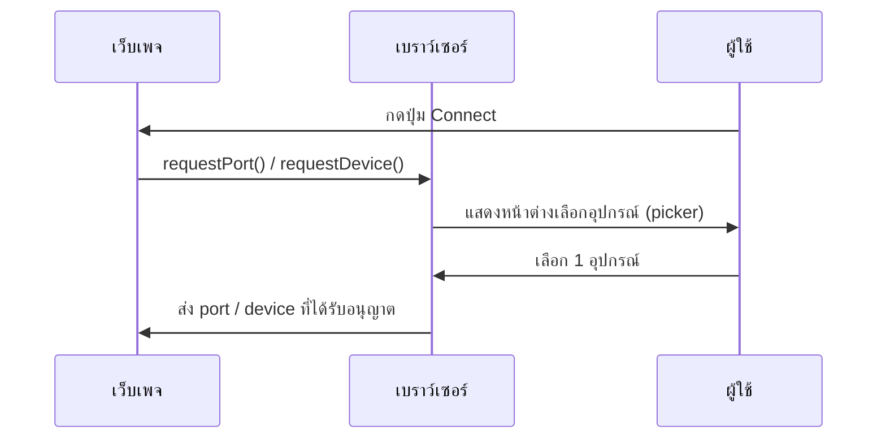
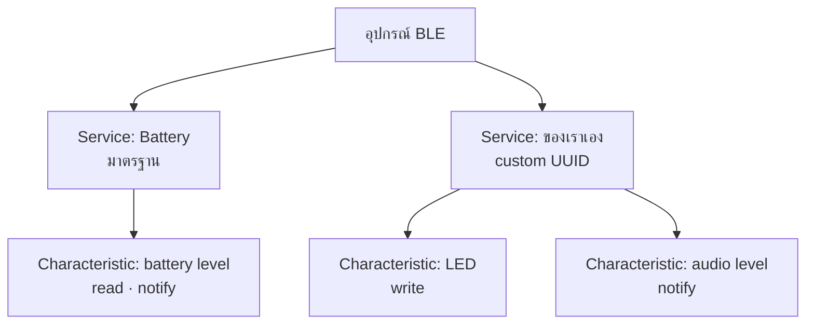
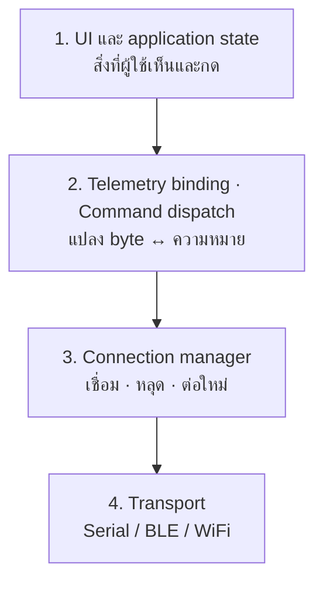
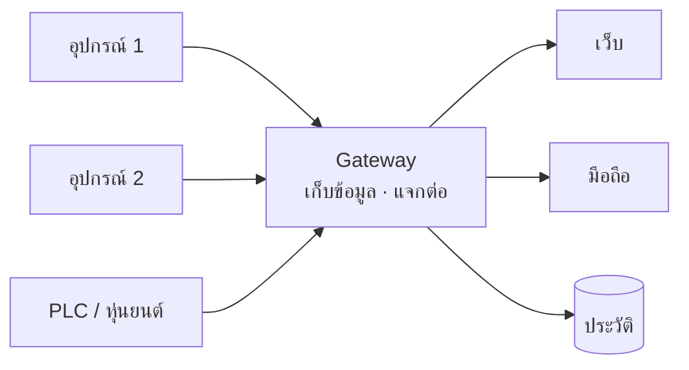

# บทที่ 2 — เข้าถึงฮาร์ดแวร์จากเบราว์เซอร์ และออกแบบแอปที่คุยกับอุปกรณ์

🏠 [หน้าหลัก](../README.md) · 📚 [สารบัญ ND2](README.md) · ⬅ [บทที่ 1](01-web-mobile-apps-for-iot.md) · ถัดไป ➡ [บทที่ 3](03-web-serial-dashboard.md)

> **บทนี้เรียนอะไร:** เว็บเพจคุยกับบอร์ดได้ตรง ๆ ผ่าน Web API ของเบราว์เซอร์ เข้าใจ Web Serial และ Web Bluetooth ในเชิงหลักการ เลือกช่องทาง (Serial / BLE / WiFi) ให้เหมาะกับงาน ออกแบบโครงสร้างแอปที่ทนต่อการหลุดการเชื่อมต่อ และเตรียมเครื่องมือ Node.js + Vite+ + TypeScript
>
> **ก่อนอ่าน:** [บทที่ 1](01-web-mobile-apps-for-iot.md) · **เวลาอ่าน:** ~60 นาที

## สารบัญบทนี้
1. [เบราว์เซอร์คือ sandbox — แล้วแตะฮาร์ดแวร์ได้อย่างไร](#1-เบราว์เซอร์คือ-sandbox--แล้วแตะฮาร์ดแวร์ได้อย่างไร)
2. [Browser hardware APIs และกฎเหล็ก 3 ข้อ](#2-browser-hardware-apis-และกฎเหล็ก-3-ข้อ)
3. [Web Serial — ท่อ byte แบบมีสาย](#3-web-serial--ท่อ-byte-แบบมีสาย)
4. [Web Bluetooth — BLE และ GATT](#4-web-bluetooth--ble-และ-gatt)
5. [เลือกช่องทาง: Serial vs BLE vs WiFi](#5-เลือกช่องทาง-serial-vs-ble-vs-wifi)
6. [ออกแบบการคุยระหว่างอุปกรณ์กับแอป](#6-ออกแบบการคุยระหว่างอุปกรณ์กับแอป)
7. [Anatomy ของแอป monitor / control](#7-anatomy-ของแอป-monitor--control)
8. [เมื่ออุปกรณ์เดียวไม่พอ: gateway](#8-เมื่ออุปกรณ์เดียวไม่พอ-gateway)
9. [เตรียมเครื่องมือ: Node.js, Vite+, TypeScript](#9-เตรียมเครื่องมือ-nodejs-vite-typescript)
10. [สรุปและแบบฝึก](#10-สรุปและแบบฝึก)

---

## 1. เบราว์เซอร์คือ sandbox — แล้วแตะฮาร์ดแวร์ได้อย่างไร

เว็บเพจปกติอยู่ใน **sandbox** ที่เข้มงวดมาก — อ่านไฟล์ในเครื่องไม่ได้ เปิด socket ดิบไม่ได้ แตะฮาร์ดแวร์ไม่ได้ **นี่คือข้อดี** ที่ทำให้เรากล้าเปิดลิงก์ของใครก็ได้

แต่ sandbox ที่ปิดสนิททำให้เว็บแพ้แอป native มาตลอด (เช่น โปรแกรม serial monitor อย่าง PuTTY / Tera Term) — เบราว์เซอร์จึงเปิด **ประตูเฉพาะ** ให้เว็บแตะอุปกรณ์ได้ **ภายใต้การอนุญาตของผู้ใช้ทุกครั้ง**

ผลคือ:
- เมื่อก่อนต้องมี server / โปรแกรมกลาง ตอนนี้ **เบราว์เซอร์คุยกับบอร์ดได้ตรง ๆ**
- ผู้ใช้แค่เปิดเว็บ ไม่ต้องติดตั้งโปรแกรม ใช้ได้บนคอมพิวเตอร์ แท็บเล็ต (บางกรณีมือถือ Android)
- Espressif และ framework embedded หลายตัวย้ายเครื่องมือมาบนเว็บแล้ว

---

## 2. Browser hardware APIs และกฎเหล็ก 3 ข้อ

| API | คุยกับ | รองรับ |
|---|---|---|
| **Web Serial** | serial port (USB-serial, RS-232 ผ่านตัวแปลง) | Chromium เท่านั้น |
| **Web Bluetooth** | อุปกรณ์ BLE | Chromium เท่านั้น |
| **WebUSB** | อุปกรณ์ USB ที่ไม่ใช่มาตรฐานทั่วไป | Chromium เท่านั้น |
| **WebHID** | อุปกรณ์ HID เช่น ปุ่มพิเศษ จอยเกม | Chromium เท่านั้น |
| Web MIDI | เครื่องดนตรี | Chromium เท่านั้น |
| Gamepad API | จอยเกม | ทุกเบราว์เซอร์ |
| Web Audio | ไมค์ / ลำโพง + ประมวลผลเสียง | ทุกเบราว์เซอร์ |

> **Chromium** = Chrome, Edge, Opera, Arc ฯลฯ — Firefox และ Safari ไม่รองรับ API กลุ่มที่แตะฮาร์ดแวร์ (Apple ให้เหตุผลเรื่องความปลอดภัย) · บน Mac ให้ติดตั้ง Chrome

### กฎเหล็กที่ทุก API ใช้ร่วมกัน

**1. ต้องเป็น secure context** — `https://` เท่านั้น ยกเว้น `localhost` / `127.0.0.1` สำหรับพัฒนา
เหตุผล: ถ้าเป็น HTTP คนกลางทาง (man-in-the-middle) อาจแทรกโค้ดสั่งงานอุปกรณ์ของผู้ใช้ได้ · ถ้า deploy ขึ้น cloud ต้องมี certificate

**2. ต้องมาจากการกระทำของผู้ใช้ + ผู้ใช้เลือกเอง**


เว็บเปิดอุปกรณ์เงียบ ๆ ไม่ได้ ต้องเรียกตอนผู้ใช้เพิ่งกดหรือแตะเท่านั้น

**3. ได้สิทธิ์เฉพาะอุปกรณ์ที่ผู้ใช้เลือก** — ไม่เห็นอุปกรณ์อื่นในเครื่อง

ตรวจว่าเบราว์เซอร์รองรับหรือไม่:
```ts
if (!("serial" in navigator)) alert("เบราว์เซอร์นี้ไม่รองรับ Web Serial — ใช้ Chrome หรือ Edge");
```

---

## 3. Web Serial — ท่อ byte แบบมีสาย

### Serial port คืออะไรในเชิงแนวคิด
**serial port คือท่อส่ง byte สองทิศ** ระหว่างสองเครื่อง:
- ข้อมูลไหลเป็นลำดับ byte ต่อเนื่อง **ไม่มี "ข้อความ" หรือ "packet" ในตัว** — เราต้องตกลงกันเองว่าข้อความหนึ่งจบตรงไหน (เช่น ขึ้นบรรทัดใหม่)
- ส่งและรับพร้อมกันได้ (full duplex)
- สองฝั่งต้องใช้ความเร็วเดียวกัน (**baud rate**) — ผิดความเร็ว = ได้ขยะ
- ท่อไม่รู้ว่าอีกฝั่งคืออะไร ความหมายมาจาก "ภาษาที่ตกลงกัน" (protocol)

เป็นช่องทางดั้งเดิมที่สุดของ embedded — มาก่อน USB และเครือข่าย แต่ยังอยู่จนวันนี้เพราะ **มีสายจึงเสถียรกว่าไร้สาย**

### เส้นทางของข้อมูล


### Lifecycle
```ts
const port = await navigator.serial.requestPort();   // 1. ผู้ใช้เลือกพอร์ต
await port.open({ baudRate: 115200 });                // 2. เปิดด้วยความเร็วที่ตกลงกัน

const reader = port.readable.getReader();             // 3. อ่าน
while (true) {
  const { value, done } = await reader.read();        //    ได้ byte เป็นก้อน ๆ (ไม่ใช่ทีละข้อความ)
  if (done) break;
  console.log(new TextDecoder().decode(value));
}

const writer = port.writable.getWriter();             // 4. เขียน
await writer.write(new TextEncoder().encode('{"cmd":"led","r":255}\n'));

reader.releaseLock(); writer.releaseLock();
await port.close();                                   // 5. ปิด คืนพอร์ต
```
- พอร์ตหนึ่ง **มีเจ้าของได้ทีละโปรแกรม** — ถ้า serial monitor ตัวอื่นเปิดอยู่ เว็บจะเปิดไม่ได้
- ข้อมูลที่อ่านมาเป็น **chunk** ที่ตัดตรงไหนก็ได้ ข้อความหนึ่งอาจมาครึ่งเดียว → ต้องต่อ buffer แล้วตัดตามตัวคั่น (บทที่ 3)

### Serial ในงานจริง
เครื่องพิมพ์ 3D, เครื่องมือวัด, เครื่องมือแพทย์, เครื่องชั่ง, **PLC ผ่าน RS-485** (ทำ Modbus RTU ได้) — ช่างที่หน้างานเสียบสายเข้า service port แล้วเปิดเว็บ diagnostic ได้ทันที ไม่ต้องพึ่งเครือข่ายของลูกค้า · สาย USB ยาวได้ราว 10 เมตร

---

## 4. Web Bluetooth — BLE และ GATT

### BLE ≠ Bluetooth ที่คุ้นเคย
| | Bluetooth Classic | **BLE (Bluetooth Low Energy)** |
|---|---|---|
| ใช้กับ | หูฟัง ลำโพง ส่งไฟล์ | sensor, smartwatch, อุปกรณ์ IoT |
| พลังงาน | กินไฟ | ประหยัดมาก (แบตกระดุมอยู่ได้เป็นปี) |
| แบนด์วิดท์ | สูง | ต่ำ ข้อความเล็ก |
| Web Bluetooth | ❌ | ✅ |

### GATT — โครงสร้างข้อมูลของ BLE
BLE ไม่ได้ให้ท่อ byte ดิบเหมือน serial แต่ให้ **โครงสร้างเป็นชั้น**:


- **Service** = กลุ่มความสามารถ (เหมือน endpoint group ของ API)
- **Characteristic** = จุดข้อมูลหนึ่งจุด มีคุณสมบัติ **read / write / notify**
- **Notify** = อุปกรณ์ push ค่าใหม่มาเองเมื่อเปลี่ยน (เหมือน event listener / subscription)

> มุมมองของคนทำแอป: **อุปกรณ์ BLE คือ API เล็ก ๆ** — service = กลุ่ม endpoint, characteristic = field, notify = subscription

```ts
const device = await navigator.bluetooth.requestDevice({
  filters: [{ namePrefix: "RB" }],                 // บอร์ดในคลาสชื่อขึ้นต้นด้วย RB
  optionalServices: [SERVICE_UUID],
});
const server  = await device.gatt!.connect();
const service = await server.getPrimaryService(SERVICE_UUID);
const level   = await service.getCharacteristic(LEVEL_UUID);
await level.startNotifications();
level.addEventListener("characteristicvaluechanged", (e) => {
  const v = (e.target as BluetoothRemoteGATTCharacteristic).value!.getUint8(0);
  console.log("level", v);
});
```

### ข้อจำกัดที่ต้องรู้
- **ส่งเสียงดิบผ่าน Web Bluetooth ไม่ได้** — ส่งได้แค่ค่าที่อุปกรณ์ประมวลผลแล้ว เช่น ระดับเสียง หรือ event "เสียงดังเกินเกณฑ์"
- ห้องที่มีหลายคนเปิด Bluetooth พร้อมกันอาจตีกัน — workshop จึงเน้น Serial
- ระยะราว 10–50 เมตรในอาคาร ผนังมีผล

---

## 5. เลือกช่องทาง: Serial vs BLE vs WiFi

| | **Serial** | **BLE** | **WiFi** |
|---|---|---|---|
| รูปแบบ | ต่อตรง มีสาย | ต่อตรง ไร้สาย | ผ่านเครือข่าย |
| ระยะ | ความยาวสาย | ~สิบเมตร | ทุกที่ที่เครือข่ายถึง |
| แบนด์วิดท์ | พอใช้ | ต่ำ | สูงสุด |
| ไฟฝั่งอุปกรณ์ | ไม่กังวล | ประหยัดสุด | กินไฟสุด |
| ต้องมีอะไร | สาย 1 เส้น | อยู่ใกล้กัน | router / access point |
| เข้าถึงจากไกล | ❌ | ❌ | ✅ |
| หลายแอปพร้อมกัน | ❌ ทีละตัว | ❌ ทีละตัว | ✅ ผ่านตัวกลาง |
| ส่งเสียงดิบ | ✅ | ❌ | ✅ |

> WiFi **ไม่ใช่การต่อตรง** — เบราว์เซอร์เปิด connection ดิบเข้าอุปกรณ์บน LAN เองไม่ได้ ต้องผ่าน server / service กลาง (ESP32 เป็น server เองได้)

### ตัวอย่างการเลือก
| สถานการณ์ | ช่องทางที่เหมาะ | เหตุผล |
|---|---|---|
| ช่างไปซ่อมเครื่องจักรหน้างาน | **Serial** | เสียบแล้วใช้ ไม่พึ่งเครือข่ายลูกค้า |
| นาฬิกา/อุปกรณ์พกพา sync กับมือถือ | **BLE** | อยู่ใกล้ตัว ประหยัดไฟ |
| ดู sensor 100 จุดทั้งอาคารจาก office | **WiFi** | เดินสาย/อยู่ใกล้ไม่ได้ ต้องเห็นพร้อมกันทุกตัว |

---

## 6. ออกแบบการคุยระหว่างอุปกรณ์กับแอป

ทุก interface ไม่ว่าช่องทางไหน ลดเหลือ 3 แบบ (ต่อจากบทที่ 1):

| ทิศ | ชื่อ | ลักษณะ |
|---|---|---|
| อุปกรณ์ → แอป | **Telemetry** | ค่าที่ไหลมาเรื่อย ๆ (เป็นช่วง หรือเมื่อเปลี่ยน) |
| แอป → อุปกรณ์ | **Command** | สั่งให้ทำ |
| อุปกรณ์ → แอป | **Event** | เหตุการณ์ที่เกิดครั้งเดียว เช่น แตะจอ, error |

> จุดที่มือใหม่พลาด: **telemetry ≠ event** — telemetry คือสายน้ำที่ไหลต่อเนื่อง event คือหยดเดียวที่เกิดขึ้น — วิธีรับต่างกัน

**แอปเป็น "ผู้รับ" ไม่ใช่ "ผู้ถาม"** — ให้อุปกรณ์ตัดสินใจว่าเมื่อไรควรบอก (telemetry เป็นช่วง + event เมื่อเปลี่ยน) แอปแค่ subscribe แล้วตอบสนอง แทนการ poll ถามทุกรอบ

### ออกแบบจาก "ความสามารถ" ของอุปกรณ์
เริ่มจากถามว่าอุปกรณ์ **ทำอะไรได้** (มี LED ไหม มีไมค์ไหม) แล้วค่อยออกแบบว่าแอปกับอุปกรณ์ **แบ่งงานกันอย่างไร** — เช่น ให้อุปกรณ์คำนวณระดับเสียงเองแล้วส่งแค่ตัวเลข ดีกว่าส่งเสียงดิบมาให้แอปคำนวณ

---

## 7. Anatomy ของแอป monitor / control

แอปที่คุยกับฮาร์ดแวร์จริงมี 4 ชั้นเสมอ ไม่ว่าเป็นเว็บ เดสก์ท็อป หรือมือถือ:



| ชั้น | หน้าที่ | หลักสำคัญ |
|---|---|---|
| **Transport** | รู้ว่าคุยผ่านอะไร ส่ง/รับ byte | **ชั้นเดียว** ที่รู้ว่าท่อคืออะไร — เปลี่ยน Serial เป็น BLE แก้แค่ชั้นนี้ |
| **Connection manager** | จัดการสถานะ: disconnected → connecting → connected → หลุด → ต่อใหม่ | ส่วนที่สำคัญที่สุดและมือใหม่มักละเลย · **ต่อใหม่แล้วต้อง refresh state เสมอ** |
| **Binding / Dispatch** | แปลงข้อมูลดิบเป็นค่าที่มีความหมาย และแปลงคำสั่งเป็น byte | ตรวจข้อมูลที่ผิดรูปแบบ |
| **UI / State** | แสดงผล ปุ่ม สถานะ | แยก "ค่าที่สั่ง" กับ "ค่าที่อุปกรณ์ยืนยันแล้ว" |

- การหลุดการเชื่อมต่อ (port ถูกแย่ง, BLE หลุด, เน็ตล่ม) **เป็นเรื่องปกติที่ต้องจัดการ** ไม่ใช่ error ที่ทำให้แอปตาย
- state machine ของ Bluetooth ระบบจัดการเอง แต่ **state ของแอปเราต้องทำเอง**
- แยกโค้ดเป็นชั้น/โมดูล ทำให้ **AI แก้ทีละส่วนได้ และเปลือง token น้อยลง**

---

## 8. เมื่ออุปกรณ์เดียวไม่พอ: gateway

การต่อตรง (point-to-point) มีข้อจำกัด:

| ต้องการ | ต่อตรงทำได้ไหม |
|---|---|
| หลายแอปดูอุปกรณ์เดียวพร้อมกัน | ❌ พอร์ตมีเจ้าของเดียว |
| เข้าถึงจากที่ไหนก็ได้ | ❌ ต้องอยู่ใกล้ |
| เก็บประวัติตอนไม่มีใครเปิดดู | ❌ ปิดแท็บ = ขาดข้อมูล |
| ดูหลายอุปกรณ์ในจอเดียว | ยาก |

ทางแก้คือแทรก **gateway (service กลาง)** ที่เป็นเจ้าของการเชื่อมต่ออุปกรณ์ แล้วแจกต่อให้หลายผู้ใช้:


- gateway ในพื้นที่อาจเป็น server เอง (รัน database ได้) ถ้าขึ้น cloud gateway ทำหน้าที่รวบรวมแล้วส่งต่อ
- workshop ของ ND2 เน้น **การต่อตรง** (Serial / BLE) เพราะแบบ client-server ทุกคนรู้อยู่แล้ว

---

## 9. เตรียมเครื่องมือ: Node.js, Vite+, TypeScript

| เครื่องมือ | ทำอะไร | ทำไมต้องมี |
|---|---|---|
| **Node.js** (LTS) | runtime ของ JavaScript ในเครื่อง + npm | เครื่องมือทั้งหมดรันบนนี้ |
| **Vite+ (`vp`)** | dev server + build + test | สร้างและรันเว็บแอป รองรับทุก framework (React, Vue, Svelte, Solid) ส่วนหลังบ้านเขียนด้วย Rust จึงเร็วมาก |
| **TypeScript** | JavaScript ที่มี type | เหมาะกับข้อมูล telemetry/command ที่ต้องมีรูปแบบชัดเจน ทั้งคนและ AI อ่านง่ายขึ้น |
| **Web API + DOM** | พื้นฐานเว็บ | ทุกอย่างสร้างบนนี้ |

```bash
node --version       # ผู้สอนใช้ v24 (LTS)
npm --version
# ติดตั้ง Vite+ ตามคำสั่งบน https://viteplus.dev
#   Windows: PowerShell 7 ใช้คำสั่ง irm ...
#   macOS / Linux: curl ... | bash
vp --version         # เห็นเวอร์ชัน = พร้อม
```
- แนะนำใช้ version manager (`nvm`, `fnm`) เผื่อหลายโปรเจกต์ใช้ Node คนละเวอร์ชัน
- ตอนสร้างโปรเจกต์ Vite+ ถามได้ว่าจะใช้กับ AI agent ตัวไหน (Codex, Claude, Gemini, Copilot, Cursor ฯลฯ) แล้วสร้างไฟล์ **`AGENTS.md`** ไว้กำกับ agent ให้
- ผู้สอนเลือก Vite+ ซึ่งตัวเองยังไม่เคยใช้ เพื่อเรียนไปพร้อมกับผู้เรียน

### ยังไม่มีบอร์ด ลองอะไรได้บ้าง
- เปิด Bluetooth ของคอมพิวเตอร์ แล้วดูใน Device Manager (Windows) จะเห็น Bluetooth serial port
- เสียบบอร์ดแล้วจะเห็นพอร์ตใหม่เพิ่มขึ้น
- ใช้ **Web Audio API** กับไมโครโฟนของคอมพิวเตอร์แทนไมโครโฟนบนบอร์ดได้

### ตัวอย่างแอปแรก (เชิงแนวคิด)
แอปหน้าเดียวที่ทำ 2 อย่าง: **ส่งคำสั่งเปลี่ยนสี LED** (command) และ **แสดงระดับเสียงสด ๆ** (telemetry) — Vite dev server รันบน `localhost` จึงเป็น secure context ใช้ Web Serial ได้ทันทีไม่ต้องมี HTTPS ตอนพัฒนา (ลงมือจริงในบทที่ 3)

---

## 10. สรุปและแบบฝึก

### สรุป
- เว็บแตะฮาร์ดแวร์ได้ผ่าน Web Serial / Web Bluetooth — **Chromium + secure context + ผู้ใช้เลือกเอง**
- Serial = ท่อ byte ไม่มีขอบเขตข้อความ · BLE = service → characteristic → read/write/notify
- เลือกช่องทางจากสถานการณ์: หน้างาน → Serial · พกพา → BLE · ทั้งอาคาร → WiFi + gateway
- แอปที่ดีมี 4 ชั้น และ connection manager สำคัญที่สุด

### แบบฝึก
1. ติดตั้ง Node.js และ Vite+ แล้วรัน `vp --version`
2. เปิด Chrome แล้วพิมพ์ใน DevTools Console: `"serial" in navigator` และ `"bluetooth" in navigator` — ลองแบบเดียวกันใน Firefox/Safari
3. ออกแบบ (บนกระดาษ) แอปคุมพัดลม 1 ตัว: ระบุ telemetry / command / event และจะใช้ช่องทางไหนถ้าผู้ใช้อยู่คนละห้อง

## คำศัพท์ในบท
[Web Serial](../common/glossary.md#web-serial) · [Web Bluetooth](../common/glossary.md#web-bluetooth) · [GATT](../common/glossary.md#gatt) · [Secure context](../common/glossary.md#secure-context) · [Gateway](../common/glossary.md#gateway) · [Telemetry / Command / Event](../common/glossary.md#telemetry--command--event)

## แหล่งอ้างอิง
- เอกสารผู้สอน ND2 Week 02 (11 บท): [lessons/README.md](https://github.com/drsanti/kmutt-nd69/blob/main/nd2/docs/week02/lessons/README.md) — โดยเฉพาะ
  [02 Browser APIs](https://github.com/drsanti/kmutt-nd69/blob/main/nd2/docs/week02/lessons/02-browser-hardware-apis.md) ·
  [03 Web Serial](https://github.com/drsanti/kmutt-nd69/blob/main/nd2/docs/week02/lessons/03-web-serial-concept.md) ·
  [05 Web Bluetooth](https://github.com/drsanti/kmutt-nd69/blob/main/nd2/docs/week02/lessons/05-web-bluetooth-concept.md) ·
  [06 เลือกช่องทาง](https://github.com/drsanti/kmutt-nd69/blob/main/nd2/docs/week02/lessons/06-choosing-the-channel.md) ·
  [08 Anatomy](https://github.com/drsanti/kmutt-nd69/blob/main/nd2/docs/week02/lessons/08-app-anatomy.md) ·
  [11 Toolchain](https://github.com/drsanti/kmutt-nd69/blob/main/nd2/docs/week02/lessons/11-toolchain-setup.md)
- การบรรยาย Online ND2 Week 02 (17 ต.ค. 2026)
- [MDN — Web Serial API](https://developer.mozilla.org/en-US/docs/Web/API/Web_Serial_API) · [MDN — Web Bluetooth API](https://developer.mozilla.org/en-US/docs/Web/API/Web_Bluetooth_API)

---
🏠 [หน้าหลัก](../README.md) · 📚 [สารบัญ ND2](README.md) · ⬅ [บทที่ 1](01-web-mobile-apps-for-iot.md) · ถัดไป ➡ [บทที่ 3 — สร้าง Dashboard ด้วย Web Serial](03-web-serial-dashboard.md)
