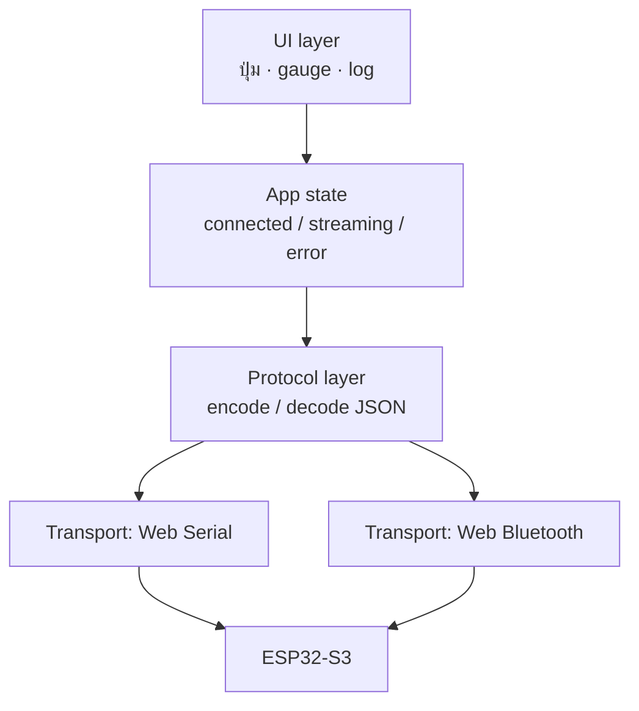

# บทที่ 2 — เข้าถึงฮาร์ดแวร์จากเบราว์เซอร์ และเครื่องมือพัฒนา

🏠 [หน้าหลัก](../README.md) · 📚 [สารบัญ ND2](README.md) · ⬅ [บทที่ 1](01-web-mobile-apps-for-iot.md) · ถัดไป ➡ [บทที่ 3](03-web-serial-dashboard.md)

> **บทนี้เรียนอะไร:** เว็บเพจคุยกับบอร์ดได้ตรง ๆ ผ่าน Web API ของเบราว์เซอร์ (Web Serial, Web Bluetooth) ต้องเลือกช่องทางอย่างไร และเตรียมเครื่องมือ Node.js + Vite+

## ทำไมสำคัญ

เมื่อก่อนเว็บแอปต้องมี server หรือโปรแกรมกลางคอยคุยกับฮาร์ดแวร์ ตอนนี้เบราว์เซอร์ตระกูล **Chromium (Chrome, Edge)** คุยกับบอร์ดได้เอง ผู้ใช้แค่เปิดเว็บ ไม่ต้องติดตั้งโปรแกรม — ใช้ได้ทั้งบนคอม แท็บเล็ต และมือถือ

## แนวคิดหลัก

### Browser hardware APIs
| API | ใช้กับ |
|---|---|
| **Web Serial** | อุปกรณ์ที่ต่อสาย USB/serial |
| **Web Bluetooth** | อุปกรณ์ BLE ไร้สาย |
| WebUSB / WebHID | อุปกรณ์ USB ทั่วไป / เมาส์ จอยเกม |
| Web Audio | ไมโครโฟน ลำโพง (ใช้แทนบอร์ดได้ถ้ายังไม่มีบอร์ด) |

- ผู้ใช้ต้อง **กดอนุญาต** ทุกครั้ง (permission)
- ต้องเป็น **secure context** — `localhost` หรือ HTTPS
- Firefox / Safari ยังไม่รองรับ Web Serial และ Web Bluetooth

### เลือกช่องทางให้เหมาะกับงาน

| | Web Serial | Web Bluetooth (BLE) | WiFi |
|---|---|---|---|
| การต่อ | มีสาย (≤ ~10 ม.) | ไร้สาย 20–50 ม. ในอาคาร | ผ่านเครือข่าย |
| ความเสถียร | สูงสุด | ปานกลาง ตีกันได้ถ้ามีหลายเครื่อง | ขึ้นกับเครือข่าย |
| ตัวอย่างงาน | 3D printer, เครื่องมือวัด, PLC ผ่าน RS-485 / Modbus RTU | smartwatch, sensor ประหยัดพลังงาน | หลายอุปกรณ์ส่งเข้า server |
| ต้องมี server | ไม่ | ไม่ | ต้องมี (เบราว์เซอร์ต่อตรงไม่ได้) |

- BLE จัดข้อมูลเป็นต้นไม้ **GATT: service → characteristic → value** · BLE ไม่เหมาะส่งเสียงต่อเนื่อง
- ถ้ามีอุปกรณ์หลายตัว (sensor, PLC, robot) ต้องมี **gateway** เป็นตัวกลาง

### โครงสร้างแอป monitor / control



แยกโค้ดเป็น layer ทำให้เปลี่ยนช่องทางได้ (Serial ↔ BLE) และให้ AI แก้ทีละส่วนได้โดยเปลือง token น้อยลง

### เครื่องมือ
- **Node.js** (LTS — ผู้สอนใช้ v24) — runtime ของ JavaScript
- **Vite+ (`vp`)** — เครื่องมือสร้างและรันโปรเจกต์เว็บ รองรับทุก framework คอมไพล์เร็ว และสร้างไฟล์ `AGENTS.md` ไว้กำกับ AI agent ให้
- **TypeScript** — JavaScript ที่มี type ช่วยให้ AI และคนอ่านโค้ดเข้าใจง่ายขึ้น

## ขั้นตอนลงมือ
```bash
node -v                 # ตรวจ Node.js
# ติดตั้ง Vite+ ตามคำสั่งบน https://viteplus.dev (Windows ใช้ PowerShell 7, Mac/Linux ใช้ terminal)
vp --version            # เห็นเวอร์ชัน = พร้อม
```
ยังไม่มีบอร์ด? เปิด Bluetooth ของคอม แล้วดูใน Device Manager (Windows) จะเห็น Bluetooth serial port · เสียบบอร์ดแล้วจะเห็นพอร์ตใหม่เพิ่มขึ้น

## ปัญหาที่พบบ่อย

| อาการ | วิธีแก้ |
|---|---|
| ปุ่ม Connect ไม่ทำงาน / ไม่มีรายการพอร์ต | ใช้ Chrome หรือ Edge ไม่ใช่ Safari / Firefox |
| API ใช้ไม่ได้ตอน deploy | ต้องเป็น HTTPS (localhost ใช้ได้เลย) |
| Linux เปิดพอร์ตไม่ได้ | เพิ่มผู้ใช้เข้า group ที่มีสิทธิ์ serial port |
| ต่อ Bluetooth หลายเครื่องในห้องแล้วตีกัน | ใช้ Serial แทนตอนทำ workshop |

## คำศัพท์ในบท
[Web Serial](../common/glossary.md#web-serial) · [Web Bluetooth](../common/glossary.md#web-bluetooth) · [GATT](../common/glossary.md#gatt) · [Secure context](../common/glossary.md#secure-context) · [Gateway](../common/glossary.md#gateway)

## แหล่งอ้างอิง
- เอกสารผู้สอน ND02 Week 02 (11 บท): [lessons/README.md](https://github.com/drsanti/kmutt-nd69/blob/main/nd2/docs/week02/lessons/README.md)
- [MDN — Web Serial API](https://developer.mozilla.org/en-US/docs/Web/API/Web_Serial_API) · [MDN — Web Bluetooth API](https://developer.mozilla.org/en-US/docs/Web/API/Web_Bluetooth_API)

---
🏠 [หน้าหลัก](../README.md) · 📚 [สารบัญ ND2](README.md) · ⬅ [บทที่ 1](01-web-mobile-apps-for-iot.md) · ถัดไป ➡ [บทที่ 3 — สร้าง Dashboard ด้วย Web Serial](03-web-serial-dashboard.md)
