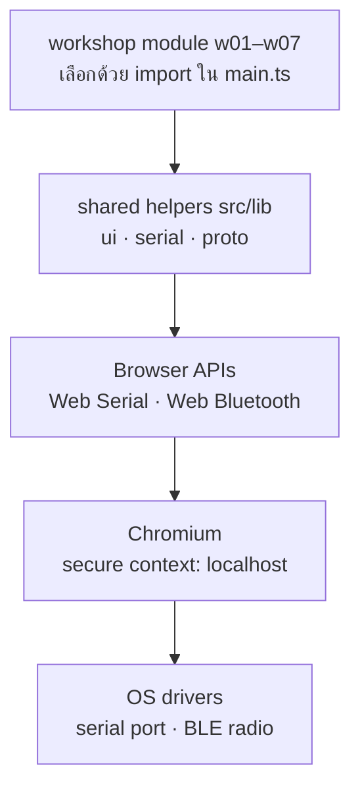
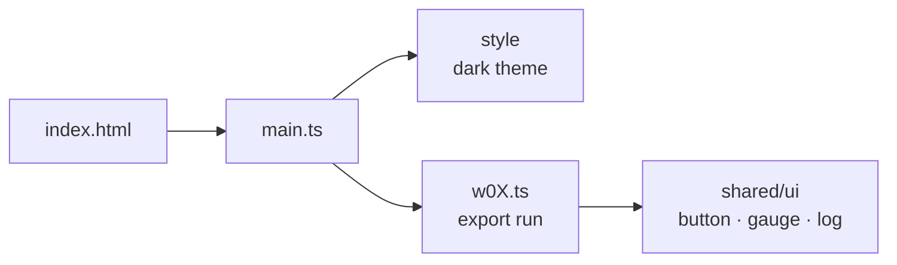
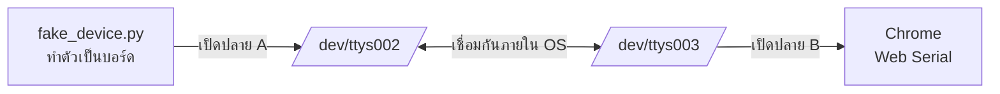
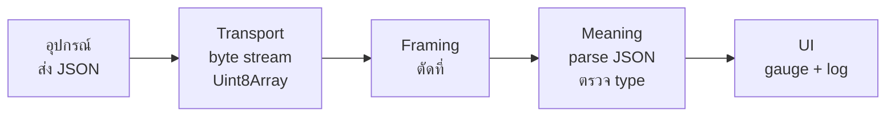
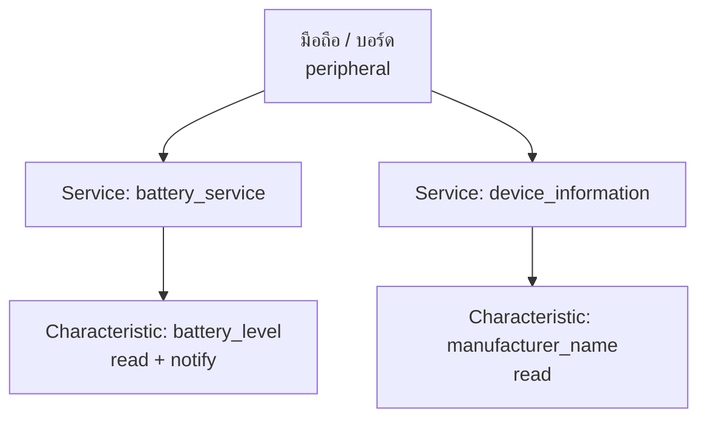
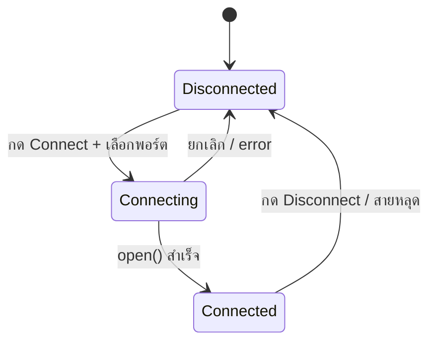

# บทที่ 3 — สร้าง Dashboard ที่คุยกับอุปกรณ์ด้วย Web Serial / Web Bluetooth

🏠 [หน้าหลัก](../README.md) · 📚 [สารบัญ ND2](README.md) · ⬅ [บทที่ 2](02-dev-tools-ai-agents.md) · ถัดไป ➡ [บทที่ 4](04-onsite-hardware-interface.md)

> **บทนี้เรียนอะไร:** สร้างเว็บแอปตัวเดียวตั้งแต่ต้นจนจบใน 7 workshop — จาก control panel ธรรมดา สู่ dashboard ที่อ่านค่าและสั่งงานอุปกรณ์ได้ ทั้งหมดรันบน laptop ด้วย **อุปกรณ์จำลอง** (Python) และใช้ **มือถือเป็นอุปกรณ์ BLE** — ยังไม่ต้องมีบอร์ด
>
> **ก่อนอ่าน:** [บทที่ 2](02-dev-tools-ai-agents.md) · **เวลา:** ~3 ชั่วโมงถ้าทำครบทุก workshop

## สารบัญบทนี้
1. [ภาพรวม 7 workshop](#1-ภาพรวม-7-workshop)
2. [ตั้งค่าเครื่องก่อนเริ่ม](#2-ตั้งค่าเครื่องก่อนเริ่ม)
3. [W01 — รันแอปตัวอย่าง](#3-w01--รันแอปตัวอย่าง)
4. [W02 — DOM และ state: สร้าง control panel](#4-w02--dom-และ-state-สร้าง-control-panel)
5. [W03 — อุปกรณ์จำลองบน serial port เสมือน](#5-w03--อุปกรณ์จำลองบน-serial-port-เสมือน)
6. [W04 — อ่าน telemetry: pipeline 4 ชั้น](#6-w04--อ่าน-telemetry-pipeline-4-ชั้น)
7. [W05 — ส่งคำสั่ง](#7-w05--ส่งคำสั่ง)
8. [W06 — Web Bluetooth กับมือถือ](#8-w06--web-bluetooth-กับมือถือ)
9. [W07 — Dashboard ครบวงจร](#9-w07--dashboard-ครบวงจร)
10. [แก้ปัญหาที่พบบ่อย](#10-แก้ปัญหาที่พบบ่อย)
11. [ใช้ AI ช่วยเขียนโค้ดให้ได้ผล](#11-ใช้-ai-ช่วยเขียนโค้ดให้ได้ผล)
12. [สรุปและแบบฝึก](#12-สรุปและแบบฝึก)

---

## 1. ภาพรวม 7 workshop

| # | Workshop | ได้อะไร |
|---|---|---|
| 01 | Getting started | ติดตั้ง Vite+ รันแอปตัวอย่าง เช็คว่าเบราว์เซอร์เข้าถึง API ได้ |
| 02 | DOM + state | ปุ่ม connect, คุม LED, gauge, log — ยังไม่มีอุปกรณ์ |
| 03 | Serial plumbing | serial port เสมือนคู่หนึ่ง + `fake_device.py` พิสูจน์ว่า byte ไหลจริง |
| 04 | Web Serial read | `requestPort` → แตกเป็นบรรทัด → แปลง JSON → gauge ขยับ |
| 05 | Web Serial write | ส่งคำสั่งไปอุปกรณ์ — monitor + control ในแอปเดียว |
| 06 | Web Bluetooth | มือถือ (nRF Connect) เป็นอุปกรณ์ BLE อ่านค่าผ่าน GATT |
| 07 | Capstone | dashboard ครบ พร้อม connect / disconnect ที่ถูกต้อง |

### โครงสร้างที่ทุก workshop ใช้ร่วมกัน

แต่ละชั้นคุยกับชั้นติดกันเท่านั้น — **Browser API คือ "ขอบเขตสิทธิ์"** ไม่ใช่แค่ฟังก์ชัน โค้ดของเราอยู่ใน sandbox และต้องขออนุญาตผ่าน API เสมอ

> ทำไม `http://localhost:5173` ใช้ได้ แต่ `http://192.168.x.x` ไม่ได้? เพราะเบราว์เซอร์ถือว่า localhost ปลอดภัย (ข้อมูลไม่ออกจากเครื่อง)

---

## 2. ตั้งค่าเครื่องก่อนเริ่ม

| ต้องมี | ใช้ใน | หมายเหตุ |
|---|---|---|
| Chrome หรือ Edge | ทุก workshop | |
| Vite+ (`vp`) | ทุก workshop | `vp` จัดการ Node ให้ด้วย |
| PowerShell 7 (Windows) | ติดตั้งและรัน | PowerShell คนละเวอร์ชันมีระดับความปลอดภัยต่างกัน ทำให้ error บ่อย — ผู้สอนให้ใช้ **v7** เป็นหลัก เลือกไฟล์ให้ตรง CPU (x64 / ARM) |
| Python ≥ 3.10 + `pyserial` | W03–05 | `pip install pyserial` |
| socat (Mac/Linux) หรือ com0com (Windows) | W03–05 | สร้าง serial port เสมือน |
| มือถือที่ติดตั้ง **nRF Connect** | W06 | ฟรี ทั้ง iOS และ Android |

**ข้อควรระวังตอนดาวน์โหลดโค้ด**
- โหลด repo ด้วย `git clone` (หรือ zip ~200 MB)
- **อย่าเก็บในโฟลเดอร์ที่ sync กับ Dropbox / Google Drive / OneDrive** — compile อาจล้มโดยไม่ทราบสาเหตุ
- แตก zip แล้วระวังโฟลเดอร์ซ้อนชื่อเดียวกันสองชั้น

แนะนำ extension **Markdown Preview Enhanced** อ่านเอกสาร (`Ctrl+Shift+V` หรือ `Ctrl+K` แล้ว `V`)

---

## 3. W01 — รันแอปตัวอย่าง

```bash
cd week03-app          # โฟลเดอร์แอปตามเอกสาร workshop
vp install             # ติดตั้ง dependency → สร้างโฟลเดอร์ node_modules
vp doctor              # ตรวจสุขภาพ toolchain
vp dev                 # รัน dev server แล้วเปิด URL ใน Chrome/Edge (Ctrl+Click)
```

**เรื่องที่มือใหม่ควรรู้**
- **`node_modules`** คือ dependency ที่ **ไม่ถูก push ขึ้น Git** ต้อง install ใหม่ทุกครั้งที่ clone มา และกินที่หลายร้อย MB ถึง 1 GB ต่อโปรเจกต์
- ควรเข้าใจ `package.json` (รายชื่อ dependency และคำสั่ง) และ lock file (ล็อกเวอร์ชันให้ทุกเครื่องตรงกัน)
- **Hot reload** — เซฟไฟล์แล้วเบราว์เซอร์อัปเดตทันที
- ถ้าพอร์ต dev server ไม่ว่าง Vite จะขยับไปพอร์ตถัดไปเอง (เช่น 5173 → 5174)

**สลับ workshop โดยแก้ `main.ts` ไฟล์เดียว** (comment / uncomment ด้วย `Ctrl+/`) ไม่ต้องสร้างโปรเจกต์ใหม่:
```ts
// import { run } from "./w01";
import { run } from "./w04";     // ← เปิดเฉพาะ workshop ที่จะลอง
run();
```

---

## 4. W02 — DOM และ state: สร้าง control panel

แอปนี้ **ไม่ใช้ React** — ทุกอย่างเป็น DOM element ระดับล่าง เพื่อให้เห็นกลไกจริง

### เส้นทางการโหลด


### พื้นฐาน DOM
```ts
// สร้าง element ด้วยโค้ด
const box = document.createElement("div");
box.textContent = "Hello";
box.style.color = "lime";
document.body.append(box);

// ผูกปุ่มที่อยู่ใน HTML: <button id="b1">+</button>
const plus = document.getElementById("b1") as HTMLButtonElement;
let count = 0;                         // ⚠️ ต้องตั้งค่าเริ่มต้น ไม่งั้นได้ NaN
plus.addEventListener("click", () => {
  count += 1;
  box.textContent = String(count);
});

// ทำงานตามเวลา
setInterval(() => console.log("tick"), 1000);
```

แนวคิดหลัก: **"เมื่อมีอะไรเกิดขึ้น ให้ทำอะไรบางอย่าง"** (event-driven) — event ที่ได้จากปุ่มจะถูก map ไปเป็นการส่งข้อมูลออก serial, สั่งไฟ, เล่นเสียง

> **2 ทางเลือก:** ใช้ AI เขียนไปเลยก็ไม่ผิด แต่ถ้าจะลงระดับ library หรือแก้ปัญหาเอง ต้องเข้าใจส่วนนี้ — และนี่คือสิ่งที่ทำให้เราต่างจากคนอื่น

CSS ผู้สอนให้ AI สร้างได้ ไม่ต้องจำ syntax แต่ควรแยกให้ออกระหว่าง **tag**, **class** (`.name`) และ **id** (`#name`)

---

## 5. W03 — อุปกรณ์จำลองบน serial port เสมือน

ยังไม่มีบอร์ด จึงสร้าง "สายเสมือน" ในเครื่อง:



- **คู่พอร์ตเสมือน (pty pair)** — byte ที่เขียนปลายหนึ่งโผล่อีกปลาย เหมือนสาย USB จริง ทั้งสองโปรแกรมแยกไม่ออกว่าไม่ใช่สายจริง
- ส่งได้ทั้งสองทางพร้อมกัน — คำสั่งจากเบราว์เซอร์ไปอุปกรณ์ใช้สายเดียวกับ telemetry
- **ข้อผิดพลาดอันดับ 1:** ให้ทั้ง script และเบราว์เซอร์เปิด **ปลายเดียวกัน** → ต้องเปิด **คนละปลาย** เสมอ

```bash
# macOS / Linux
socat -d -d pty,raw,echo=0 pty,raw,echo=0
#   ... PTY is /dev/ttys002   ← ให้ fake_device.py เปิดอันนี้
#   ... PTY is /dev/ttys003   ← ให้เบราว์เซอร์เลือกอันนี้
python fake_device.py /dev/ttys002
```
Windows ใช้ **com0com** สร้างคู่ COM (เช่น COM10 ↔ COM11)

`fake_device.py` จำลองบอร์ด ESP32 — ส่ง JSON (เช่นค่าเซนเซอร์) ทีละบรรทัด และรับคำสั่ง (สี RGB, ความถี่กะพริบ) — **ใช้รูปแบบข้อความเดียวกับบอร์ดจริงในสัปดาห์ถัดไป**

---

## 6. W04 — อ่าน telemetry: pipeline 4 ชั้น

```ts
const dev = await connect();              // requestPort + open + streams
dev.onLine((line) => {                    // ได้ทีละบรรทัด
  const t = parseTelemetry(line);         // JSON → Telemetry | null
  if (t) gauge.set(t.level);              // อัปเดต gauge
});
```

ข้อมูลไหลผ่าน 4 ชั้น แต่ละชั้นทำงานเดียว:



| ชั้น | หน้าที่ | ถ้าพังจะเห็นอะไร |
|---|---|---|
| **Transport** | ขน byte ไม่รู้เนื้อหา | ไม่มี byte เข้ามาเลย |
| **Framing** | แปลงสาย byte เป็นข้อความแยกชิ้น (ที่นี่ตัดที่ `\n` · โปรโตคอลจริงใช้ length prefix หรือ COBS) | มี byte แต่ไม่เป็นบรรทัด |
| **Meaning** | แปลง JSON ตรวจชนิดข้อความ ทิ้งขยะ | มีบรรทัดแต่ parse ได้ `null` |
| **UI** | แสดงผล ไม่แตะสาย | ได้ค่าแล้วแต่จอค้าง |

> **Debug ทีละชั้น** — ถามว่า "พังที่ชั้นไหน" เป็นนิสัยที่มีประโยชน์ที่สุดในงานสื่อสาร

### JSON lines และ back-pressure
- **JSON lines** = 1 บรรทัด 1 ข้อความ JSON เช่น `{"type":"tele","level":42}\n`
- ข้อมูลที่อ่านมาเป็น chunk ที่ตัดตรงไหนก็ได้ → ต้องเก็บ buffer รอจนเจอ `\n`
- ใช้ **Web Streams** ซึ่งรองรับ **back-pressure** (ถ้าประมวลผลไม่ทัน stream จะชะลอการอ่านเอง)

---

## 7. W05 — ส่งคำสั่ง

```ts
await dev.send({ cmd: "led", r: 255, g: 0, b: 0 });   // แปลงเป็น JSON + "\n" แล้ว write
await dev.send({ cmd: "blink", hz: 2 });
```
- ตอนนี้แอปเป็นทั้ง **monitor** (อ่าน) และ **control** (สั่ง)
- บนบอร์ดจริง คำสั่ง `R, G, B` จะถูกแปลงเป็น PWM ขับ LED แต่ละสี
- อย่าลืมว่าคำสั่งที่ส่งไป ≠ อุปกรณ์ทำแล้ว — ควรรอ event/ack ยืนยัน

---

## 8. W06 — Web Bluetooth กับมือถือ

Web Bluetooth ต้องการอุปกรณ์ BLE จริง (จำลองในเบราว์เซอร์ไม่ได้) จึงให้ **มือถือเล่นบทบอร์ด** — แอป **nRF Connect** เปิด GATT server บนมือถือ ประกาศตัวเหมือนฮาร์ดแวร์จริง



- 3 ระดับตายตัว: **service → characteristic → value** อ้างอิงด้วย **UUID** (มาตรฐานใช้ UUID สั้นที่กำหนดไว้แล้ว ของเราเองใช้ UUID 128 บิต)
- `readValue()` = ถามครั้งเดียว (poll) · `startNotifications()` = subscribe รับ push — **notification คือ pub/sub ของ BLE**
- API เหมือนกับที่จะใช้กับบอร์ดจริงทุกประการ — เรียนของจริง แค่เปลี่ยนวิทยุ

### Fallback
ถ้าปิด Bluetooth ที่คอม แอปตัวอย่างจะ **fallback ไปใช้ Serial เอง** — ออกแบบลำดับได้ (Bluetooth → Serial → USB → WiFi)
> **ควรมี fallback เสมอ** อย่างน้อยเป็น fallback ที่แค่ log error บอกผู้ใช้

เมื่อเปิด Bluetooth จะเห็นอุปกรณ์รอบตัวจำนวนมาก บอร์ดในคลาสชื่อขึ้นต้นด้วย **`RB` + เลข 4 หลัก**

---

## 9. W07 — Dashboard ครบวงจร

เพิ่ม lifecycle ที่ workshop ก่อน ๆ ข้ามไป:

```ts
const connectBtn = button("Connect", async () => {
  dev = await connect();
  status.set(true);
  connectBtn.disabled = true;          // เชื่อมได้ทีละตัว
  disconnectBtn.disabled = false;
  dev.onLine(/* telemetry → gauge + log */);
});

const disconnectBtn = button("Disconnect", async () => {
  await dev?.close();                  // คืนพอร์ตให้เรียบร้อย
  dev = null;
  status.set(false);
  connectBtn.disabled = false;
  disconnectBtn.disabled = true;
});
```


- พอร์ตเป็น **ทรัพยากรที่มีเจ้าของได้คนเดียว** แต่ละสถานะจึงมีกฎว่าปุ่มไหนกดได้
- ทุกการเปลี่ยนสถานะ = `await` หนึ่งครั้ง (`connect()` รอ picker + open, `close()` รอคืนพอร์ต)
- นี่คือโครงของแอปที่จะใช้กับบอร์ดจริงในบทที่ 4

---

## 10. แก้ปัญหาที่พบบ่อย

| อาการ | สาเหตุ / วิธีแก้ |
|---|---|
| ติดตั้ง Vite+ แล้ว error เขียนไฟล์ไม่ได้ | รัน PowerShell แบบ administrator (Mac/Linux ใช้ `sudo`) |
| `vp` หาไม่เจอใน terminal ของ IDE ทั้งที่ติดตั้งแล้ว | ปิด-เปิด IDE ใหม่ · ตรวจ PATH ในโปรไฟล์ PowerShell |
| compile ไม่ผ่านผิดปกติ | โปรเจกต์อยู่ในโฟลเดอร์ที่ sync กับ cloud drive |
| clone มาแล้วรันไม่ได้ | ยังไม่ได้ `vp install` (ไม่มี `node_modules`) |
| ปุ่ม Connect ไม่มีอะไรเกิดขึ้น | ใช้ Firefox/Safari → เปลี่ยนเป็น Chrome/Edge |
| เลือกพอร์ตแล้วเปิดไม่ได้ | ปลายพอร์ตถูกโปรแกรมอื่นเปิดอยู่ / script กับเบราว์เซอร์เปิดปลายเดียวกัน |
| มี byte แต่ gauge ไม่ขยับ | debug ทีละชั้น: framing หรือ meaning ผิด |
| AI agent เปิด dev server ค้างไว้ ปิดไม่ได้ | เจอบ่อยบน Windows — ใช้ **Process Explorer** (Sysinternals) ดูและปิด process |

---

## 11. ใช้ AI ช่วยเขียนโค้ดให้ได้ผล

ตัวอย่างจากคลาส:
- ตั้ง id ปุ่มให้ชัด (`+`, `−`) แล้ว **AI autocomplete** เติมโค้ด counter ให้ครบด้วยการกด Tab ไม่กี่ครั้ง โดยไม่เปลือง token ของ LLM
- แต่ AI ไม่รู้ว่าค่าเริ่มต้นเป็นข้อความ "Hello World" จึงบวกออกมาเป็น **NaN** — ถ้าไม่รู้พื้นฐานต้องไปถาม AI ต่อ เปลืองทั้ง token และเวลา (แก้แค่ตั้งค่าเริ่มต้นเป็น 0)
- การให้ AI แก้ error เล็ก ๆ บางครั้งใช้เวลานานกว่าการแก้เองในไม่กี่วินาที → **"อะไรที่เก็บเป็นความสามารถของเราได้ ก็เก็บเถอะ"**
- ดูสิ่งที่ agent แก้จาก **diff** (เขียว = เพิ่ม, แดง = ลบ) แล้ว accept ทีละส่วน
- **ทำ context ให้ชัด** (ออกแบบ UI ให้เสร็จ, มีไฟล์ Markdown อธิบาย) แล้ว AI จะช่วยได้มาก — จึงช่วยลดการใช้ token ลงได้มาก
- AI วาด **ASCII diagram** ได้แล้ว เขียนเป็น skill ให้วาดตามสไตล์ที่ชอบได้

---

## 12. สรุปและแบบฝึก

### สรุป
- พัฒนาแอปฮาร์ดแวร์ได้โดยไม่มีบอร์ด: serial port เสมือน + `fake_device.py` และมือถือเป็นอุปกรณ์ BLE
- อ่านข้อมูลผ่าน 4 ชั้น: transport → framing → meaning → UI และ debug ทีละชั้น
- แอปจริงต้องมี connection lifecycle และ fallback

### แบบฝึก
1. ทำ W03 ให้ byte ไหลได้ แล้วจงใจให้ script กับเบราว์เซอร์เปิดปลายเดียวกัน — สังเกตว่าเกิดอะไร
2. แก้ `fake_device.py` ให้ส่งค่าอุณหภูมิเพิ่ม แล้วเพิ่ม gauge ตัวที่สองใน W04
3. ใน W07 เพิ่มการ auto-reconnect เมื่อสายหลุด และ refresh ค่าทั้งหมดหลังต่อใหม่

## คำศัพท์ในบท
[DOM](../common/glossary.md#dom) · [JSON lines](../common/glossary.md#json-lines) · [Web Serial](../common/glossary.md#web-serial) · [GATT](../common/glossary.md#gatt) · [Fallback](../common/glossary.md#fallback) · [Secure context](../common/glossary.md#secure-context)

## แหล่งอ้างอิง
- เอกสารผู้สอน ND02 Week 03: [workshops/README.md](https://github.com/drsanti/kmutt-nd69/blob/main/nd2/docs/week03/workshops/README.md) —
  [01](https://github.com/drsanti/kmutt-nd69/blob/main/nd2/docs/week03/workshops/01-getting-started.md) ·
  [03](https://github.com/drsanti/kmutt-nd69/blob/main/nd2/docs/week03/workshops/03-serial-plumbing.md) ·
  [04](https://github.com/drsanti/kmutt-nd69/blob/main/nd2/docs/week03/workshops/04-serial-read.md) ·
  [06](https://github.com/drsanti/kmutt-nd69/blob/main/nd2/docs/week03/workshops/06-web-bluetooth.md) ·
  [07](https://github.com/drsanti/kmutt-nd69/blob/main/nd2/docs/week03/workshops/07-dashboard.md)
- การบรรยาย Online ND2 Week 03 (24 ต.ค. 2026)
- [nRF Connect for Mobile](https://www.nordicsemi.com/Products/Development-tools/nRF-Connect-for-mobile)

---
🏠 [หน้าหลัก](../README.md) · 📚 [สารบัญ ND2](README.md) · ⬅ [บทที่ 2](02-dev-tools-ai-agents.md) · ถัดไป ➡ [บทที่ 4 — Workshop Onsite](04-onsite-hardware-interface.md)
