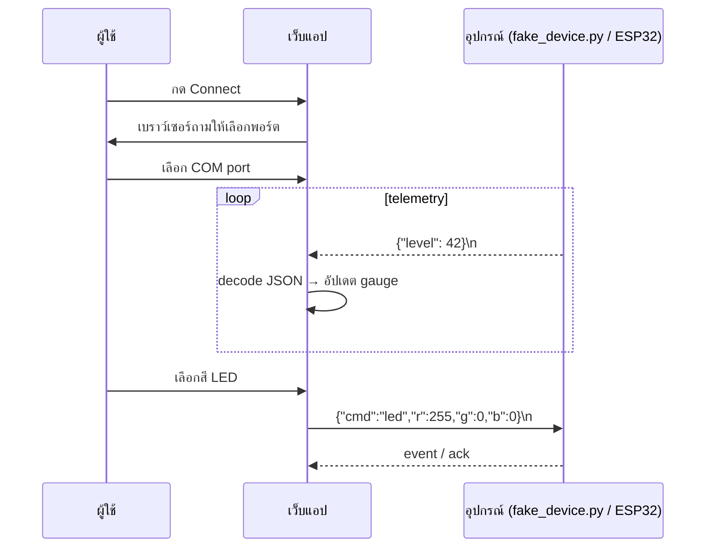

# บทที่ 3 — สร้าง Dashboard ที่คุยกับอุปกรณ์ด้วย Web Serial / Web Bluetooth

🏠 [หน้าหลัก](../README.md) · 📚 [สารบัญ ND2](README.md) · ⬅ [บทที่ 2](02-dev-tools-ai-agents.md) · ถัดไป ➡ [บทที่ 4](04-onsite-hardware-interface.md)

> **บทนี้เรียนอะไร:** สร้างเว็บแอปตัวเดียวตั้งแต่ต้นจนจบใน 7 workshop — จาก control panel ธรรมดา สู่ dashboard ที่อ่านค่าและสั่งงานอุปกรณ์ได้ โดยใช้อุปกรณ์จำลอง (ยังไม่ต้องมีบอร์ด)

## ทำไมสำคัญ

เป็นแกนของงาน monitor / control ทุกชนิด: อ่านค่าจากอุปกรณ์มาแสดงแบบ real-time และส่งคำสั่งกลับ · การเขียนด้วย **TypeScript + DOM ล้วน (ไม่ใช้ React)** ทำให้เห็นกลไกจริงก่อนไปใช้ framework

## แนวคิดหลัก

### ลำดับ 7 workshop
| # | Workshop | ได้อะไร |
|---|---|---|
| 01 | Getting started | ติดตั้ง Vite+ รันแอปตัวอย่าง เช็คว่าเบราว์เซอร์รองรับ API |
| 02 | DOM + state | ปุ่ม connect, คุม LED, gauge, log — ยังไม่ต้องมีอุปกรณ์ |
| 03 | Serial plumbing | คู่ serial port เสมือน + `fake_device.py` พิสูจน์ว่าข้อมูลไหลจริง |
| 04 | Web Serial read | `requestPort` → อ่าน JSON ทีละบรรทัด → gauge ขยับตามจริง |
| 05 | Web Serial write | ส่งคำสั่งไปอุปกรณ์ — monitor + control ในแอปเดียว |
| 06 | Web Bluetooth | ใช้มือถือ (แอป nRF Connect) เป็นอุปกรณ์ BLE อ่านค่าผ่าน GATT |
| 07 | Capstone | dashboard ครบ พร้อมจัดการ connect / disconnect |

### ข้อมูลไหลอย่างไร



- โปรโตคอลเป็น **JSON ทีละบรรทัด (JSON lines)** อ่านด้วย Web Streams ซึ่งรองรับ back-pressure (ข้อมูลมาเร็วกว่าที่ประมวลผลทัน)
- ควรมี **fallback** เสมอ เช่น ปิด Bluetooth อยู่ให้แอปลอง Serial แทน อย่างน้อยต้อง log error

### พื้นฐาน DOM ที่ต้องเข้าใจ
```ts
const btn = document.getElementById("b1") as HTMLButtonElement;
let count = 0;                       // ต้องตั้งค่าเริ่มต้น ไม่งั้นได้ NaN
btn.addEventListener("click", () => {
  count += 1;
  label.textContent = String(count);
});
```
เมื่อ context ชัด (ตั้ง id ปุ่มดี ๆ, มีเอกสารอธิบาย) AI autocomplete จะช่วยเติมโค้ดได้เกือบหมดโดยไม่เปลือง token ของ LLM

## ขั้นตอนลงมือ
**ต้องมี:** Chrome หรือ Edge · Vite+ · Python ≥ 3.10 + `pyserial` · socat (Mac/Linux) หรือ com0com (Windows) · มือถือที่มี nRF Connect (workshop 06)

ดาวน์โหลดแอปตัวอย่างตามขั้นตอนใน [01-getting-started.md](https://github.com/drsanti/kmutt-nd69/blob/main/nd2/docs/week03/workshops/01-getting-started.md) แล้ว `cd` เข้าโฟลเดอร์แอป
```bash
vp install          # ติดตั้ง dependency (node_modules)
vp doctor           # ตรวจสุขภาพ toolchain
vp dev              # รัน dev server แล้วเปิด URL ใน Chrome/Edge
```
สลับตัวอย่างโดยแก้ `main.ts` ไฟล์เดียว (comment / uncomment) ไม่ต้องสร้างโปรเจกต์ใหม่ เพราะ `node_modules` แต่ละโปรเจกต์กินที่หลายร้อย MB

## ปัญหาที่พบบ่อย

| อาการ | วิธีแก้ |
|---|---|
| `vp` หาไม่เจอใน terminal ของ IDE | ปิด-เปิด IDE ใหม่ / ตรวจ PATH ในโปรไฟล์ PowerShell |
| Windows ติดตั้งแล้ว error | อัปเดตเป็น **PowerShell 7** และเลือกใน terminal dropdown |
| compile ไม่ผ่านแบบแปลก ๆ | อย่าเก็บโปรเจกต์ในโฟลเดอร์ที่ sync กับ Dropbox / Google Drive |
| พอร์ต dev server ชน | Vite จะขยับไปพอร์ตถัดไปเอง / ปิด process ค้าง (ดูด้วย Process Explorer) |
| clone มาแล้วรันไม่ได้ | `node_modules` ไม่ถูก push ขึ้น Git ต้อง `vp install` ใหม่ทุกครั้ง |

## คำศัพท์ในบท
[DOM](../common/glossary.md#dom) · [JSON lines](../common/glossary.md#json-lines) · [Web Serial](../common/glossary.md#web-serial) · [GATT](../common/glossary.md#gatt) · [Fallback](../common/glossary.md#fallback)

## แหล่งอ้างอิง
- เอกสารผู้สอน ND02 Week 03: [workshops/README.md](https://github.com/drsanti/kmutt-nd69/blob/main/nd2/docs/week03/workshops/README.md)

---
🏠 [หน้าหลัก](../README.md) · 📚 [สารบัญ ND2](README.md) · ⬅ [บทที่ 2](02-dev-tools-ai-agents.md) · ถัดไป ➡ [บทที่ 4 — Workshop Onsite](04-onsite-hardware-interface.md)
