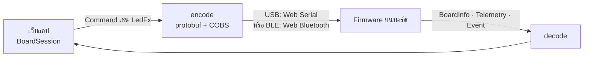
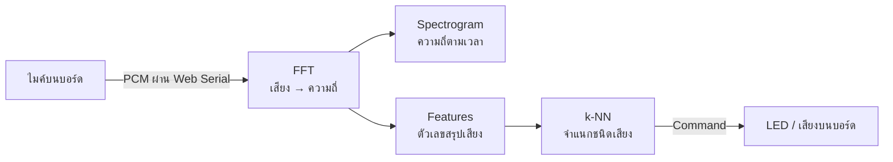

# บทที่ 4 — Workshop Onsite: คุยกับบอร์ดจริงจากเบราว์เซอร์ด้วย hardware-interface-workshop

🏠 [หน้าหลัก](../README.md) · 📚 [สารบัญ ND2](README.md) · ⬅ [บทที่ 3](03-web-serial-dashboard.md) · ถัดไป ➡ [Git, GitHub และ Markdown](../common/git-github-markdown.md)

> **บทนี้เรียนอะไร:** flash firmware สำเร็จรูปลงบอร์ด ESP32-S3 (ไม่ต้องติดตั้ง ESP-IDF) แล้วเขียนเว็บแอปคุมอุปกรณ์บนบอร์ดจริง — LED, ลำโพง, ไมค์, ปุ่ม, แบต, IMU, นาฬิกา — ผ่าน USB หรือ Bluetooth ทั้งแบบ HTML/TS ล้วน (21 แบบฝึก) และแบบ React (35 แบบฝึก) ไปจนถึงวิเคราะห์เสียงและจำแนกเสียงบนเว็บ
>
> **ก่อนอ่าน:** [บทที่ 3](03-web-serial-dashboard.md) · **เวลา:** Workshop เต็มวัน (09:00–16:00)

## สารบัญบทนี้
1. [สิ่งที่ต้องเตรียม](#1-สิ่งที่ต้องเตรียม)
2. [บอร์ด 2 รุ่น มีอะไรต่างกัน](#2-บอร์ด-2-รุ่น-มีอะไรต่างกัน)
3. [โครงสร้าง repo และ 2 track](#3-โครงสร้าง-repo-และ-2-track)
4. [ขั้นที่ 1: flash firmware สำเร็จรูป](#4-ขั้นที่-1-flash-firmware-สำเร็จรูป)
5. [ขั้นที่ 2: รัน track ที่เลือก](#5-ขั้นที่-2-รัน-track-ที่เลือก)
6. [ข้อความระหว่างแอปกับบอร์ด](#6-ข้อความระหว่างแอปกับบอร์ด)
7. [Track vanilla: ex00–20](#7-track-vanilla-ex0020)
8. [Track React: ex00–34](#8-track-react-ex0034)
9. [แก้ปัญหาที่พบบ่อย](#9-แก้ปัญหาที่พบบ่อย)
10. [สรุปและแบบฝึกต่อยอด](#10-สรุปและแบบฝึกต่อยอด)

---

## 1. สิ่งที่ต้องเตรียม

| ต้องมี | หมายเหตุ |
|---|---|
| Notebook + ที่ชาร์จ + สาย USB รับส่งข้อมูล | |
| **Chrome หรือ Edge** | Web Serial + Web Bluetooth |
| [Node.js](https://nodejs.org/en) 20+ และ [Vite+](https://viteplus.dev/) (`vp`) | |
| Python + `esptool` | ใช้ flash อย่างเดียว: `pip install --user esptool` |
| บอร์ด `es3c28p` หรือ `ws28p` | |

> **ND2 ไม่ต้องติดตั้ง ESP-IDF** — ใช้ไฟล์ firmware ที่ build ไว้แล้ว

---

## 2. บอร์ด 2 รุ่น มีอะไรต่างกัน

| ความสามารถ | `es3c28p` | `ws28p` | หมายเหตุ |
|---|---|---|---|
| RGB LED | ✅ | ❌ | แบบฝึก LED ต้องใช้ es3c28p |
| ไมโครโฟน | ✅ | ❌ | ระดับเสียงส่งได้ทั้ง USB/BLE · **เสียงดิบ (PCM) ส่งได้เฉพาะ Web Serial** |
| IMU (การเคลื่อนไหว) | ❌ | ✅ | แบบฝึก motion ต้องใช้ ws28p |
| RTC (นาฬิกา) | ❌ | ✅ | |
| ลำโพง | ✅ | ✅ | |
| ปุ่ม / touch | ✅ | ✅ | |
| แบตเตอรี่ | ✅ | ✅ | อ่านแรงดัน |
| **Caps mask** | `0x33` | `0x3c` | ค่าที่โค้ดใช้เปิดฟีเจอร์ให้ตรงบอร์ด |

### Caps mask คืออะไร
บอร์ดบอกความสามารถของตัวเองเป็นตัวเลขที่แต่ละบิตแทนอุปกรณ์หนึ่งชนิด แอปอ่านค่านี้แล้ว **เปิดเฉพาะแบบฝึกที่บอร์ดรองรับ** (capability gating) — หลักการสำคัญ: **อย่าเดาว่าบอร์ดมีทุกอย่าง**

```ts
if (boardHas(CAP.LED)) showLedPanel();
if (boardHas(CAP.IMU)) showMotionPanel();
```

---

## 3. โครงสร้าง repo และ 2 track

```text
hardware-interface-workshop/
├── firmware-prebuilt/   ← ไฟล์ firmware สำเร็จรูป (es3c28p, ws28p) + เครื่องมือ rb
├── web-app/             ← track เริ่มต้น: HTML / CSS / TypeScript + sdk/  (พอร์ต 5174)
└── demos/               ← track React: แบบฝึกกับบอร์ด                      (พอร์ต 5173)
```

| | **web-app (vanilla)** | **demos (React)** |
|---|---|---|
| เหมาะกับ | มือใหม่ / อยากเห็นกลไกจริง | คนที่รู้ React หรืออยากทำ UI สวย |
| เทคโนโลยี | HTML, CSS, TypeScript ล้วน + `@sdk` | React 19, TypeScript, Tailwind CSS, Zustand (state), protobufjs, react-router |
| แบบฝึก | ex00–20 | ex00–34 |

ทั้งสอง track ใช้ firmware ชุดเดียวกัน — flash ครั้งเดียวแล้วเลือก track ได้

---

## 4. ขั้นที่ 1: flash firmware สำเร็จรูป

### Windows (PowerShell)
```powershell
git clone https://github.com/drsanti/hardware-interface-workshop.git
cd hardware-interface-workshop\firmware-prebuilt

Set-ExecutionPolicy -Scope Process -ExecutionPolicy Bypass   # ครั้งเดียวต่อหน้าต่าง
python -m pip install --user esptool
.\rb doctor                                 # ตรวจเครื่องมือ + หาพอร์ต
.\rb config --port COM5 --board es3c28p     # พอร์ตและรุ่นบอร์ดของเรา
.\rb flash-bin                              # เขียน firmware ลงบอร์ด
```

### macOS / Linux
```bash
cd hardware-interface-workshop/firmware-prebuilt
python3 -m pip install --user esptool
chmod +x rbdev/mac/rbdev rbdev/linux/rbdev rb
./rb config --port /dev/cu.usbmodemXXXX --board es3c28p   # Linux: /dev/ttyACM0
./rb flash-bin
```

| OS | ชื่อพอร์ตทั่วไป |
|---|---|
| Windows | `COM3`, `COM17` … (Device Manager → Ports) |
| macOS | `/dev/cu.usbmodem*` หรือ `/dev/cu.usbserial*` |
| Linux | `/dev/ttyACM0` หรือ `/dev/ttyUSB0` |

> ปิด serial monitor ทุกตัวก่อน flash หรือก่อนเปิด Web Serial

---

## 5. ขั้นที่ 2: รัน track ที่เลือก

```bash
# Track vanilla
cd web-app
vp install
vp dev              # เปิด http://localhost:5174/

# Track React
cd demos
vp install
vp dev              # เปิด http://localhost:5173/
```
ในหน้าเว็บกด **Connect** → เลือกพอร์ต (USB) หรืออุปกรณ์ Bluetooth ชื่อ **`RB` + เลข 4 หลัก** → แอปอ่าน BoardInfo แล้วเปิดแบบฝึกที่รองรับ

---

## 6. ข้อความระหว่างแอปกับบอร์ด

ในบทที่ 3 ใช้ JSON ทีละบรรทัดเพื่อให้อ่านง่าย บอร์ดจริงใช้รูปแบบที่กะทัดรัดและแม่นยำกว่า:



| คำ | ความหมาย |
|---|---|
| **protobuf** | รูปแบบข้อมูลแบบ binary ที่มี **schema** ตกลงกันไว้ล่วงหน้า — เล็กกว่า JSON และตรวจชนิดข้อมูลได้ |
| **COBS** | วิธีห่อข้อมูล binary ให้รู้ว่าข้อความหนึ่งจบตรงไหน (ทำหน้าที่เดียวกับ `\n` ใน JSON lines) |
| **BoardSession** | ตัวจัดการการเชื่อมต่อใน SDK — `connectSerial()` / `connectBle()` |
| **BoardInfo** | ข้อความแรกที่บอร์ดส่ง บอกรุ่น firmware และ caps |
| **writeAcked** | ส่งคำสั่งแล้ว **รอบอร์ดตอบรับ (ack)** — รู้แน่ว่าคำสั่งถึงและถูกใช้ |

- ข้อความชุดเดียวกันส่งได้ทั้งทาง USB และ BLE — เปลี่ยนช่องทางไม่ต้องแก้ตรรกะของแอป (ตรงกับแนวคิด transport layer ในบทที่ 2)
- **ไม่ต้องใช้ host SDK ของ robotos** — เว็บคุยกับบอร์ดเองทั้งหมด

---

## 7. Track vanilla: ex00–20

### ส่วน A — พื้นฐานเว็บ (ยังไม่ใช้บอร์ด)
| แบบฝึก | เรียนอะไร |
|---|---|
| ex00 Hello | โครงหน้าเว็บ: HTML (โครงสร้าง), CSS (หน้าตา), TS (คลิก) |
| ex01 Dynamic elements | สร้าง/ลบ UI ด้วย `createElement` / `append` / `remove` |
| ex02 Dynamic style | `setInterval` เปลี่ยน `element.style` |
| ex03 Form events | `input` / `change` / `submit` + `preventDefault` |
| ex04 Keyboard + pointer | `keydown`, `pointerdown` |
| ex05 SVG draw | วาดกราฟเส้นด้วย SVG `polyline` |
| ex06 Canvas draw | วาดด้วย Canvas 2D `lineTo` / `stroke` |
| ex07 Web Audio mic | ไมค์ของคอม: `getUserMedia` + `AnalyserNode` |
| ex08 Web Audio speaker | สร้างเสียงด้วย `OscillatorNode` |
| ex09 Web video camera | กล้อง: `getUserMedia` + `<video>` |

### ส่วน B — คุยกับบอร์ด
| แบบฝึก | เรียนอะไร |
|---|---|
| ex10 Web Serial | `BoardSession.connectSerial` + อ่าน BoardInfo |
| ex11 Web Bluetooth | `BoardSession.connectBle` + BoardInfo |
| ex12–14 LED | ส่ง `LedFx` แบบรอ ack, คำสั่งคลื่น (`WaveCmd`), slider สี |
| ex15–17 SFX | เล่นเสียงบนลำโพงบอร์ด ปรับความดัง ปรับพารามิเตอร์เสียง |
| ex18–20 Mic | เปิดไมค์บนบอร์ด, VU meter, รูปคลื่นเสียง (เฉพาะ USB) |

---

## 8. Track React: ex00–34

| ช่วง | แบบฝึก | เนื้อหา |
|---|---|---|
| **เริ่มต้น** | ex00–03 | ตรวจเบราว์เซอร์, อุ่นเครื่อง React (props / state / hook), เชื่อม/ตัด USB-BLE, ฟังข้อความแนะนำตัวของบอร์ด |
| **LED** | ex04–05 | ส่งสี RGB, LED studio พร้อม preset การเคลื่อนไหว |
| **เสียง (ลำโพง)** | ex06–10 | เล่น preset, ความดัง/วนซ้ำ, ปรับพารามิเตอร์สด, อัปโหลดทำนองของเราเอง, speaker studio |
| **ไมค์** | ex11–15 | ระดับเสียงเป็นตัวเลข, VU meter, gain/mute, รูปคลื่น PCM, mic studio |
| **ปุ่ม** | ex16–17 | ฟัง KeyEvent, กดสั้น → เสียง beep (+ LED) |
| **แบต** | ex18–19 | แรงดัน/เปอร์เซ็นต์, เตือนแบตต่ำ |
| **IMU / RTC** | ex20–22 | แท่งความเร่ง, เขย่าแล้ว beep, ซิงก์เวลากับนาฬิกาบอร์ด (ws28p) |
| **รวมหลายอย่าง** | ex23–25 | LED ตอบสนองเสียง, "เครื่องใช้ไฟฟ้า" ปุ่ม+LED+เสียง, ตาราง caps / สลับบอร์ด |
| **วิเคราะห์เสียง** | ex26–31 | FFT สด, spectrogram, อัด/เล่น WAV, ตัวกรอง biquad, feature ของเสียง, หาระดับเสียงดนตรี (YIN pitch) |
| **AI เสียง** | ex32–34 | **จำแนกเสียงด้วย k-NN** บนเว็บ, ผลจำแนก → สั่ง LED/เสียงบนบอร์ด, เครื่องใช้ไฟฟ้าที่ฟังเสียง + ปุ่ม + แบต |

### เส้นทางจากเสียงสู่การตัดสินใจ (ex26 → ex33)


นี่คือแนวคิดเดียวกับ "จากเสียงสู่โมเดล AI" ในบทที่ 1 — ฝึกบนเว็บก่อน แล้วต่อยอดเป็นโมเดลที่รันบนบอร์ดเอง (Edge AI) ใน Workshop ครั้งที่ 2

> **FFT (Fast Fourier Transform)** = แปลงสัญญาณเสียงตามเวลาให้เป็น "มีความถี่อะไรบ้าง ดังเท่าไร" · **k-NN** = จำแนกโดยดูว่าเสียงใหม่คล้ายตัวอย่างที่เก็บไว้กลุ่มไหนมากที่สุด

---

## 9. แก้ปัญหาที่พบบ่อย

| อาการ | วิธีแก้ |
|---|---|
| Windows: script `.ps1` ถูกบล็อก | `Set-ExecutionPolicy -Scope Process -ExecutionPolicy Bypass` |
| flash ไม่ได้ | ปิด serial monitor / แท็บเว็บที่ต่อพอร์ตอยู่ · ตรวจด้วย `rb doctor` |
| แบบฝึก LED ไม่มีผล | บอร์ด ws28p ไม่มี LED — ดู caps / BoardInfo |
| รูปคลื่นเสียงไม่ขึ้นตอนใช้ Bluetooth | PCM ส่งได้เฉพาะ Web Serial |
| Bluetooth เห็นอุปกรณ์เยอะมาก | มองหาชื่อขึ้นต้นด้วย `RB` |
| macOS บล็อก `rbdev` | คลิกขวา → Open หนึ่งครั้ง |
| Linux เปิดพอร์ตไม่ได้ | เพิ่มผู้ใช้เข้า group `dialout` |

---

## 10. สรุปและแบบฝึกต่อยอด

### สรุป
- flash firmware สำเร็จรูปด้วย `rb flash-bin` แล้วเลือก track vanilla (5174) หรือ React (5173)
- บอร์ดสื่อสารด้วย protobuf + COBS ผ่าน USB หรือ BLE · เริ่มจากอ่าน BoardInfo แล้วเปิดเฉพาะฟีเจอร์ที่รองรับ
- แบบฝึกไล่จากพื้นฐานเว็บ → LED/เสียง/ไมค์/ปุ่ม/แบต/IMU → วิเคราะห์เสียง → จำแนกเสียงแล้วสั่งบอร์ด

### แบบฝึกต่อยอด
1. ทำ ex10 (Serial) และ ex11 (BLE) แล้วเทียบว่าโค้ดต่างกันตรงไหนบ้าง
2. ใช้ ex24 เป็นต้นแบบ ออกแบบ "เครื่องใช้ไฟฟ้า" ของตัวเอง เช่น กดปุ่มค้าง 2 วินาทีแล้ว LED เปลี่ยนโหมด
3. ใน ex32 เก็บตัวอย่างเสียง 3 แบบ (ปรบมือ, เคาะโต๊ะ, ผิวปาก) แล้วดูว่าจำแนกได้แม่นแค่ไหน — ถ้าไม่แม่น ปัญหาอยู่ที่ข้อมูลหรือโมเดล?

## คำศัพท์ในบท
[Web Serial](../common/glossary.md#web-serial) · [Web Bluetooth](../common/glossary.md#web-bluetooth) · [Capability gating](../common/glossary.md#capability-gating) · [IMU](../common/glossary.md#imu) · [Flash](../common/glossary.md#flash-firmware) · [Fallback](../common/glossary.md#fallback)

## แหล่งอ้างอิง
- repo workshop: [hardware-interface-workshop](https://github.com/drsanti/hardware-interface-workshop) · [web-app/README.md](https://github.com/drsanti/hardware-interface-workshop/blob/main/web-app/README.md) · [demos/README.md](https://github.com/drsanti/hardware-interface-workshop/blob/main/demos/README.md) · [firmware-prebuilt/README.md](https://github.com/drsanti/hardware-interface-workshop/blob/main/firmware-prebuilt/README.md)
- Workshop Onsite ครั้งที่ 1 ND2 (1 พ.ย. 2026) และสไลด์ประกอบ

---
🏠 [หน้าหลัก](../README.md) · 📚 [สารบัญ ND2](README.md) · ⬅ [บทที่ 3](03-web-serial-dashboard.md) · ถัดไป ➡ [บทที่ 5 — Git, GitHub และ Markdown](../common/git-github-markdown.md)
