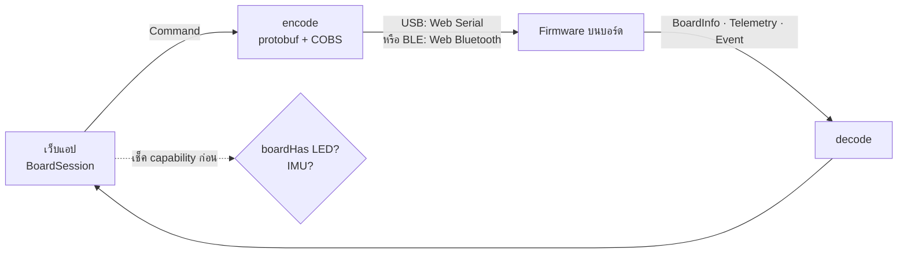

# บทที่ 4 — Workshop Onsite: คุยกับบอร์ดจริงจากเบราว์เซอร์

🏠 [หน้าหลัก](../README.md) · 📚 [สารบัญ ND2](README.md) · ⬅ [บทที่ 3](03-web-serial-dashboard.md) · ถัดไป ➡ [Git, GitHub และ Markdown](../common/git-github-markdown.md)

> **บทนี้เรียนอะไร:** flash firmware สำเร็จรูปลงบอร์ด ESP32-S3 แล้วเขียนเว็บแอปคุมอุปกรณ์บนบอร์ดจริง (LED, เสียง, ไมค์, ปุ่ม, แบต, IMU) ผ่าน USB หรือ Bluetooth — ทั้งแบบ HTML/TS ล้วน และแบบ React

## ทำไมสำคัญ

เป็นการรวมทุกอย่างจากบทที่ 2–3 เข้ากับฮาร์ดแวร์จริง และฝึกนิสัยสำคัญของงานที่ต้องรองรับอุปกรณ์หลายรุ่น: **ถามความสามารถของบอร์ดก่อนใช้ อย่าเดาว่ามีทุกอย่าง**

## แนวคิดหลัก

### โครงสร้าง repo workshop
| ส่วน | เนื้อหา | พอร์ต dev server |
|---|---|---|
| `web-app/` | ระดับเริ่มต้น HTML / CSS / TypeScript + `sdk/` (ex00–20) | 5174 |
| `demos/` | React labs: Serial/BLE → LED, เสียง, ไมค์, IMU ฯลฯ (ex00–34) | 5173 |
| `firmware-prebuilt/` | ไฟล์ firmware สำเร็จรูปของบอร์ดแต่ละรุ่น | — |

- **ND2 ไม่ต้องติดตั้ง ESP-IDF** — flash ไฟล์สำเร็จรูปด้วย `rbdev flash-bin`
- บอร์ด 2 รุ่น: **es3c28p** (LED + ไมค์) และ **ws28p** (IMU + RTC)

### ข้อความระหว่างแอปกับบอร์ด



- ข้อความเดียวกันส่งได้ทั้งทาง USB และ BLE
- **protobuf** = รูปแบบข้อมูลแบบ binary ที่มีโครงสร้าง (schema) ตกลงกันไว้ · **COBS** = วิธีห่อข้อมูลให้รู้ว่าข้อความหนึ่งจบตรงไหน
- เริ่มต้นแอปอ่าน **`BoardInfo`** เพื่อรู้ว่าบอร์ดมีอะไรบ้าง แล้วเปิดเฉพาะฟีเจอร์ที่รองรับ (capability gating)

## ขั้นตอนลงมือ
**สิ่งที่ต้องเตรียม:** Notebook + ที่ชาร์จ · สาย USB ที่รับส่งข้อมูลได้ · Chrome/Edge · [Node.js](https://nodejs.org/en) · [Vite+](https://viteplus.dev/)

```bash
git clone https://github.com/drsanti/hardware-interface-workshop.git
cd hardware-interface-workshop
# 1) flash firmware ครั้งเดียว — ทำตามหัวข้อ "Flash firmware" ใน README ของ repo (rbdev flash-bin)
# 2) เลือก track
cd web-app && vp install && vp dev      # เปิด http://localhost:5174
# หรือ
cd demos && vp install && vp dev        # เปิด http://localhost:5173
```
ในหน้าเว็บกด Connect → เลือกพอร์ต (หรืออุปกรณ์ Bluetooth ชื่อ `RB` + เลข 4 หลัก) → ลองสั่ง LED / เล่นเสียง / ดูค่า IMU

## ปัญหาที่พบบ่อย

| อาการ | วิธีแก้ |
|---|---|
| แบบฝึก LED ไม่มีผลกับบอร์ด | บอร์ด ws28p ไม่มี LED — ตรวจ `BoardInfo` ก่อน |
| เลือกพอร์ตไม่ได้เพราะถูกใช้อยู่ | ปิดโปรแกรมอื่นที่เปิดพอร์ตเดียวกัน (serial monitor, แท็บเว็บอื่น) |
| Bluetooth เห็นอุปกรณ์เยอะมาก | มองหาชื่อขึ้นต้นด้วย `RB` |

## คำศัพท์ในบท
[Web Serial](../common/glossary.md#web-serial) · [Web Bluetooth](../common/glossary.md#web-bluetooth) · [Capability gating](../common/glossary.md#capability-gating) · [IMU](../common/glossary.md#imu) · [Flash](../common/glossary.md#flash-firmware)

## แหล่งอ้างอิง
- repo workshop: [hardware-interface-workshop](https://github.com/drsanti/hardware-interface-workshop)

---
🏠 [หน้าหลัก](../README.md) · 📚 [สารบัญ ND2](README.md) · ⬅ [บทที่ 3](03-web-serial-dashboard.md) · ถัดไป ➡ [บทที่ 5 — Git, GitHub และ Markdown](../common/git-github-markdown.md)
