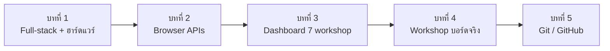

# ND2 — นักพัฒนา GUI/HMI สำหรับ Mobile และ Edge

🏠 [หน้าหลัก](../README.md) · 📖 [คำศัพท์](../common/glossary.md)

> สรุปสิ่งที่เรียนใน **ND2: เว็บและโมบายแอปพลิเคชันสำหรับ IoT และ Edge Devices** (KMUTT Non-Degree 2026) Week 01–05
> เขียนให้ **มือใหม่ที่ไม่เคยเรียนหลักสูตรนี้** อ่านแล้วเข้าใจภาพรวม และรู้ว่าต้องเริ่มจากตรงไหน

## หลักสูตรนี้เกี่ยวกับอะไร

สร้างเว็บแอปที่ **คุยกับฮาร์ดแวร์จริงได้โดยตรงจากเบราว์เซอร์** ผ่าน Web Serial และ Web Bluetooth — อ่านค่า sensor แสดงผลแบบ real-time และส่งคำสั่งกลับไปที่บอร์ด ESP32-S3 ต่อยอดไปถึงการเก็บข้อมูลเสียงเพื่อสร้างโมเดล AI · ไม่ต้องเขียน firmware เอง (มี firmware สำเร็จรูปให้)

## สารบัญ

| บท | หัวข้อ | สัปดาห์ | เรียนอะไร |
|---|---|---|---|
| 1 | [Full-stack ที่คุยกับฮาร์ดแวร์](01-web-mobile-apps-for-iot.md) | Week 01 | telemetry / command / event, device lifecycle, AI pipeline เสียง |
| 2 | [เข้าถึงฮาร์ดแวร์จากเบราว์เซอร์](02-dev-tools-ai-agents.md) | Week 02 | Web Serial vs BLE vs WiFi, โครงสร้างแอป, Node.js + Vite+ |
| 3 | [สร้าง Dashboard ด้วย Web Serial / BLE](03-web-serial-dashboard.md) | Week 03 | 7 workshop, JSON lines, DOM + TypeScript |
| 4 | [Workshop Onsite: คุยกับบอร์ดจริง](04-onsite-hardware-interface.md) | Week 04 | flash firmware สำเร็จรูป, BoardInfo, React labs |
| 5 | [Git, GitHub และ Markdown](../common/git-github-markdown.md) | Week 05 | เครื่องมือส่งงานและเขียนเอกสาร (ใช้ร่วมกันทุกหลักสูตร) |

## เครื่องมือที่ต้องติดตั้ง

| เครื่องมือ | ใช้ทำอะไร | ตรวจว่าพร้อม |
|---|---|---|
| Chrome หรือ Edge | รัน Web Serial / Web Bluetooth | — |
| [Node.js](https://nodejs.org/en) LTS | runtime ของ JavaScript | `node -v` |
| [Vite+](https://viteplus.dev/) | สร้างและรันโปรเจกต์เว็บ | `vp --version` |
| PowerShell 7 (Windows) | terminal ที่เครื่องมือรองรับ | `$PSVersionTable` |
| Git | เก็บโค้ดและส่งงาน | `git --version` |

## ถ้ามีเวลาน้อย อ่านแค่นี้
1. ข้อมูลระหว่างแอปกับอุปกรณ์มี 3 แบบ: **telemetry, command, event** — และควรเลี่ยง polling
2. เลือกช่องทางให้เหมาะ: **Serial** เสถียรสุด · **BLE** ไร้สายประหยัดพลังงาน · **WiFi** ต้องมี server
3. เว็บคุยกับฮาร์ดแวร์ได้เฉพาะ **Chromium + secure context**
4. ถามความสามารถของบอร์ดก่อนใช้ (**BoardInfo**) อย่าเดาว่ามีทุกอย่าง

## แหล่งอ้างอิงหลัก
- เอกสารของผู้สอน (ผศ.ดร.สันติ นุราช มจธ.): [github.com/drsanti/kmutt-nd69 — ND2](https://github.com/drsanti/kmutt-nd69/blob/main/nd2/README.md)

---
🏠 [หน้าหลัก](../README.md) · [ND1](../nd1/README.md) · [ND3](../nd3/README.md)
