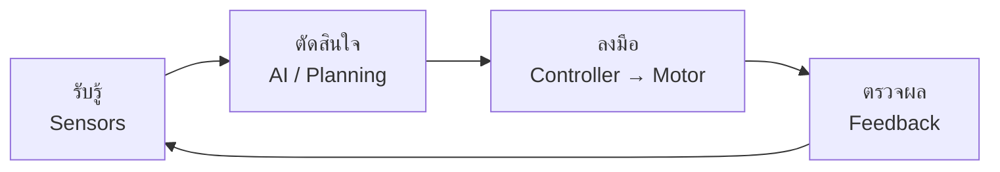
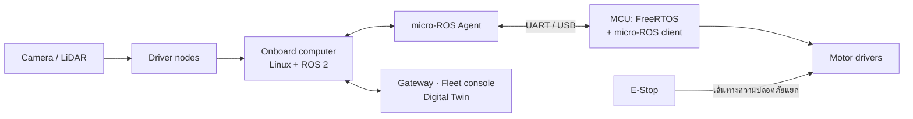

# บทที่ 1 — ROS 2, Digital Twin และ AI ในระบบอุตสาหกรรม

🏠 [หน้าหลัก](../README.md) · 📚 [สารบัญ ND3](README.md) · ถัดไป ➡ [บทที่ 2](02-ros-concepts-digital-twin.md)

> **บทนี้เรียนอะไร:** ทำไมงาน automation กำลังขยับจาก PLC ไปสู่ระบบกระจายแบบ ROS 2 ระบบหุ่นยนต์จริงประกอบด้วยอะไร และโปรโตคอลอุตสาหกรรมหลัก (ROS 2, OPC UA, MQTT) ต่างกันอย่างไร

## ทำไมสำคัญ

- โรงงานกำลังมีหุ่นยนต์และ AI มากขึ้น หุ่นยนต์ตัวหนึ่งประกอบจากหลายทีมหลาย vendor ต้องมี **ภาษากลาง** ในการส่งข้อมูล — **ROS 2** คือภาษากลางนั้น
- ROS 2 ไม่ได้ดีที่สุดเชิงวิศวกรรม (ไม่ใช่ hard real-time) แต่ทุกคนใช้ หน้าที่ของวิศวกรคือ **เลือกเครื่องมือให้เหมาะกับงาน**
- AI ทั้งช่วยพัฒนา (เราต้องตรวจ logic และผลทดสอบ) และทำงานอยู่ในหุ่นยนต์ (เราต้องประเมินพฤติกรรมและข้อจำกัด)

## แนวคิดหลัก

### วงจรของหุ่นยนต์ / Embodied AI

### ตัวอย่างระบบหุ่นยนต์ขนของ (AMR)

> ⚠️ **ROS 2 ไม่รับประกัน safety** — ปุ่มหยุดฉุกเฉินต้องมีเส้นทางแยกที่ไม่ผ่านซอฟต์แวร์แอป

### โปรโตคอล 3 ตัวที่ต้องรู้จัก

| | ROS 2 | OPC UA | MQTT |
|---|---|---|---|
| ใช้ที่ไหน | หุ่นยนต์ | PLC / SCADA / MES ในโรงงาน | IoT / cloud |
| แนวคิด | Topic / Service / Action ผ่าน DDS | Information model มาตรฐาน | Pub/Sub ผ่าน broker |
| ใช้ร่วมกัน | เชื่อมกันผ่าน gateway หรือแอปพลิเคชัน |||

### 5 ทักษะสู่อุตสาหกรรมอัตโนมัติ
1. Embedded / Firmware
2. Software / Driver
3. ROS 2 / Robotics (ros2_control, URDF/Xacro)
4. Digital Twin / UI (visualization, tuning, replay)
5. AI / ML (data pipeline, edge inference, anomaly detection)

ฐานร่วมของทุกข้อ: ฮาร์ดแวร์, ระบบควบคุม, safety

### คำศัพท์ ROS 2 ที่จะเจอบ่อย
`Node` · `Topic` · `Service` · `Action` · `.msg/.srv/.action` · `QoS` · `DDS` · `tf2` · `URDF` · `micro-ROS` · `rosbag2` · `RViz 2` · `Nav2` · `MoveIt 2`
ไม่ต้องจำทั้งหมด ให้รู้ว่ามีอยู่และแต่ละตัวทำหน้าที่อะไร แล้วใช้ถาม AI ต่อได้

## ปัญหาที่พบบ่อย

| ความเข้าใจผิด | ที่ถูก |
|---|---|
| ROS 2 = real-time | ไม่ใช่ งาน hard real-time อยู่ที่ MCU / controller |
| ใช้ ROS แล้วปลอดภัย | safety ต้องออกแบบแยก (E-Stop, safety controller) |
| ต้องเลือกโปรโตคอลเดียว | ระบบจริงใช้หลายตัวคู่กัน เชื่อมด้วย gateway |

## คำศัพท์ในบท
[ROS 2](../common/glossary.md#ros-2) · [Node](../common/glossary.md#node) · [Topic](../common/glossary.md#topic) · [Digital Twin](../common/glossary.md#digital-twin) · [OPC UA](../common/glossary.md#opc-ua) · [MQTT](../common/glossary.md#mqtt) · [micro-ROS](../common/glossary.md#micro-ros)

## แหล่งอ้างอิง
- เอกสารผู้สอน ND03 Week 01: [kmutt-nd69/nd3/docs/week01](https://github.com/drsanti/kmutt-nd69/blob/main/nd3/docs/week01/README.md)
- [ROS 2 Documentation](https://docs.ros.org/)

---
🏠 [หน้าหลัก](../README.md) · 📚 [สารบัญ ND3](README.md) · ถัดไป ➡ [บทที่ 2 — แนวคิด ROS และ Digital Twin](02-ros-concepts-digital-twin.md)
