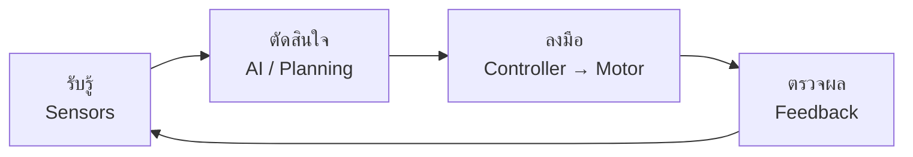
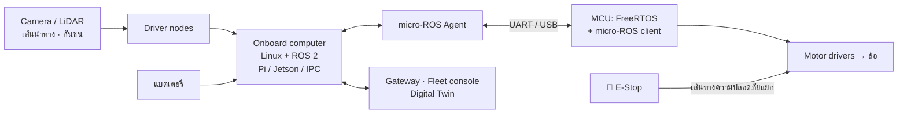
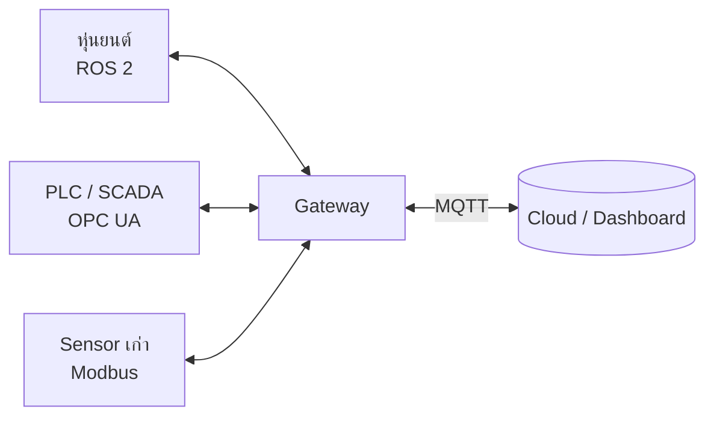
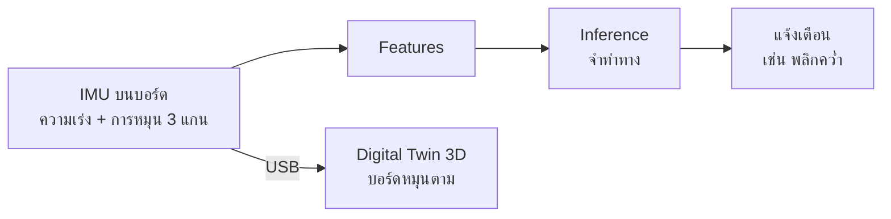

# บทที่ 1 — ROS 2, Digital Twin และ AI ในระบบอุตสาหกรรม

🏠 [หน้าหลัก](../README.md) · 📚 [สารบัญ ND3](README.md) · ถัดไป ➡ [บทที่ 2](02-ros-concepts-digital-twin.md)

> **บทนี้เรียนอะไร:** ทำไมงาน automation กำลังขยับจาก PLC ไปสู่ระบบกระจายแบบ ROS 2 หุ่นยนต์จริงประกอบด้วยอะไร โปรโตคอลอุตสาหกรรม (ROS 2, OPC UA, MQTT, Modbus) ต่างกันอย่างไร Digital Twin คืออะไร และนายจ้างต้องการทักษะอะไร
>
> **ก่อนอ่าน:** ไม่ต้องมีพื้นฐาน ROS · คุ้นกับ PLC/automation จะเห็นภาพเร็วขึ้น · **เวลาอ่าน:** ~40 นาที

## สารบัญบทนี้
1. [ทำไม ND3 เน้น ROS 2](#1-ทำไม-nd3-เน้น-ros-2)
2. [5 ทักษะที่นายจ้างต้องการ](#2-5-ทักษะที่นายจ้างต้องการ)
3. [วงจรของหุ่นยนต์ / Embodied AI](#3-วงจรของหุ่นยนต์--embodied-ai)
4. [ตัวอย่างหุ่นยนต์จริง: AMR ในโกดัง](#4-ตัวอย่างหุ่นยนต์จริง-amr-ในโกดัง)
5. [MQTT vs OPC UA vs Modbus vs ROS](#5-mqtt-vs-opc-ua-vs-modbus-vs-ros)
6. [ROS 1 → ROS 2 และข้อจำกัดของ ROS](#6-ros-1--ros-2-และข้อจำกัดของ-ros)
7. [Digital Twin และ AI ในโลกเครื่องจักร](#7-digital-twin-และ-ai-ในโลกเครื่องจักร)
8. [ระบบนิเวศและคำศัพท์ ROS 2](#8-ระบบนิเวศและคำศัพท์-ros-2)
9. [หลักสูตรนี้เรียนอย่างไร](#9-หลักสูตรนี้เรียนอย่างไร)
10. [สรุปและแบบฝึกคิด](#10-สรุปและแบบฝึกคิด)

---

## 1. ทำไม ND3 เน้น ROS 2

- อุตสาหกรรมต้องการ **เครื่องจักรที่คิดเองได้** และคุยกับระบบสต๊อก ขนส่ง โลจิสติกส์ เป็นระบบเดียว
- หุ่นยนต์ตัวหนึ่งใช้อุปกรณ์จาก **หลายค่าย** (sensor, motor drive, กล้อง) ถ้าไม่มีภาษากลาง การต่อทุกอย่างเข้าด้วยกันจะยากมาก — **ROS คือ "software integrator"** ที่เป็นภาษากลางนั้น
- หลักสูตรจึงปรับเนื้อหาตามตลาดแรงงาน **ลด PLC ระดับ field device และ Digital Twin เชิงลึก แล้วเน้น ROS 2 มากขึ้น**
- แม้เราจะไม่ได้ใช้ ROS เอง ก็ **ต้องรู้** — ถ้าทำบอร์ด motor driver หรือ sensor ขายในตลาดหุ่นยนต์ ต้องรองรับ ROS (มี driver ให้เสียบใช้ได้) · ในไทย ROS ถูกใช้มากในการศึกษา งานวิจัย และโรงงานกึ่งอัตโนมัติ

> **นิยามความรู้พื้นฐานในยุค AI** (ผู้สอน) = **ตัดสินใจตอบโจทย์ได้โดยไม่ต้องเปิด AI หรืออินเทอร์เน็ต** — AI เป็นแค่คอมพิวเตอร์ที่ให้ผลตาม input ทั้ง 3 หลักสูตรจึงเน้น **แนวคิด** มากกว่าการเขียนโค้ดหรือคณิตศาสตร์

---

## 2. 5 ทักษะที่นายจ้างต้องการ

| # | ทักษะ | ตัวอย่าง | เรียนใน |
|---|---|---|---|
| 1 | **Physical** | sensor/actuator, power electronics, firmware, real-time | ND1 |
| 2 | **Software ตัวกลาง** | driver, SDK, library, MCP — ให้ AI/แอปคุยกับฮาร์ดแวร์ได้ | ND1–ND2 |
| 3 | **Application layer = ROS 2** | ros2_control, URDF/Xacro | **ND3** |
| 4 | **Digital Twin / UI** | visualization, ปรับค่า, เล่นซ้ำ (replay) | **ND3** |
| 5 | **AI / ML** | data pipeline, edge inference, ตรวจจับความผิดปกติ (anomaly detection) | ND2–ND3 |

ฐานร่วมของทุกข้อ: **ฮาร์ดแวร์ ระบบควบคุม และความปลอดภัย (safety)**

> "AI เหมือนสมอง ถ้าไม่มีมอเตอร์ ไม่มีแหล่งจ่ายไฟ ก็ทำอะไรในโลกจริงไม่ได้" — ทั้ง 3 หลักสูตรจริง ๆ ควรอยู่ในคนเดียว และต้องมีความรู้ **ข้ามสาขา** (security, programming) พอจะคุยกับทีมได้

---

## 3. วงจรของหุ่นยนต์ / Embodied AI

สิ่งที่ ROS 2 ช่วยในวงจรนี้:
- **Interface ร่วมกัน** — ทุกทีมตกลงรูปแบบข้อมูลเดียวกัน
- **แยกงานเป็น node** — แต่ละโปรแกรมทำหน้าที่เดียว เปลี่ยน/ทดสอบแยกกันได้
- **Topic / Service / Action** — รูปแบบการสื่อสาร 3 แบบ (บทที่ 2)
- **TF2 + timestamp** — รู้ว่าอะไรอยู่ตรงไหน ณ เวลาไหน
- **QoS + record / replay** — กำหนดคุณภาพการส่ง บันทึกและเล่นซ้ำข้อมูล
- **Ecosystem** — เครื่องมือสำเร็จรูปจำนวนมาก

### Sensor เป็นกล่องดำ
ในมุมของ ROS เราไม่ต้องรู้ลึกว่า IMU คำนวณมุมด้วย Euler หรือ quaternion — ติดตั้ง driver แล้วได้ค่า XYZ มาใช้ เขียน logic ตัดสินใจ แล้วส่งคำสั่งกลับ · โค้ด ROS เรียบง่ายและคาดเดาได้ **AI เขียนได้เก่งมาก** ส่วนงานของเราคือ **เลือก sensor ให้ตรงโจทย์** (ลดต้นทุน ลดพลังงาน เพิ่มความเร็ว)

---

## 4. ตัวอย่างหุ่นยนต์จริง: AMR ในโกดัง

**AMR (Autonomous Mobile Robot)** = หุ่นยนต์ขนของที่วิ่งเองในโกดัง

| ส่วน | หน้าที่ |
|---|---|
| Sensor | ตามเส้น, กันชน, LiDAR สร้างแผนที่ (SLAM) |
| คอมพิวเตอร์บนหุ่น | รัน ROS 2 — หุ่นยนต์อุตสาหกรรมเกือบ 100% ใช้ **Linux** |
| MCU + micro-ROS | คุมมอเตอร์แบบ real-time แล้วคุยกับ ROS 2 ผ่าน agent |
| ระบบภายนอก | fleet console (คุมหุ่นหลายตัว), Digital Twin |

> ⚠️ **ROS 2 ไม่รับประกัน safety** — ปุ่มหยุดฉุกเฉินต้องมี **เส้นทางแยก** ที่ตัดมอเตอร์ได้โดยไม่ผ่านซอฟต์แวร์แอป

> **ESP32 เล็กเกินกว่าจะรัน ROS runtime ตรง ๆ** — ต้องใช้คอมพิวเตอร์ embedded ราคาหลายพันบาท หรือให้ ESP32 เป็น micro-ROS client ต่อเข้าคอมพิวเตอร์

---

## 5. MQTT vs OPC UA vs Modbus vs ROS

ทั้งหมดเป็นการส่งข้อมูลระหว่างเครื่อง (ส่วนใหญ่ใช้แนวคิด pub/sub เดียวกัน) **ต่างกันที่ "เวที"**:

| | **MQTT** | **OPC UA** | **Modbus** | **ROS 2** |
|---|---|---|---|---|
| ใช้ที่ไหน | IoT: MCU → cloud | เครื่องจักรระดับโรงงาน: PLC, หุ่นยนต์, conveyor, AMR, SCADA, MES | อุปกรณ์ต่ออุปกรณ์ (เก่าแต่ยังใช้มาก) | ภายในหุ่นยนต์ |
| แนวคิด | Pub/Sub ผ่าน broker | Information model มาตรฐาน | Master ถาม slave ตอบ (register) | Topic / Service / Action ผ่าน DDS |
| จุดเด่น | เบา ใช้กับเน็ตไม่เสถียรได้ | มาตรฐานอุตสาหกรรม มีโครงสร้างข้อมูลครบ | เรียบง่าย ทุกค่ายรองรับ | ecosystem หุ่นยนต์ |

ในระบบจริงใช้หลายตัวร่วมกัน เชื่อมด้วย **gateway** หรือแอปพลิเคชัน:

---

## 6. ROS 1 → ROS 2 และข้อจำกัดของ ROS

| | ROS 1 | ROS 2 |
|---|---|---|
| คาดเดาเวลาได้ (deterministic) | ❌ (เหมือน Windows ที่คาดเดาเรื่องเวลาไม่ได้) | เน้นให้คาดเดาได้ วางแผนได้ |
| ระบบส่งข้อมูล | ของตัวเอง | **DDS** (มาตรฐานอุตสาหกรรม) + QoS |
| สถานะ | เลิกพัฒนา | ใช้ปัจจุบัน — หลักสูตรเริ่มที่ ROS 2 เลย |

**ข้อจำกัดที่ต้องรู้**
- งาน **hard real-time** จริงจังไม่ใช้ ROS เพราะ pub/sub มีคอขวด — งานนั้นอยู่ที่ MCU / motor controller
- แต่หุ่นยนต์ส่วนใหญ่ไม่ต้องการ real-time ระดับนั้น ROS จึงยังเป็นตัวเลือกหลัก
- **หน้าที่ของเราคือเลือก** ว่าจะใช้อะไรเพราะอะไร — คิดแบบ top-down (ออกแบบตามโจทย์แล้วค่อยหาคน) หรือ based on existing (ดูความสามารถทีม และความคุ้มของการเพิ่มทักษะ)

---

## 7. Digital Twin และ AI ในโลกเครื่องจักร

### Digital Twin
**Digital Twin ≠ ภาพ 3 มิติสวย ๆ** แต่คือการจำลองเครื่องจริงที่ **รับสถานะจริง** และ **จำลองสถานการณ์ที่เป็นไปได้** ได้

ในหลักสูตรใช้ Digital Twin เพื่อ:
- **Visualization** — เห็นสถานะเครื่อง/หุ่นแบบสด
- **ปรับพารามิเตอร์แบบ real-time**
- **Simulate logic ง่าย ๆ** ก่อนลงเครื่องจริง

(สอนวิธี **ใช้** ไม่ได้สอนสร้างตัว engine จำลองเอง) · simulator ที่นิยม: **Webots** (ตัวอย่างเยอะ ลิงก์กับ ROS ได้), Gazebo, NVIDIA Isaac Sim (ต้องคอมแรงระดับเกมมิ่ง)

### AI ในเครื่องจักร
- เน้น **Machine Learning** มากกว่า LLM — LLM ใช้เวลาหลายวินาทีต่อคำตอบ **ช้าเกินไปสำหรับคุมเครื่องจักร**
- งานที่เหมาะ: จำแนกท่าทาง, ตรวจจับความผิดปกติ, ตรวจจับการชน

### โจทย์ IMU + AI ในหลักสูตร

- หมุน / เอียง / ยกบอร์ดแล้วเห็นการเคลื่อนไหวใน Digital Twin
- ติดป้ายข้อมูล (data labeling) ให้ AI จำท่าทาง เช่น พลิก เอียง แล้วแจ้งเตือน
- IMU เป็นข้อมูล 3 มิติตามเวลา ใช้ตรวจจับ **การชน** (ความเร่งเปลี่ยนเร็วมาก) หรือ **พื้นไม่เรียบ** ได้

---

## 8. ระบบนิเวศและคำศัพท์ ROS 2

| หมวด | เครื่องมือ | ใช้ทำอะไร |
|---|---|---|
| Core | `rclcpp` (C++), **`rclpy` (Python)**, Fast DDS / Cyclone DDS | เขียน node, ส่งข้อมูล |
| Build | `colcon`, `ament`, `rosdep` | build และติดตั้ง dependency |
| Embedded | **micro-ROS**, rosbridge, foxglove_bridge | ต่อ MCU / เว็บ / เครื่องมือภายนอก |
| Model | **URDF** / Xacro, **tf2** | โครงสร้างหุ่น, ระบบพิกัด |
| Control | ros2_control, MoveIt 2 (แขนกล), **Nav2** (นำทาง), SLAM Toolbox | ควบคุมและนำทาง |
| GUI / Debug | **RViz 2**, rqt, PlotJuggler, Foxglove, **rosbag2** | ดูภาพ กราฟ บันทึก/เล่นซ้ำ |

**คำย่อที่จะเจอ**
| คำ | ความหมาย |
|---|---|
| **DDS / RTPS** | ระบบส่งข้อมูลมาตรฐานที่ ROS 2 ใช้อยู่ข้างใต้ |
| **QoS** | คุณภาพการส่ง: ต้องถึงแน่นอน หรือเอาล่าสุดพอ |
| **URDF** | ไฟล์บรรยายโครงสร้างหุ่น (ข้อต่อ, ความยาวแขน) — NVIDIA และฝั่งเยอรมันมีรูปแบบของตัวเองแต่แนวคิดเดียวกัน |
| **TF / tf2** | Transform library — ระบบพิกัดของทุกชิ้นส่วน |
| **SLAM / AMCL / EKF** | สร้างแผนที่ไปพร้อมระบุตำแหน่ง / ระบุตำแหน่งบนแผนที่ / รวมข้อมูล sensor |
| **micro-ROS / XRCE-DDS** | ROS ฉบับย่อสำหรับไมโครคอนโทรลเลอร์ |
| `.msg` / `.srv` / `.action` | ไฟล์กำหนดรูปแบบข้อความ / service / action |

> ไม่ต้องจำทั้งหมด — รู้ว่ามีอยู่และทำหน้าที่อะไร แล้วใช้เป็นคีย์เวิร์ดถาม AI ต่อ

---

## 9. หลักสูตรนี้เรียนอย่างไร

- **ไม่มีหุ่นยนต์จริงในคลาส** — ใช้บอร์ด ESP32-S3 รุ่นที่มี IMU แทน พร้อม **firmware สำเร็จรูป** ที่ทำตัวเป็น robot controller / sensor (มองเป็น PLC ตัวหนึ่ง) แล้วโฟกัสฝั่งซอฟต์แวร์ ROS
- ภาษาหลัก: **Python (`rclpy`)** — เหมาะกับวิศวกรสายเครื่องกล ecosystem ใหญ่ที่สุด · ควรทบทวนพื้นฐาน Python เรื่อง **class / method**, pub/sub และ event-driven
- Workshop ครั้งที่ 2 (สำหรับคนที่สนใจทำอุปกรณ์ขาย): **micro-ROS client** — ออกแบบชิ้นส่วนหุ่นให้รองรับมาตรฐาน ROS แต่ไม่ผูกกับ ROS อย่างเดียว
- ช่วงต่อมาของหลักสูตรใช้ **robotos** — middleware ที่ผู้สอนพัฒนา แนวคิดเดียวกับ ROS แต่ติดตั้งง่ายกว่า (บทที่ 3–4)

---

## 10. สรุปและแบบฝึกคิด

### สรุป
- ROS 2 คือภาษากลางของหุ่นยนต์ — ไม่ real-time และไม่รับประกัน safety แต่ทุกคนใช้
- โปรโตคอลแต่ละตัวมีเวทีของตัวเอง: MQTT (IoT/cloud), OPC UA (โรงงาน), Modbus (อุปกรณ์), ROS 2 (ในหุ่นยนต์)
- Digital Twin = จำลองที่ผูกกับของจริง · AI ในเครื่องจักรเน้น ML ที่เร็ว ไม่ใช่ LLM
- งานของวิศวกรคือ **เลือก** เครื่องมือและ sensor ให้เหมาะกับโจทย์

### แบบฝึกคิด
1. วาดผังระบบหุ่นยนต์ทำความสะอาดพื้นในห้าง: มี sensor อะไร คอมพิวเตอร์อะไร และส่วนไหนต้อง real-time
2. โรงงานมี PLC เดิม 20 ตัว (OPC UA) และอยากเพิ่ม AMR 3 ตัว (ROS 2) พร้อม dashboard บน cloud — ข้อมูลควรไหลผ่านอะไรบ้าง?
3. ยกตัวอย่างงานที่ควรใช้ LLM และงานที่ **ไม่ควร** ใช้ LLM ในโรงงาน อย่างละ 2 งาน

## คำศัพท์ในบท
[ROS 2](../common/glossary.md#ros-2) · [Node](../common/glossary.md#node) · [Topic](../common/glossary.md#topic) · [Digital Twin](../common/glossary.md#digital-twin) · [OPC UA](../common/glossary.md#opc-ua) · [MQTT](../common/glossary.md#mqtt) · [micro-ROS](../common/glossary.md#micro-ros) · [QoS](../common/glossary.md#qos) · [TF](../common/glossary.md#tf)

## แหล่งอ้างอิง
- เอกสารผู้สอน ND3 Week 01: [kmutt-nd69/nd3/docs/week01](https://github.com/drsanti/kmutt-nd69/blob/main/nd3/docs/week01/README.md) และสไลด์ประกอบการบรรยาย
- การบรรยาย Online ND3 Week 01 (11 ต.ค. 2026)
- [ROS 2 Documentation](https://docs.ros.org/) · [micro-ROS](https://micro.ros.org/) · [Webots](https://cyberbotics.com/)

---
🏠 [หน้าหลัก](../README.md) · 📚 [สารบัญ ND3](README.md) · ถัดไป ➡ [บทที่ 2 — แนวคิด ROS และ Digital Twin](02-ros-concepts-digital-twin.md)
