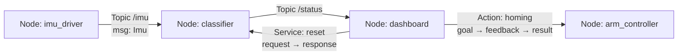
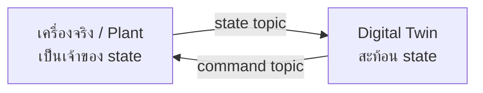

# บทที่ 2 — แนวคิดของ ROS และ Digital Twin (ก่อนลงมือเขียนโค้ด)

🏠 [หน้าหลัก](../README.md) · 📚 [สารบัญ ND3](README.md) · ⬅ [บทที่ 1](01-digital-twins-ai.md) · ถัดไป ➡ [บทที่ 3](03-robotos-hands-on.md)

> **บทนี้เรียนอะไร:** คำศัพท์และแนวคิดหลักของระบบแบบ ROS — node, topic, message, service, action, parameter, TF, QoS — เทียบกับสิ่งที่คนสาย PLC คุ้นเคย และ Digital Twin คืออะไร

## ทำไมสำคัญ

ROS เป็นแค่ **ระบบจัดการการส่งข้อความ (messaging)** แนวคิดเดียวกับ MQTT และ OPC UA ถ้าเข้าใจคำศัพท์ชุดนี้ จะอ่านเอกสาร สั่ง AI และ debug ระบบหุ่นยนต์ได้ ไม่ว่าจะใช้ ROS 2 ของจริงหรือ middleware ตัวอื่น

## แนวคิดหลัก

### จาก PLC สู่ระบบกระจาย
| PLC / DCS แบบเดิม | ระบบแบบ ROS |
|---|---|
| โปรแกรมเดียวรันเป็น **scan cycle** | หลายโปรแกรม (node) ทำงานแยกกัน **event-driven** |
| tag table | parameter ของแต่ละ node |
| เรียก function block | service |
| historian | record & replay (bag) |

### Graph: node คุยกันผ่าน topic

| รูปแบบ | ใช้เมื่อ | ตัวอย่าง |
|---|---|---|
| **Topic (pub/sub)** | ส่งข้อมูลต่อเนื่อง ใครสนใจก็ subscribe | ค่า sensor, ตำแหน่งหุ่น |
| **Service** | ถาม-ตอบสั้น ๆ | ขอค่าปัจจุบัน, reset |
| **Action** | งานยาวที่มี feedback และ **ยกเลิกกลางทางได้** | homing, เดินไปจุดหมาย, batch cycle |
| **Parameter** | ค่าตั้งของ node เปลี่ยนได้ขณะรัน | gain, ความเร็วสูงสุด |

- **Message / schema** = สัญญาว่าข้อมูลหน้าตาแบบไหน ทั้งผู้ส่งและผู้รับต้องตรงกัน
- **Lifecycle** = node มีสถานะ (configure → activate → deactivate) ไม่ใช่แค่ "รันตลอด"
- **TF (transform)** = ระบบพิกัด หุ่นยนต์ต้องรู้ว่าแต่ละชิ้นส่วนและวัตถุอยู่ตรงไหนเทียบกับอะไร
- **QoS** = ตั้งว่าข้อความต้องส่งถึงแน่นอน (reliable) หรือส่งล่าสุดเร็ว ๆ พอ (best effort), เก็บย้อนหลังกี่ข้อความ
- **Observe & debug** = ระบบกระจายไม่มี "โปรแกรมเดียว" ให้ดู ต้องดู graph, echo topic และ record ข้อมูล

### Digital Twin คืออะไร
**ภาพจำลองที่มีชีวิตของเครื่องจริง** — รับ state จากเครื่องจริงมาแสดง และส่งคำสั่งกลับได้ ไม่ใช่แค่โมเดล 3D ที่สวย

twin ที่ดีต้องใช้ **สัญญาข้อมูล (contract) เดียวกับเครื่องจริง** — แค่หน้าตาข้อความเหมือนกันไม่ได้แปลว่าจำลองได้เที่ยงตรง

### แนวคิดเดียวกัน หลายภาษา
ตัวอย่างในเอกสารผู้สอนเขียนให้ดูทั้ง **C, Rust และ Python** เพื่อให้เห็นว่าแนวคิด node/topic ไม่ผูกกับภาษาใด

## ปัญหาที่พบบ่อย

| อาการ | สาเหตุ |
|---|---|
| node ส่งแล้วอีกฝั่งไม่ได้รับ | ชื่อ topic หรือชนิด message ไม่ตรงกัน / QoS ไม่เข้ากัน |
| ใช้ topic ทำงานยาวแล้วหยุดกลางทางไม่ได้ | งานแบบนี้ควรใช้ action |
| ตำแหน่งในจอผิดทิศ | frame ของ TF ไม่ตรงกัน (เช่น แกน Y-up กับ Z-up) |

## คำศัพท์ในบท
[Node](../common/glossary.md#node) · [Topic](../common/glossary.md#topic) · [Service](../common/glossary.md#service) · [Action](../common/glossary.md#action) · [QoS](../common/glossary.md#qos) · [TF](../common/glossary.md#tf) · [Digital Twin](../common/glossary.md#digital-twin)

## แหล่งอ้างอิง
- เอกสารผู้สอน ND03 Week 02 (11 บท): [lessons/README.md](https://github.com/drsanti/kmutt-nd69/blob/main/nd3/docs/week02/lessons/README.md)

---
🏠 [หน้าหลัก](../README.md) · 📚 [สารบัญ ND3](README.md) · ⬅ [บทที่ 1](01-digital-twins-ai.md) · ถัดไป ➡ [บทที่ 3 — ลงมือกับ robotos](03-robotos-hands-on.md)
