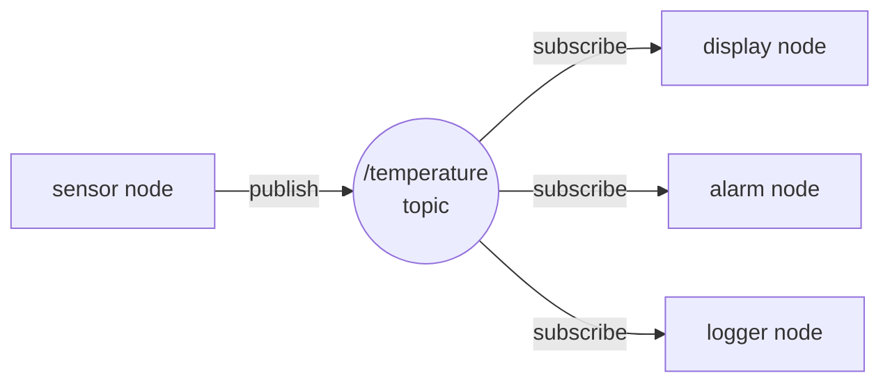
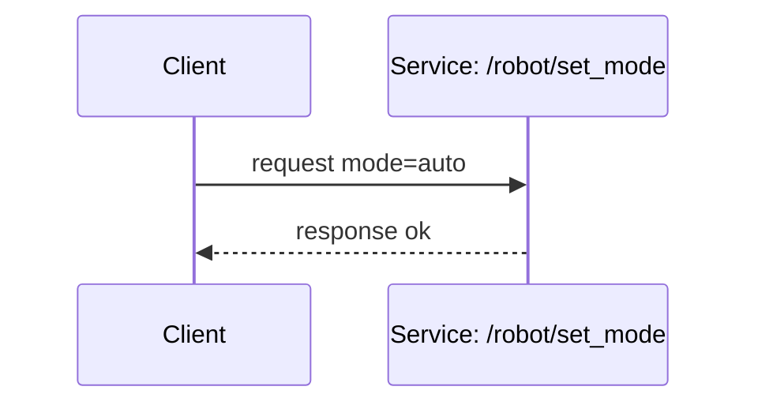
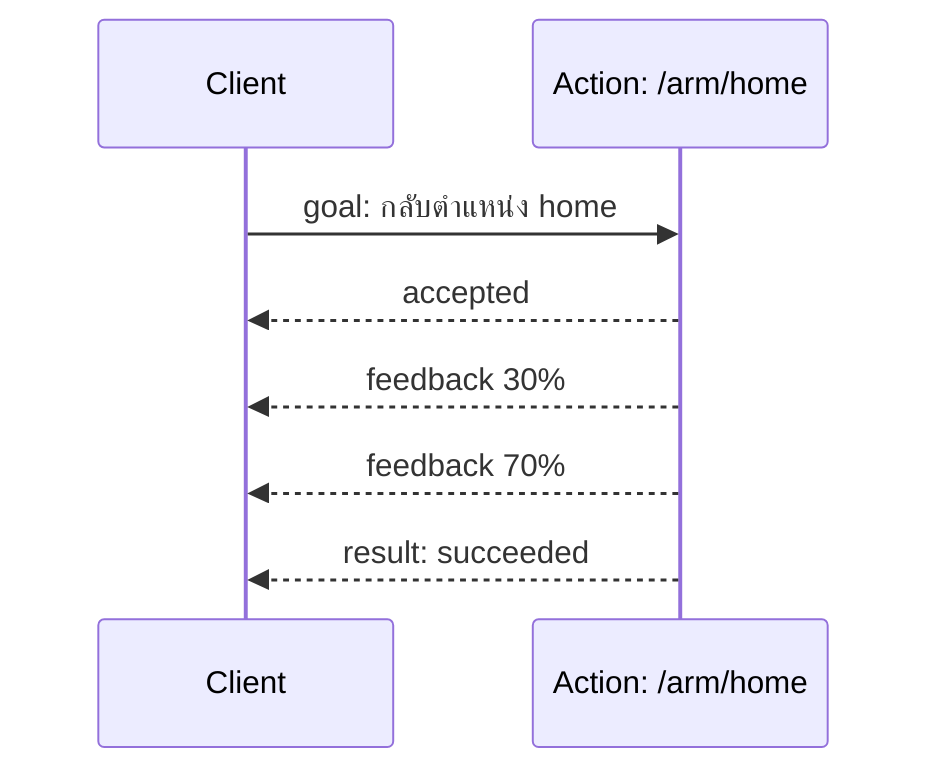
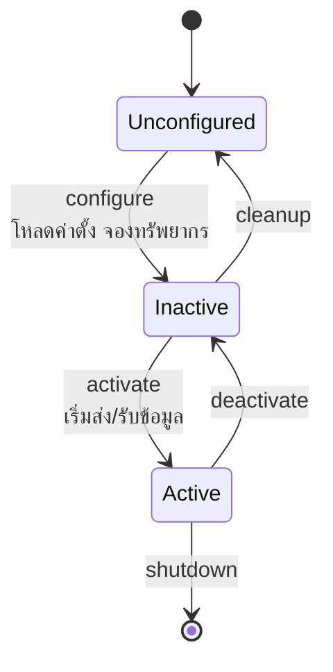
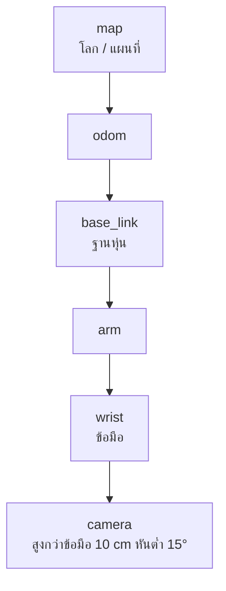
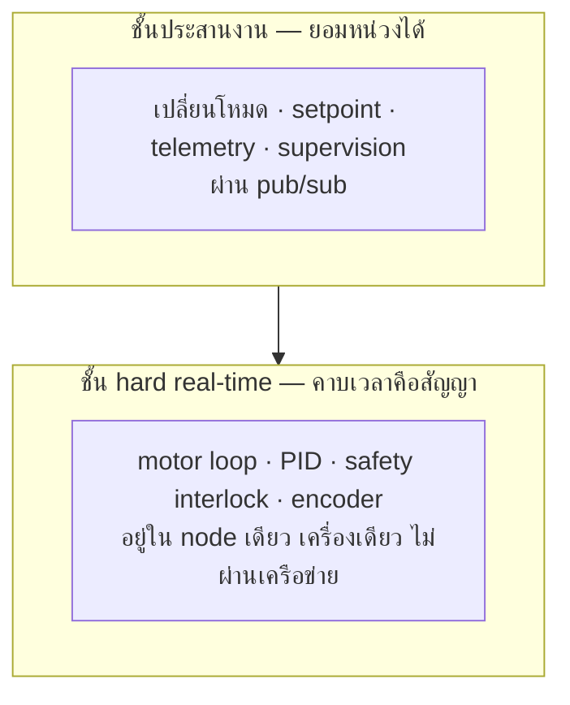
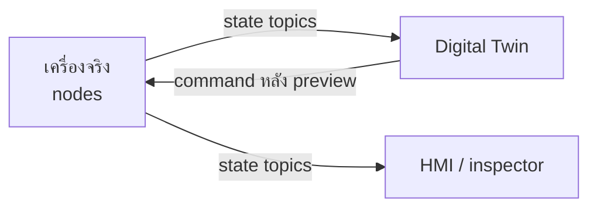

# บทที่ 2 — แนวคิดของ ROS และ Digital Twin สำหรับคนสาย Automation

🏠 [หน้าหลัก](../README.md) · 📚 [สารบัญ ND3](README.md) · ⬅ [บทที่ 1](01-digital-twins-ai.md) · ถัดไป ➡ [บทที่ 3](03-robotos-hands-on.md)

> **บทนี้เรียนอะไร:** คำศัพท์และแนวคิดหลักของระบบแบบ ROS ก่อนลงมือเขียนโค้ด — graph, node, topic, message/schema, service, action, parameter, lifecycle, TF, การ debug ระบบกระจาย, QoS — เทียบกับสิ่งที่คนสาย PLC คุ้นเคยทีละข้อ และนิยามที่แท้จริงของ Digital Twin
>
> **ก่อนอ่าน:** [บทที่ 1](01-digital-twins-ai.md) · **เวลาอ่าน:** ~60 นาที

## สารบัญบทนี้
1. [ความรู้เดิมยังมีค่า — สิ่งที่เปลี่ยนคือ "ชั้นกลาง"](#1-ความรู้เดิมยังมีค่า--สิ่งที่เปลี่ยนคือ-ชั้นกลาง)
2. [Graph: node + topic](#2-graph-node--topic)
3. [Message และ schema: สัญญาข้อมูล](#3-message-และ-schema-สัญญาข้อมูล)
4. [Service และ Action](#4-service-และ-action)
5. [Parameter และ Lifecycle](#5-parameter-และ-lifecycle)
6. [TF: frame และการแปลงพิกัด](#6-tf-frame-และการแปลงพิกัด)
7. [Observe และ Debug ระบบกระจาย](#7-observe-และ-debug-ระบบกระจาย)
8. [QoS และเรื่องเวลา](#8-qos-และเรื่องเวลา)
9. [Digital Twin ตัวจริง](#9-digital-twin-ตัวจริง)
10. [Twin + middleware ทำงานร่วมกัน](#10-twin--middleware-ทำงานร่วมกัน)
11. [AI, PID และ sim-to-real](#11-ai-pid-และ-sim-to-real)
12. [สรุปและแบบฝึก](#12-สรุปและแบบฝึก)

---

## 1. ความรู้เดิมยังมีค่า — สิ่งที่เปลี่ยนคือ "ชั้นกลาง"

คน automation ผ่านการเปลี่ยนแปลงมาแล้ว: relay logic → PLC → DCS → fieldbus → SCADA รอบนี้คือ **robotics + embodied AI** — และสิ่งที่เปลี่ยน **ไม่ใช่ฮาร์ดแวร์ แต่เป็นสถาปัตยกรรมซอฟต์แวร์**

| สิ่งที่รู้อยู่แล้ว | ในโลกใหม่ |
|---|---|
| PID / control loop | ยังเป็นแกนของทุก actuator — หุ่นยนต์คือลูปหลายสิบตัวซ้อนกัน |
| sensor / actuator | ตัวเดิม แค่ต่อเข้า "node" แทน I/O card |
| ความคิดเรื่อง safety / interlock | สำคัญกว่าเดิม เพราะหุ่นยนต์เคลื่อนที่ในโลกของคน |
| อ่าน process / flow | เหมือนเดิม แต่ข้อมูลเป็น stream ไม่ใช่ tag |
| fieldbus / Modbus / Profibus | แนวคิดเดียวกัน เปลี่ยนแค่ transport และรูปแบบข้อมูล |

สิ่งที่ต้องเติม:

| คุ้นเคย | ใหม่ | ต่างกันตรง |
|---|---|---|
| **scan cycle** — วนตรวจทุกอย่างตามจังหวะ | **event-driven** — ทำงานเมื่อมีเหตุ | ไม่มีรอบสแกนกลาง node ทำงานอิสระ |
| **fieldbus poll** — master ถามทีละจุด | **pub/sub** — ผู้ผลิตข้อมูล push ให้ผู้สนใจ | ไม่ต้องถาม subscribe แล้วข้อมูลมาเอง |
| **tag table** | **typed message** | ข้อมูลมีโครงสร้างและความหมายในตัว |
| โปรแกรมเดียวรู้ทุกอย่าง | **หลาย node กระจายหลายเครื่อง** | ไม่มีศูนย์กลางเดียว |

ทำไมต้องเปลี่ยน: เดิมแต่ละที่เขียน PLC / MCU / robot controller กันเองคนละแบบ ใช้เวลา debug และ integrate หลายเดือน ไม่ทันตลาด — ROS เป็น "Robot Builder Software" ซื้อมอเตอร์มาก็ต่อได้ด้วยภาษากลาง (เทียบได้กับ Arduino ในฝั่งอิเล็กทรอนิกส์)

---

## 2. Graph: node + topic

### ของเดิม
PLC ตัวเดียววนลูป: **อ่าน input → รัน logic → เขียน output** และคุยกับอุปกรณ์ภายนอกโดย **ถามทีละจุดทุกรอบ** แม้ไม่มีอะไรเปลี่ยน — ใช้ได้ดีมา 40 ปี แต่ **ไม่ scale** เมื่อมีหุ่นหลายตัว sensor หลายสิบ และ AI หลายกล่อง

### ของใหม่
แตกโปรแกรมใหญ่เป็น **node เล็ก ๆ ทำงานอิสระ** คุยกันผ่าน **topic**:



- **Node** = โปรแกรมเล็กทำงานเดียว (อ่าน sensor, คำนวณ control, ขับมอเตอร์, แสดงผล) ไม่มีใครคุมจังหวะ
- **Topic** = ชื่อช่องข้อมูลที่อยู่ "ตรงกลาง" — ผู้ส่งไม่ต้องรู้จักผู้รับ ผู้รับไม่ต้องรู้จักผู้ส่ง
- เพิ่มผู้รับใหม่ (เช่น logger) **ไม่ต้องแก้ผู้ส่งเลย**
- ภาพรวมของ node และ topic ทั้งระบบเรียกว่า **graph**
- ข้อมูลวิ่งผ่าน TCP/UDP บน LAN หรือ WiFi

---

## 3. Message และ schema: สัญญาข้อมูล

### Tag แบบเดิม
```
TAG        ADDRESS    TYPE    VALUE
TEMP_01    %MW100     INT     423
PUMP_RUN   %M50       BOOL    1
```
- ความหมายอยู่ในหัวคนหรือในเอกสาร ("423 คือ ×0.1 องศา" ไม่มีในระบบ)
- เพิ่ม field = จอง address ใหม่ + แก้เอกสาร — เปราะและพังง่าย

### Typed message
```text
message Temperature {
    float32 celsius
    string  sensor_id
    uint64  timestamp
    Quality quality      // good / stale / fault
}
```
- **มีโครงสร้าง** — field มีชื่อและชนิดชัด
- **มีบริบทในตัว** — เวลา, แหล่งที่มา, คุณภาพของข้อมูล
- **เป็นสัญญา** — ผู้ส่งและผู้รับรู้รูปทรงเดียวกัน ผิด schema = เชื่อมไม่ได้ ตรวจเจอตั้งแต่ต้น ไม่ใช่ตอนระบบล้ม
- ใน ROS 2 กำหนดด้วยไฟล์ `.msg` · ในเอกสารผู้สอนมีตัวอย่าง schema เดียวกันเขียนได้ทั้ง **C, Rust, Python**

---

## 4. Service และ Action

| รูปแบบ | ลักษณะ | เหมาะกับ | เทียบโลก PLC |
|---|---|---|---|
| **Topic** | stream ไหลเรื่อย ๆ | telemetry, sensor, สถานะ | ค่า process ที่อัปเดตตลอด |
| **Service** | request → response จบเร็ว | อ่านค่า ตั้งค่า reset | function block ถาม-ตอบสั้น |
| **Action** | goal → feedback → result ใช้เวลานาน **ยกเลิกได้** | เคลื่อนที่, homing, batch cycle | sequence ที่มีสถานะระหว่างทาง |

> **กฎข้อเดียว: ถ้างานไม่จบทันที อย่าใช้ service** — นั่นคือเหตุผลที่ action มีอยู่





ตัวอย่างโค้ดเชิงแนวคิด (pseudo-API จากเอกสารผู้สอน ไม่ใช่ API จริง):
```python
resp = client.call("/robot/set_mode", mode="auto")
if resp.ok:
    ...    # service มีคำตอบกลับ จึงรู้ว่าสำเร็จหรือไม่
```

---

## 5. Parameter และ Lifecycle

### Parameter — ค่าปรับได้ที่มีเจ้าของชัด
- **เป็นของ node ตัวนั้น** ไม่มีตารางกลาง
- **ปรับได้ขณะรัน** ไม่ต้องหยุดหรือ compile ใหม่ — เหมือนจูน PID สด ๆ ผ่าน interface ที่เป็นระบบ
- มีชนิดและขอบเขตชัด (setpoint, threshold, mode, rate)
- เทียบได้กับ faceplate ของ function block ที่เข้าถึงผ่านเครือข่าย

```python
node.declare_parameter("max_speed", 1.5)    # ค่าเริ่มต้น
speed = node.get_parameter("max_speed")      # อ่าน
node.set_parameter("max_speed", 2.0)         # ปรับขณะรัน
```

| | Topic | Parameter |
|---|---|---|
| คืออะไร | ข้อมูลที่ไหลต่อเนื่อง | การตั้งค่าของ node |
| เปลี่ยนเมื่อ | ตลอดเวลา | มีคนตั้งใจเปลี่ยน |
| เทียบ | process variable | setpoint / config |

### Lifecycle — node ไม่ใช่ "เปิดแล้วรันเลย"
PLC มีแค่ STOP / RUN แต่ระบบใหญ่ต้องเปิดเครื่องอย่างมีลำดับ:


ประโยชน์: เตรียมทุก node ให้พร้อมก่อน แล้วค่อย activate พร้อมกัน — หุ่นไม่ขยับก่อนที่ระบบรอบตัวจะพร้อม

---

## 6. TF: frame และการแปลงพิกัด

### ปัญหาที่โลก PLC ไม่เคยเจอ
ในเครื่องจักรที่ติดตั้งอยู่กับที่ ค่าของ sensor ก็คือค่า แต่หุ่นยนต์:
- กล้องอยู่บนหัวที่หันได้ — "เห็นวัตถุกลางภาพ" แปลว่าวัตถุอยู่ไหนในโลก? ขึ้นกับว่าหัวหันทางไหนตอนนั้น
- gripper อยู่ปลายแขนที่ขยับตลอด — "วัตถุอยู่ที่ x = 1.2" วัดจากฐานหรือจากมือ?
- หุ่นยนต์เคลื่อนที่ — sensor ตัวเดิมวัดจุดใหม่ตลอด

> **ค่าของ sensor ไม่มีความหมายถ้าไม่รู้ว่าวัดในกรอบอ้างอิงไหน**

### Frame และ Transform

- **Frame** = ระบบพิกัดที่ผูกกับชิ้นส่วนหนึ่ง เช่น `base_link`, `wrist`, `camera`, `map`
- ทุกค่าที่วัดต้องมี **`frame_id`** บอกว่าวัดในกรอบไหน
- **Transform** = ความสัมพันธ์เชิงตำแหน่งและทิศระหว่างสอง frame ใช้แปลง "จุดที่กล้องเห็น" → "ตำแหน่งจริงในโลก"
- transform เปลี่ยนตลอดเพราะแขนขยับ → **ต้องมีเวลากำกับ** (transform ณ เวลาไหน)
- ระวังแกนต่างมาตรฐาน: บางระบบให้ Y ชี้ขึ้น (Y-up) บางระบบให้ Z ชี้ขึ้น (Z-up)

---

## 7. Observe และ Debug ระบบกระจาย

PLC debug = เปิดโปรแกรมเดียวดู ladder กับ watch table แต่ระบบ node:
- **ไม่มีจุดเดียวที่เห็นทั้งหมด**
- ค่าอยู่ใน **stream ระหว่าง node** ไม่ใช่ตัวแปรในหน่วยความจำเดียว
- bug มักเป็นเรื่อง **ปฏิสัมพันธ์** (จังหวะ ลำดับ ข้อความหาย) ไม่ใช่ logic ผิดบรรทัดเดียว
- เหตุเกิดแล้วผ่านไป ถ้าไม่บันทึกไว้ **ย้อนดูไม่ได้**

เครื่องมือ 3 ชิ้นหลัก:

| เครื่องมือ | ดูอะไร | เทียบโลกโรงงาน |
|---|---|---|
| **Inspect graph** | มี node / topic อะไรบ้าง ใครต่อกับใคร | แผนผังระบบ |
| **Watch topic** (echo) | ค่าที่ไหลในช่องหนึ่งแบบสด | watch table |
| **Record → replay** | บันทึกข้อความไว้แล้วเล่นซ้ำ | historian / trend |

ใน ROS 2 คือ `ros2 node list`, `ros2 topic echo`, **rosbag2** และเครื่องมือภาพอย่าง RViz 2 / Foxglove

---

## 8. QoS และเรื่องเวลา

คำถามแรกของคน automation: **"แล้วเรื่องเวลาล่ะ? ลูปของผมต้องตรงทุก ms"**

| | PLC loop | pub/sub |
|---|---|---|
| ลักษณะ | **deterministic** สแกนทุก X ms | **event-driven** "เมื่อมี" ไม่ใช่ "ทุกรอบ" |
| เวลาถึง | แน่นอน | ไม่แน่นอนเท่า (ผ่าน queue / เครือข่าย) |

> ยอมรับตรง ๆ: **middleware แบบ pub/sub ไม่ใช่ลูป hard real-time** — มันคือชั้นสื่อสาร ไม่ใช่ตัวคุมเวลา

### ทางออก: แยกชั้น


### QoS (Quality of Service)
ตั้งค่าได้ต่อ topic:
- **Reliability** — `reliable` (ต้องถึงทุกข้อความ) หรือ `best effort` (หายบ้างได้ เอาล่าสุดเร็ว ๆ เช่นภาพจากกล้อง)
- **History / depth** — เก็บข้อความย้อนหลังกี่อัน
- **Deadline** — ถ้าข้อความไม่มาภายในเวลาที่กำหนดให้แจ้งเตือน

---

## 9. Digital Twin ตัวจริง

> **Digital Twin = ภาพจำลองดิจิทัลของ "เครื่องจริงเครื่องหนึ่ง" ที่ sync กับของจริงต่อเนื่อง และมีทางส่งกลับได้**

เงื่อนไข 3 ข้อที่ต้องครบ:
1. **ผูกกับเครื่องจริงเครื่องเดียว** — ไม่ใช่ "แขนกลทั่วไป" แต่ "แขนตัวที่อยู่ cell 3"
2. **Sync ต่อเนื่อง** — ของจริงเปลี่ยน twin เปลี่ยนตาม ผ่าน stream ข้อมูลสด
3. **มีทางกลับ** — อย่างน้อยใช้ทดลอง/ตัดสินใจบน twin ก่อนส่งคำสั่งกลับไปเครื่องจริง

| สิ่งนี้ | เป็น twin ไหม | เพราะ |
|---|---|---|
| โมเดล 3D ใน CAD | ❌ | เป็นรูป ไม่มีข้อมูลสด |
| simulation ทั่วไป | ❌ | ไม่ผูกกับเครื่องเฉพาะตัว |
| หน้าจอ SCADA / HMI | ❌ | แสดงค่าสดแต่ไม่มีแบบจำลอง ทำ "what-if" ไม่ได้ |
| replay ข้อมูลเก่า | ❌ | เล่นซ้ำอย่างเดียว ไม่ได้จำลอง |
| **Digital Twin** | ✅ | มีแบบจำลอง + ผูกเครื่องเดียว + sync สด + ใช้ตัดสินใจได้ |

**ประโยชน์จริง:** จำลองเหตุการณ์ที่ทำกับของจริงไม่ได้ (มอเตอร์พัง ท่อลมแตก) เพื่อ **predictive maintenance** และวางแผนซ่อมบำรุง

---

## 10. Twin + middleware ทำงานร่วมกัน


- เครื่องจริง publish สถานะ → twin **subscribe เหมือน node ทั่วไป** — ไม่ต้องต่อพิเศษ
- เพราะทุกอย่างเป็น typed message twin จึงแปลข้อมูลได้โดยไม่ต้องเขียนโค้ดเฉพาะเครื่อง

รูปแบบการใช้งานจริง:
| รูปแบบ | ทำอะไร |
|---|---|
| **Shadow monitoring** | ดูท่าทางและตำแหน่งจริงในภาพ 3D (ใช้ TF แปลงพิกัด) — เห็นมากกว่า "joint3 = 45°" |
| **Virtual commissioning** | ทดสอบลอจิกกับ twin ก่อน deploy ลงเครื่องจริง — use case ที่จับต้องได้ที่สุดของคน automation |
| **What-if** | ลองค่าใหม่บน twin ก่อนส่งให้เครื่องจริง |

---

## 11. AI, PID และ sim-to-real

- **PID ยังสำคัญ** — AI สั่งระดับสูงว่ามอเตอร์แต่ละตัวควรทำอะไร แล้วให้ PID ระดับล่างคุมจริง (ใช้ AI คุมความเร็วมอเตอร์ตัวเดียวคือ over-engineering) · ระบบ dynamic สูงอย่าง humanoid อาจใช้ AI / fuzzy logic ปรับค่า PID แบบ dynamic
- **Sim-to-real** — NVIDIA Isaac สร้างหุ่นยนต์เสมือนจำนวนมากใน twin แล้วเทรนให้เดินด้วย reinforcement learning ได้ base model ก่อน แล้วค่อยปรับกับของจริงเล็กน้อย (ผูกเชือกกันล้ม พื้นนุ่ม) — humanoid โอเพนซอร์สก็ใช้วิธีนี้
- อัลกอริทึมซับซ้อน (SLAM, mapping) ไม่ต้องเขียนเอง มี plugin ให้ — **คีย์เวิร์ดสำคัญกว่า coding** ในยุคนี้
- **มุมผู้ผลิตชิ้นส่วน** — ขาย sensor/motor drive ให้ตลาดหุ่นยนต์ ต้องมี **driver และ URDF** ให้คนใช้ ROS ใช้ได้ทันที คนประกอบหุ่นไม่สนว่าข้างในใช้ทรานซิสเตอร์อะไร
- ผู้สอนลองให้ AI สร้างเนื้อหาบทนี้ พบว่ายังไม่แม่นทั้งภาษาและเทคนิค — **ต้องตรวจจากหลายแหล่งเสมอ**
- "คนที่พูดถึงอดีตบ่อย ๆ คือคนที่กลัวการปรับตัว" — มองตลาดระดับโลก

---

## 12. สรุปและแบบฝึก

### สรุป
| แนวคิด | จำสั้น ๆ |
|---|---|
| Graph | node อิสระคุยผ่าน topic |
| Message | สัญญาข้อมูลที่มีโครงสร้างและบริบท |
| Topic / Service / Action | ไหลต่อเนื่อง / ถาม-ตอบ / งานยาวยกเลิกได้ |
| Parameter / Lifecycle | ค่าตั้งของ node / ลำดับการเปิดใช้งาน |
| TF | ทุกค่าต้องรู้ว่าวัดในกรอบไหน ณ เวลาไหน |
| QoS | pub/sub ไม่ใช่ real-time — แยกชั้น |
| Digital Twin | ผูกเครื่องเดียว + sync สด + มีทางกลับ |

### แบบฝึก
1. แปลงระบบสายพานลำเลียงที่มี sensor นับชิ้น 2 ตัว มอเตอร์ 1 ตัว และ HMI 1 จอ ให้เป็น graph: มี node อะไร topic อะไร
2. งานต่อไปนี้ควรเป็น topic, service หรือ action: (ก) ค่าน้ำหนักจากเครื่องชั่ง (ข) สั่งรีเซ็ตตัวนับ (ค) สั่งแขนกลหยิบของไปวาง
3. ทำไมหน้าจอ SCADA ที่แสดงค่าสดจากเครื่องจริงยังไม่ใช่ Digital Twin?

## คำศัพท์ในบท
[Node](../common/glossary.md#node) · [Topic](../common/glossary.md#topic) · [Service](../common/glossary.md#service) · [Action](../common/glossary.md#action) · [Parameter](../common/glossary.md#parameter) · [QoS](../common/glossary.md#qos) · [TF](../common/glossary.md#tf) · [Digital Twin](../common/glossary.md#digital-twin)

## แหล่งอ้างอิง
- เอกสารผู้สอน ND03 Week 02 (11 บท): [lessons/README.md](https://github.com/drsanti/kmutt-nd69/blob/main/nd3/docs/week02/lessons/README.md) — โดยเฉพาะ
  [01](https://github.com/drsanti/kmutt-nd69/blob/main/nd3/docs/week02/lessons/01-why-ros-and-digital-twin.md) ·
  [02](https://github.com/drsanti/kmutt-nd69/blob/main/nd3/docs/week02/lessons/02-the-graph.md) ·
  [04](https://github.com/drsanti/kmutt-nd69/blob/main/nd3/docs/week02/lessons/04-services-and-actions.md) ·
  [06](https://github.com/drsanti/kmutt-nd69/blob/main/nd3/docs/week02/lessons/06-tf-frames.md) ·
  [08](https://github.com/drsanti/kmutt-nd69/blob/main/nd3/docs/week02/lessons/08-qos-and-determinism.md) ·
  [09](https://github.com/drsanti/kmutt-nd69/blob/main/nd3/docs/week02/lessons/09-digital-twin.md) ·
  [10](https://github.com/drsanti/kmutt-nd69/blob/main/nd3/docs/week02/lessons/10-twin-meets-middleware.md)
- การบรรยาย Online ND3 Week 02 (18 ต.ค. 2026)
- [ROS 2 Concepts](https://docs.ros.org/en/jazzy/Concepts.html)

---
🏠 [หน้าหลัก](../README.md) · 📚 [สารบัญ ND3](README.md) · ⬅ [บทที่ 1](01-digital-twins-ai.md) · ถัดไป ➡ [บทที่ 3 — ลงมือกับ robotos](03-robotos-hands-on.md)
