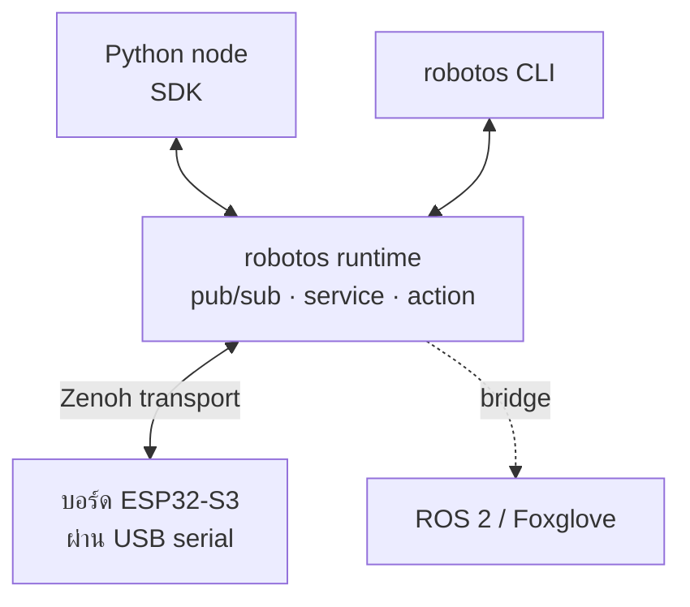
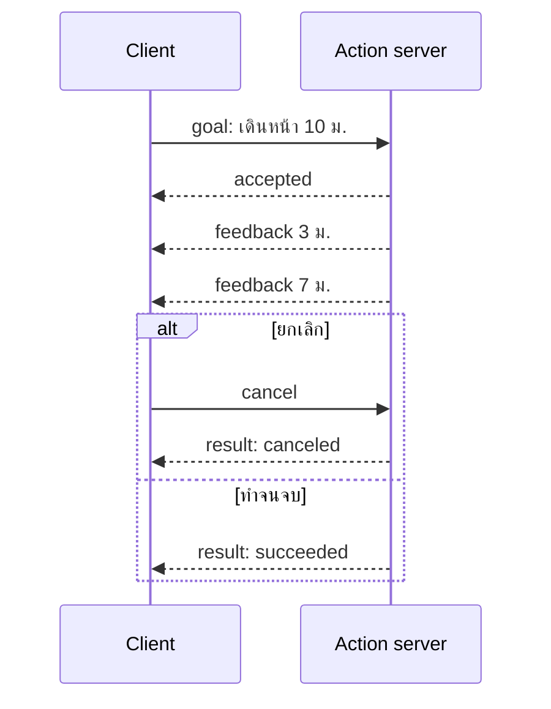

# บทที่ 3 — ลงมือกับ robotos: pub/sub, service, action และ mini digital twin

🏠 [หน้าหลัก](../README.md) · 📚 [สารบัญ ND3](README.md) · ⬅ [บทที่ 2](02-ros-concepts-digital-twin.md) · ถัดไป ➡ [บทที่ 4](04-onsite-robotos-workshop.md)

> **บทนี้เรียนอะไร:** ลงมือครั้งแรกกับ **robotos** — middleware แบบ ROS ที่ผู้สอนพัฒนาเอง รันเป็นไฟล์เดียวบน laptop ลองส่ง/รับข้อมูล เรียก service สั่ง action แล้วต่อยอดเป็น digital twin ขนาดเล็ก

## ทำไมสำคัญ

ROS 2 ตัวจริงติดตั้งยากและเหมาะกับคนสาย Linux ส่วน robotos ใช้ **แนวคิดเดียวกันทุกประการ** แต่ติดตั้งง่าย และยังเชื่อมกับ ROS 2 / Foxglove ได้ — มือใหม่จึงเข้าใจแนวคิดก่อนแล้วค่อยย้ายไป ROS 2 ได้

## แนวคิดหลัก

### โครงสร้างของ robotos



- ในมุมของ ROS **ฮาร์ดแวร์คือกล่องดำ** — คุยผ่านซอฟต์แวร์ ถือว่าสั่งอะไรได้อย่างนั้น ROS แค่รวมข้อมูล ประมวลผล แล้วสั่งการ
- **Zenoh** = ตัวรับส่งข้อมูลแบบ open source ของ Eclipse
- ต่อบอร์ดจริงด้วย **USB serial** ไม่ใช้ Bluetooth/WiFi เพราะข้อมูลอาจชนและไม่เสถียร

### Service กับ Action ต่างกันอย่างไร
เปรียบกับฝากเพื่อนซื้อกาแฟ:
- **Service** = ถามแล้วได้คำตอบทันที (เหมือนเปิดเว็บหนึ่งหน้า)
- **Action** = งานที่ใช้เวลา ต้องมี **feedback** ระหว่างทาง ("ถึงร้านแล้ว"), **ยกเลิก** ได้ ("ไม่เอาแล้ว") และต้องมี **result** เสมอ ("ได้แล้ว / ร้านปิด")



### 7 workshop
| # | Workshop | เทียบกับโลก PLC |
|---|---|---|
| 01 | Getting started — ติดตั้ง CLI, เปิด inspector ดู live graph | — |
| 02 | Publish & Subscribe — Python 2 ตัวส่ง/รับค่า sensor ผ่าน topic | ส่งค่า tag |
| 03 | Services — request/response | เรียก function block |
| 04 | Actions — งานยาว มี feedback ยกเลิกได้ | homing, batch cycle |
| 05 | Parameters — เปลี่ยนค่าตั้งขณะรัน | แก้ tag table แบบ online |
| 06 | Record & replay — บันทึก topic เป็น `.rbag` แล้วเล่นซ้ำ | historian |
| 07 | Capstone: mini digital twin — เครื่องจำลองส่ง state → twin สะท้อน → ส่งคำสั่งกลับ | HMI ที่ผูกกับเครื่องจริง |

**Record & replay** มีประโยชน์มาก: บันทึกข้อมูล IMU ไว้ครั้งเดียว แล้วจูนพารามิเตอร์ offline ได้โดยไม่ต้องรันหุ่นยนต์ใหม่

## ขั้นตอนลงมือ
**ต้องมี:** Python ≥ 3.10 · laptop เครื่องเดียว (ไม่ต้องใช้เน็ต บอร์ด หรือ compiler) · **Windows ใช้ PowerShell 7 เท่านั้น ไม่ใช้ Git Bash**

```powershell
# ใน workshops/code มี robotos สำหรับแต่ละ OS และ script setup (.ps1 / .sh)
robotos version
robotos doctor        # ตรวจเวอร์ชัน, peer, toolchain
robotos topic list    # ดู topic ที่มีอยู่ใน graph
```
จากนั้นรัน script ตัวอย่างเป็นคู่ (publisher + subscriber) ใน terminal 2 หน้าต่าง

## ปัญหาที่พบบ่อย

| อาการ | วิธีแก้ |
|---|---|
| `robotos` หาไม่เจอ | ไม่ได้ติดตั้งทั้งระบบ ต้องเพิ่ม PATH ทุกครั้งที่เปิด terminal ใหม่ (ทำผ่าน script setup) |
| path แปลก ๆ บน Windows | Git Bash แปลง path ที่ขึ้นต้นด้วย `/` ให้ใช้ PowerShell |
| `topic list` ว่าง | ยังไม่มี node ไหนรันอยู่ — เป็นเรื่องปกติ |

## คำศัพท์ในบท
[Topic](../common/glossary.md#topic) · [Service](../common/glossary.md#service) · [Action](../common/glossary.md#action) · [Parameter](../common/glossary.md#parameter) · [Middleware](../common/glossary.md#middleware) · [Digital Twin](../common/glossary.md#digital-twin)

## แหล่งอ้างอิง
- เอกสารผู้สอน ND03 Week 03: [workshops/README.md](https://github.com/drsanti/kmutt-nd69/blob/main/nd3/docs/week03/workshops/README.md)
- [Zenoh](https://zenoh.io/) · [Foxglove](https://foxglove.dev/)

---
🏠 [หน้าหลัก](../README.md) · 📚 [สารบัญ ND3](README.md) · ⬅ [บทที่ 2](02-ros-concepts-digital-twin.md) · ถัดไป ➡ [บทที่ 4 — Workshop Onsite](04-onsite-robotos-workshop.md)
