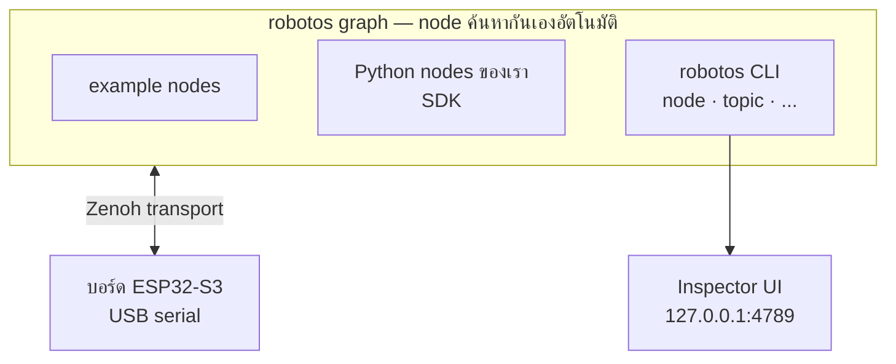
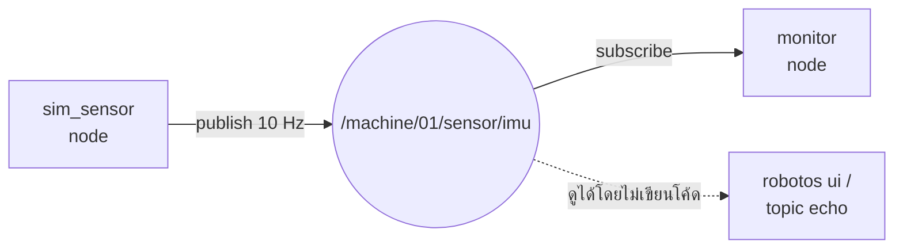
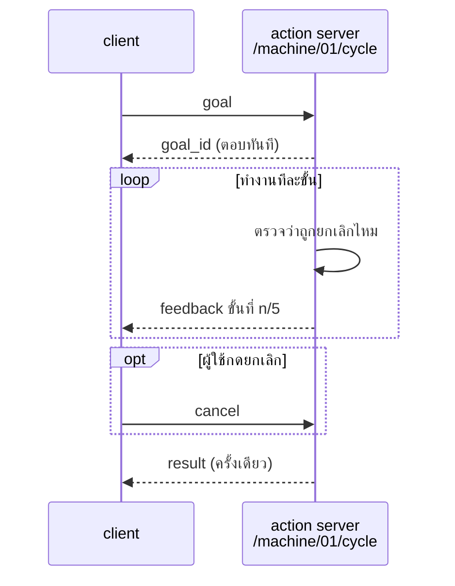
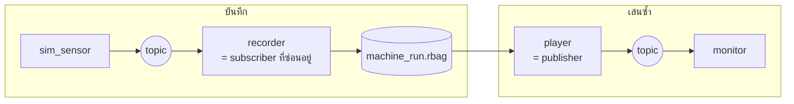
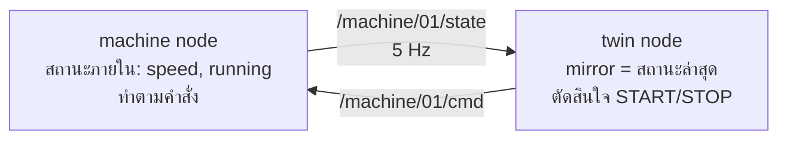

# บทที่ 3 — ลงมือกับ robotos: pub/sub, service, action, parameter, record และ mini digital twin

🏠 [หน้าหลัก](../README.md) · 📚 [สารบัญ ND3](README.md) · ⬅ [บทที่ 2](02-ros-concepts-digital-twin.md) · ถัดไป ➡ [บทที่ 4](04-onsite-robotos-workshop.md)

> **บทนี้เรียนอะไร:** ลงมือครั้งแรกกับ **robotos** — middleware แนวคิดเดียวกับ ROS ที่ผู้สอนพัฒนา รันเป็นไฟล์เดียวบน laptop ไม่ต้องใช้เน็ต บอร์ด หรือ compiler — เขียน Python ส่ง/รับข้อมูล เรียก service สั่ง action ปรับ parameter บันทึกและเล่นซ้ำข้อมูล แล้วประกอบเป็น digital twin ขนาดเล็ก
>
> **ก่อนอ่าน:** [บทที่ 2](02-ros-concepts-digital-twin.md) · Python พื้นฐาน · **เวลา:** ~3 ชั่วโมงถ้าทำครบ 7 workshop

## สารบัญบทนี้
1. [ทำไมใช้ robotos แทน ROS 2](#1-ทำไมใช้-robotos-แทน-ros-2)
2. [โครงสร้างของ robotos](#2-โครงสร้างของ-robotos)
3. [W01 — ติดตั้งและดู graph](#3-w01--ติดตั้งและดู-graph)
4. [W02 — Publish และ Subscribe](#4-w02--publish-และ-subscribe)
5. [W03 — Service](#5-w03--service)
6. [W04 — Action](#6-w04--action)
7. [W05 — Parameter](#7-w05--parameter)
8. [W06 — Record และ Replay](#8-w06--record-และ-replay)
9. [W07 — Mini digital twin](#9-w07--mini-digital-twin)
10. [แก้ปัญหาที่พบบ่อย](#10-แก้ปัญหาที่พบบ่อย)
11. [สรุปและแบบฝึก](#11-สรุปและแบบฝึก)

---

## 1. ทำไมใช้ robotos แทน ROS 2

| | ROS 2 ตัวจริง | robotos |
|---|---|---|
| ติดตั้ง | ยุ่งยาก เหมาะกับคนสาย Linux | ไฟล์เดียว รันได้ทันที |
| แนวคิด | node, topic, service, action, parameter, bag | **เหมือนกันทุกประการ** |
| ต่อบอร์ด ESP32 | ต้องใช้ micro-ROS | ต่อตรงผ่าน USB serial ได้ |
| เชื่อมโลกภายนอก | — | เชื่อมกับ ROS 2 / Foxglove ได้ (กำลังพัฒนา) |
| ระบบที่ทดสอบ | Linux | Windows, macOS Apple Silicon (Linux ยังไม่ทดสอบครบ) |

เป้าหมาย: **เข้าใจแนวคิดก่อน** แล้วย้ายไป ROS 2 ได้ทันทีเพราะคำศัพท์และรูปแบบเดียวกัน

---

## 2. โครงสร้างของ robotos



- **ไม่มี broker ให้เปิดก่อน** — node ค้นหากันเองผ่านเครือข่ายในเครื่อง (ต่างจาก MQTT ที่ต้องเปิด broker)
- CLI, inspector และโค้ด Python ของเรา ล้วนเป็น "พลเมือง" ของ graph เดียวกัน — `topic echo` ฟังข้อความชุดเดียวกับที่ subscriber ได้
- **Zenoh** = ระบบส่งข้อมูลโอเพนซอร์สของ Eclipse ที่ robotos ใช้อยู่ข้างใต้
- ในมุมของ ROS **ฮาร์ดแวร์คือกล่องดำ** — สั่งอะไรได้อย่างนั้น ข้อมูลที่ส่งมาถือว่าถูก ROS แค่รวบรวม ประมวลผล แล้วสั่งการ

---

## 3. W01 — ติดตั้งและดู graph

### หาแพ็กเกจของ OS ตัวเอง
```text
code/
├── robotos-v0.3.0-macos-arm64/
├── robotos-v0.3.0-windows-x64/
└── robotos-v0.3.0-linux-x64/
    ├── bin/robotos[.exe]        ← CLI ไฟล์เดียวทำทุกอย่าง
    ├── lib/librobotos_ffi.*     ← library ที่ SDK ทุกภาษาใช้
    └── include/
```

### ทุกครั้งที่เปิด terminal ใหม่
`robotos` **ไม่ได้ติดตั้งทั้งระบบ** ต้องตั้ง PATH และ activate Python environment ใหม่ทุกหน้าต่าง (ใช้ script setup ที่มากับ repo ได้)

```powershell
# Windows — PowerShell เท่านั้น (ไม่ใช้ Git Bash เพราะแปลง path ที่ขึ้นต้นด้วย / ผิด)
cd code
$env:PATH = "$PWD\robotos-v0.3.0-windows-x64\bin;$env:PATH"
.\.venv\Scripts\Activate.ps1
```
```bash
# macOS / Linux
cd code
export PATH="$PWD/robotos-v0.3.0-macos-arm64/bin:$PATH"
source .venv/bin/activate
```

### ตรวจและเปิด inspector
```bash
robotos version
robotos doctor          # ตรวจเวอร์ชัน, target, peer, toolchain
robotos ui              # เปิด inspector ในเบราว์เซอร์ เห็น graph สด
```

แนะนำ extension ใน VS Code: **Markdown Preview Enhanced** (อ่านเอกสาร มี graph view) และ **Draw.io Integration** (วาดไดอะแกรมในโปรเจกต์)

---

## 4. W02 — Publish และ Subscribe



### ติดตั้ง Python SDK (ครั้งแรก)
```bash
cd code
python3 -m venv .venv && source .venv/bin/activate     # Windows: python -m venv .venv
pip install ./robotos-0.3.0-py3-none-any.whl protobuf
```

### Publisher — `02-sim_sensor.py`
```python
import random, time
import robotos
from robotos.messages.robotos.sensor.v1.imu_pb2 import Imu

TOPIC = "/machine/01/sensor/imu"

with robotos.Node("sim_sensor") as node:                 # เข้าร่วม graph ในชื่อ sim_sensor
    pub = node.create_publisher(TOPIC, Imu)               # ช่องข้อมูลที่มีชนิดชัดเจน
    while True:
        pub.publish(Imu(
            timestamp_ns=time.time_ns(),
            frame_id="imu_01",                            # บอกว่าวัดในกรอบไหน (TF)
            acceleration={"x": 0.0, "y": 0.0, "z": 9.81},
            angular_velocity={"x": random.uniform(-1, 1)},
        ))
        time.sleep(0.1)                                   # 10 Hz
```
3 แนวคิดใน 15 บรรทัด: `Node` = โปรเซสของเราบน graph · `create_publisher(topic, Type)` = ช่องที่มีชนิด · `publish(msg)` = ส่งแล้วไม่ต้องรอ

### Subscriber — `02-monitor.py`
```python
import robotos
from robotos.messages.robotos.sensor.v1.imu_pb2 import Imu

with robotos.Node("monitor") as node:
    sub = node.create_subscriber("/machine/01/sensor/imu", Imu)
    sub.on_message(lambda msg, meta: print(
        f"acc.z={msg.acceleration.z:.2f}  gyro.x={msg.angular_velocity.x:+.3f}"))
    input("subscribed — press Enter to stop")
```
- `on_message(cb)` = **event-driven** — ข้อมูลมาเมื่อไรเรียกฟังก์ชันเมื่อนั้น (การเปลี่ยนจาก PLC สู่ event-driven ใน 2 บรรทัด)
- `sub.recv(timeout_ms)` = แบบ **ดึงเอง (polling)** ถ้าต้องการ

### ดู graph โดยไม่เขียนโค้ด
```bash
robotos node list                            # → sim_sensor, monitor
robotos topic list                           # → /machine/01/sensor/imu
robotos topic echo /machine/01/sensor/imu    # ดูค่าที่ไหลสด
```

### หัวใจคือ decoupling
- subscriber เข้ามาทีหลัง → เริ่มได้ข้อความใหม่ทันที publisher ไม่ต้อง restart
- subscriber ตาย → publisher ไม่รู้และไม่สน
- subscriber ตัวที่สองเข้ามา → ข้อมูลกระจายให้ทั้งคู่ โดย publisher ไม่ต้องทำอะไรเพิ่ม

ตรงข้ามกับการเรียกฟังก์ชันที่ผู้เรียกและผู้ถูกเรียกต้องมีอยู่พร้อมกันและรู้จักกัน — นี่คือเหตุที่ graph ของหุ่นยนต์โตเป็นหลายสิบ node ได้โดยไม่ต้องต่อสายตรงกันทุกคู่

---

## 5. W03 — Service

```python
# server
def echo(req):
    return EchoResponse(text=req.text)

node.create_service("/test/echo", EchoRequest, EchoResponse, echo)

# client
resp = node.call("/test/echo", EchoRequest(text="hello"))
```
- `create_service(ชื่อ, ชนิด request, ชนิด response, handler)` — handler ได้ request แล้วคืน response
- เทียบโลก PLC: **เรียก function block แบบถาม-ตอบ** เช่น "อ่าน setpoint ปัจจุบัน", "reset alarm"
- ต่างจาก topic ตรงที่ **มีผู้รับเจาะจงและมีคำตอบกลับ**

---

## 6. W04 — Action

| รูปแบบ | รูปทรง | ใช้กับ |
|---|---|---|
| topic | stream ต่อเนื่อง | ข้อมูล sensor |
| service | request → reply สั้น | คำสั่งเร็ว |
| **action** | goal → feedback… → result | งานยาว ยกเลิกได้ |



**ทำไมต้องมี action:** ถ้าใช้ service กับงาน homing 5 นาที = เรียกค้าง 5 นาที มองไม่เห็นความคืบหน้า และยกเลิกไม่ได้ · action แยก "เริ่มงาน" ออกจาก "เฝ้าดูงาน" — `send_goal` คืนค่าทันที แล้ว feedback / result ตามมาเองตามจังหวะ

เปรียบเทียบที่ผู้สอนใช้: **ฝากเพื่อนซื้อกาแฟ** — ถ้าไม่รู้ว่าเพื่อนรับปากไหม ไม่รู้ว่าถึงไหนแล้ว หรือยกเลิกไม่ได้ ถือว่าระบบไม่ดี

ตัวอย่างในชีวิตจริง: homing แกน, รัน batch cycle, ชาร์จแบตเตอรี่, เดินหุ่นยนต์ 10 เมตร

---

## 7. W05 — Parameter

```bash
robotos param list  tuning_node              # ดู parameter ที่ node ประกาศไว้
robotos param get   tuning_node setpoint     # → 42
robotos param set   tuning_node setpoint 77  # เปลี่ยนขณะรัน
robotos param watch tuning_node              # ดูเหตุการณ์เปลี่ยนค่าแบบสด
```
- เทียบได้กับ **แก้ tag table ของ PLC แบบ online**
- node เป็นเจ้าของ parameter ของตัวเอง ค่าคงอยู่จนมีคนตั้งใจเปลี่ยน (ต่างจาก topic ที่ไหลตลอด)

---

## 8. W06 — Record และ Replay

ปัญหาจากบทที่ 2: ระบบกระจายไม่มีโปรแกรมเดียวให้ไล่ดู — การบันทึกทำให้ได้ **ข้อมูลจริง (เวลาและลำดับเดิม)** มาเล่นซ้ำได้ไม่จำกัด



```bash
python3 02-sim_sensor.py                         # terminal 1: สร้างข้อมูล
robotos record /machine/01/sensor/imu -o machine_run.rbag --duration-s 10
robotos bag info machine_run.rbag                # ดูว่ามี topic อะไร กี่ข้อความ
robotos play machine_run.rbag                    # เล่นตามจังหวะเดิม
robotos play machine_run.rbag --rate 2.0         # เร็ว 2 เท่า
robotos play machine_run.rbag --dry-run          # แค่ดูแผน ไม่ส่งจริง
```
- recorder เป็นแค่ subscriber ที่ซ่อนอยู่ player เป็นแค่ publisher — **ไม่ได้เปลี่ยน graph** แค่ "ดักสาย"
- เทียบได้กับ **historian** ในโรงงาน: ดึง trend ของกะเมื่อวานมารันซ้ำแบบ offline
- ใช้จริง: บันทึกค่า IMU ครั้งเดียว แล้ว **จูนพารามิเตอร์ offline** ได้โดยไม่ต้องรันหุ่นยนต์ใหม่
- ⚠️ replay คือ **หลักฐานที่บันทึกไว้** ไม่ใช่การทดสอบสดครั้งใหม่

---

## 9. W07 — Mini digital twin

รวมทุกอย่างในสัปดาห์เป็นรูปแบบ digital twin — **twin คือผู้ฟังตัวหนึ่งใน graph** ไม่ใช่ simulator ที่ต่อแปะไว้ข้าง ๆ



- **สถานะไหลจากเครื่อง → twin · คำสั่งไหลจาก twin → เครื่อง**
- twin **ไม่เขียนสถานะของเครื่องโดยตรง** — มีผลต่อเครื่องได้ทางเดียวคือ publish คำสั่ง เหมือนชั้น supervisory ของ HMI/SCADA
- สองช่อง สองทิศ หนึ่งเครื่อง — รูปแบบเดียวกับที่จะใช้กับบอร์ดจริงในบทที่ 4

ตัวอย่างลำดับการทำงาน (MW-06 ใน workshop onsite): twin เฝ้าดู 5 วินาที → ส่ง START (ความเร็วค่อย ๆ ขึ้นถึง 1.00) เฝ้าดู 8 วินาที → ส่ง STOP (ความเร็วลดลงเป็น 0) เฝ้าดู 6 วินาที

---

## 10. แก้ปัญหาที่พบบ่อย

> 💡 **ปัญหาพื้นฐานเรื่อง Shell (PowerShell / Git Bash), สิทธิ์พอร์ต USB, PATH และ Gatekeeper** รวมวิธีแก้ไว้ที่ [คู่มือแก้ปัญหาพื้นฐาน (Troubleshooting)](../common/troubleshooting.md) — ตารางด้านล่างนี้เน้นปัญหาเฉพาะของบทนี้

| อาการ | สาเหตุ / วิธีแก้ |
|---|---|
| `robotos` หาไม่เจอ | เปิด terminal ใหม่แล้วยังไม่ได้ตั้ง PATH / activate `.venv` |
| path แปลก ๆ บน Windows | ใช้ Git Bash → เปลี่ยนเป็น **PowerShell** (แนะนำ PowerShell 7) |
| `.venv` does not exist | ยังไม่ได้ทำขั้นติดตั้ง SDK |
| `topic list` ว่าง | ยังไม่มี node รันอยู่ — เป็นสถานะปกติ |
| `record` ขึ้น `invalid topic name` | ชื่อ topic ผิดรูปแบบ (ต้องขึ้นต้นด้วย `/`) |
| ใช้ `python3` บน Windows ไม่ได้ | Windows ใช้ `python` |

---

## 11. สรุปและแบบฝึก

### สรุป
| Workshop | คำสั่ง / API หลัก |
|---|---|
| W01 | `robotos doctor`, `robotos ui` |
| W02 | `create_publisher` / `create_subscriber` + `on_message`, `topic echo` |
| W03 | `create_service`, `node.call` |
| W04 | action: goal → feedback → result + cancel |
| W05 | `robotos param list/get/set/watch` |
| W06 | `robotos record`, `bag info`, `play --rate` |
| W07 | twin = subscriber สถานะ + publisher คำสั่ง |

### แบบฝึก
1. รัน W02 แล้วเปิด subscriber ตัวที่สอง (`topic echo`) ระหว่างทาง — publisher ต้องทำอะไรเพิ่มไหม?
2. แก้ `sim_sensor` ให้ส่งค่าอุณหภูมิไปอีก topic หนึ่ง แล้วเขียน node แจ้งเตือนเมื่อเกิน 60 °C
3. บันทึกข้อมูล 10 วินาที แล้วเล่นซ้ำที่ความเร็ว 2 เท่า — monitor แยกออกไหมว่าเป็นข้อมูลสดหรือข้อมูลเล่นซ้ำ?
4. ใน W07 ให้ twin ส่ง STOP อัตโนมัติเมื่อความเร็วเกิน 0.8

## คำศัพท์ในบท
[Topic](../common/glossary.md#topic) · [Service](../common/glossary.md#service) · [Action](../common/glossary.md#action) · [Parameter](../common/glossary.md#parameter) · [Middleware](../common/glossary.md#middleware) · [Digital Twin](../common/glossary.md#digital-twin) · [Node](../common/glossary.md#node)

## แหล่งอ้างอิง
- เอกสารผู้สอน ND3 Week 03: [workshops/README.md](https://github.com/drsanti/kmutt-nd69/blob/main/nd3/docs/week03/workshops/README.md) · [SYSTEM-OVERVIEW.md](https://github.com/drsanti/kmutt-nd69/blob/main/nd3/docs/week03/SYSTEM-OVERVIEW.md) —
  [01](https://github.com/drsanti/kmutt-nd69/blob/main/nd3/docs/week03/workshops/01-getting-started.md) ·
  [02](https://github.com/drsanti/kmutt-nd69/blob/main/nd3/docs/week03/workshops/02-pub-sub.md) ·
  [04](https://github.com/drsanti/kmutt-nd69/blob/main/nd3/docs/week03/workshops/04-actions.md) ·
  [06](https://github.com/drsanti/kmutt-nd69/blob/main/nd3/docs/week03/workshops/06-record-replay.md) ·
  [07](https://github.com/drsanti/kmutt-nd69/blob/main/nd3/docs/week03/workshops/07-mini-digital-twin.md)
- การบรรยาย Online ND3 Week 03 (25 ต.ค. 2026)
- [Zenoh](https://zenoh.io/) · [Foxglove](https://foxglove.dev/)

---
🏠 [หน้าหลัก](../README.md) · 📚 [สารบัญ ND3](README.md) · ⬅ [บทที่ 2](02-ros-concepts-digital-twin.md) · ถัดไป ➡ [บทที่ 4 — Workshop Onsite](04-onsite-robotos-workshop.md)
