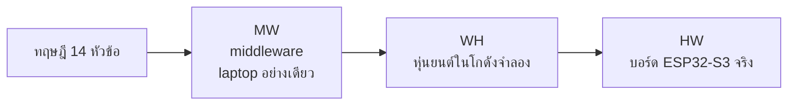
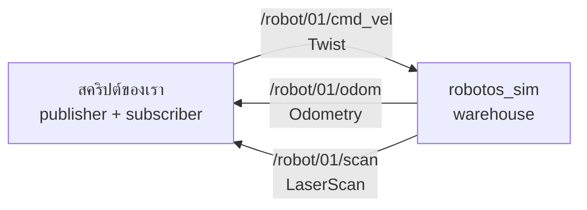
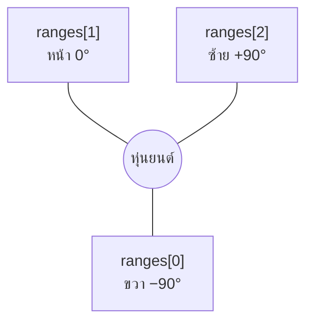
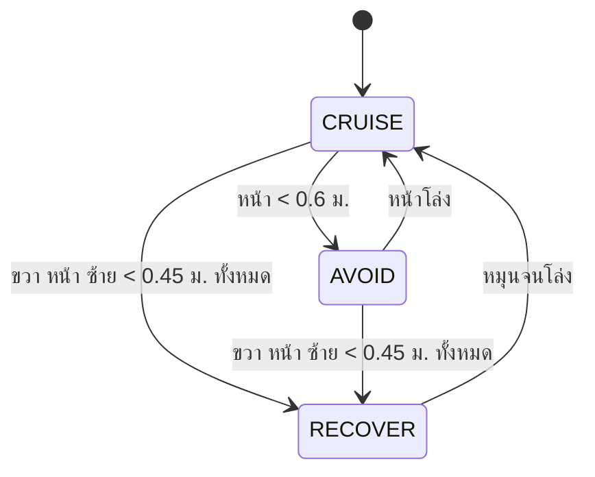
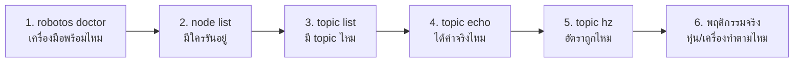
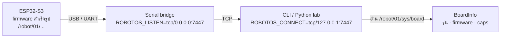

# บทที่ 4 — Workshop Onsite: robotos กับ warehouse simulation และบอร์ดจริง

🏠 [หน้าหลัก](../README.md) · 📚 [สารบัญ ND3](README.md) · ⬅ [บทที่ 3](03-robotos-hands-on.md) · ถัดไป ➡ [Git, GitHub และ Markdown](../common/git-github-markdown.md)

> **บทนี้เรียนอะไร:** 24 แบบฝึกใน 3 track — middleware บน laptop, ขับหุ่นยนต์ในโกดังจำลอง และต่อบอร์ด ESP32-S3 จริง — พร้อมทฤษฎี 14 หัวข้อที่ใช้ในแบบฝึก: Twist, odometry, scan, open/closed loop, เดินตามผนัง, state machine, bag, schema, TF, digital twin และการต่อบอร์ด
>
> **ก่อนอ่าน:** [บทที่ 3](03-robotos-hands-on.md) · **เวลา:** Workshop เต็มวัน (09:00–16:00)

## สารบัญบทนี้
1. [สิ่งที่ต้องเตรียมและการติดตั้ง](#1-สิ่งที่ต้องเตรียมและการติดตั้ง)
2. [ภาพรวม 3 track](#2-ภาพรวม-3-track)
3. [หลักคิด: หลักฐาน ไม่ใช่แค่ "รันผ่าน"](#3-หลักคิด-หลักฐาน-ไม่ใช่แค่-รันผ่าน)
4. [ทฤษฎี: หุ่นยนต์ในโกดังจำลอง](#4-ทฤษฎี-หุ่นยนต์ในโกดังจำลอง)
5. [ทฤษฎี: การควบคุมและพฤติกรรม](#5-ทฤษฎี-การควบคุมและพฤติกรรม)
6. [ทฤษฎี: ข้อมูล การ debug และพิกัด](#6-ทฤษฎี-ข้อมูล-การ-debug-และพิกัด)
7. [ทฤษฎี: บอร์ด ESP32-S3 บน graph](#7-ทฤษฎี-บอร์ด-esp32-s3-บน-graph)
8. [Track MW — middleware](#8-track-mw--middleware)
9. [Track WH — warehouse simulation](#9-track-wh--warehouse-simulation)
10. [Track HW — บอร์ดจริง](#10-track-hw--บอร์ดจริง)
11. [แก้ปัญหาที่พบบ่อย](#11-แก้ปัญหาที่พบบ่อย)
12. [สรุปและแบบฝึกต่อยอด](#12-สรุปและแบบฝึกต่อยอด)

---

## 1. สิ่งที่ต้องเตรียมและการติดตั้ง

| ต้องมี | หมายเหตุ |
|---|---|
| Notebook + ที่ชาร์จ | รองรับ Windows x64 และ macOS Apple Silicon |
| สาย USB-C ↔ USB-A ที่รับส่งข้อมูลได้ | สำหรับ track HW · เครื่องที่มีแต่ USB-C เตรียมตัวแปลง |
| VS Code (หรือ Cursor) | เปิดโฟลเดอร์ workshop |
| Python ≥ 3.10 | script setup สร้าง `.venv` ให้ |

### ติดตั้งครั้งแรก
```powershell
git clone https://github.com/drsanti/robotos-workshop.git
cd robotos-workshop
# Windows: ดับเบิลคลิก scripts\start-here.cmd
#   → สร้าง .venv · ติดตั้ง Python SDK · เปิด warehouse sim
# macOS:   ดับเบิลคลิก scripts/start-here.command หรือ ./scripts/start-here.sh
```

### ทุกครั้งที่เปิด terminal ใหม่ (Windows PowerShell)
```powershell
cd YOUR_WORKSHOP_DIR
$env:PATH = "$PWD\code\robotos-v0.3.0-windows-x64\bin;$env:PATH"
.\.venv\Scripts\Activate.ps1
robotos topic list            # เมื่อ sim เชื่อมแล้ว ต้องเห็น /robot/01/cmd_vel, odom, scan
scripts\run.cmd wh-01         # รันแบบฝึก
```
macOS ใช้ `export PATH="$PWD/code/robotos-v0.3.0-macos-arm64/bin:$PATH"`, `source .venv/bin/activate`, `./scripts/run wh-01`

> ใช้ **PowerShell** ไม่ใช้ Git Bash (Git Bash แปลง path ที่ขึ้นต้นด้วย `/robot/` ผิด)

มีเอกสารแบบ interactive (กดคัดลอก/รันได้) ที่ [drsanti.github.io/robotos-workshop-docs](https://drsanti.github.io/robotos-workshop-docs/) หรือแบบ offline ด้วย `scripts/start-online-docs`

---

## 2. ภาพรวม 3 track



| Track | แบบฝึก | ต้องมี |
|---|---|---|
| **MW** (Signal Lab) | MW-00 … MW-06 | laptop อย่างเดียว ไม่ต้องใช้ sim หรือบอร์ด |
| **WH** (Warehouse) | WH-00 … WH-08 | warehouse sim แบบ **Native + Connected** และตั้งเป็น **External** |
| **HW** (Hardware) | HW-00 … HW-07 | บอร์ดจริง + serial bridge · **ปิด sim ก่อน** |

ทุกแบบฝึกใช้โครงเดียวกัน: **Objective → Mechanism → Checkpoints (Prepare / Run / Observe) → Expected evidence → Takeaway**

---

## 3. หลักคิด: หลักฐาน ไม่ใช่แค่ "รันผ่าน"

หลักการสำคัญที่เน้นย้ำในเกือบทุกแบบฝึก:
- **ได้รับค่าที่ decode แล้ว** เป็นหลักฐานที่ดีกว่าแค่เห็นชื่อ topic
- **ภาพเคลื่อนไหวแบบ Mock** ไม่ได้พิสูจน์ว่าโค้ดเราต่อ graph จริง
- **process จบโดยไม่ error** ไม่ได้แปลว่าทำงานสำเร็จ — ต้องเห็น response / result จริง
- **ข้อความ "ส่งแล้ว"** ยืนยันแค่ฝั่งส่ง ต้องสังเกตผลทางกายภาพแยกต่างหาก (ไฟติดจริงไหม)
- **ชื่อ state ใน log** (เช่น RECOVER) บันทึกการตัดสินใจ ไม่ได้พิสูจน์ว่าหุ่นหลุดจากมุมได้จริง
- **replay** คือหลักฐานที่บันทึกไว้ ไม่ใช่การทดสอบสดใหม่

---

## 4. ทฤษฎี: หุ่นยนต์ในโกดังจำลอง

### Graph ของหุ่นในโกดัง (Theory 01)

- **Node** = ผู้ร่วมระบบที่กำลังรัน · **Topic** = ช่องข้อมูลที่มีชื่อ · **Schema** = ชนิดข้อความที่ตกลงกัน
- ตรวจ graph: `robotos topic list` และ `robotos topic echo /robot/01/odom --count 5`

### Twist และการควบคุม (Theory 02)
| ค่า | ความหมาย |
|---|---|
| `linear.x` (m/s) | ความเร็วเดินหน้า |
| `angular.z` (rad/s) | ความเร็วหมุน · **ค่าบวก = ทวนเข็มนาฬิกา (เลี้ยวซ้าย)** |

- ส่งคำสั่ง **สม่ำเสมอ 20 ครั้ง/วินาที** (ทุก 50 ms)
- หยุดส่งนาน ≥ 500 ms → **หุ่นหยุดเอง** (stale-command timeout กันหุ่นวิ่งเตลิด)
- จบงานปกติให้ส่ง **Twist เป็นศูนย์** — การหยุดด้วยศูนย์กับการหยุดด้วย timeout เป็น **คนละกลไก**
- sim มี 2 โหมด: **Manual** (คุมด้วย UI / คีย์บอร์ด) และ **External** (รับคำสั่งจากสคริปต์) — ต้องตั้งเป็น External

### Odometry และ scan 3 ลำแสง (Theory 03)

- **Odometry** = ตำแหน่ง `x, y` (เมตร) และทิศ `yaw` (เรเดียน) ที่หุ่นคำนวณจากการเคลื่อนที่ของตัวเอง
- **Scan** มีระยะ 3 ค่า เรียง **ขวา / หน้า / ซ้าย ที่ index 0 / 1 / 2** — เข้าใกล้ชั้นวางด้านหน้า `ranges[1]` จะลดลง
- ตรวจ `range_max` ก่อนเชื่อค่าที่มากผิดปกติ

---

## 5. ทฤษฎี: การควบคุมและพฤติกรรม

### Open loop vs Closed loop (Theory 04)
| | Open loop | Closed loop (feedback) |
|---|---|---|
| คำสั่งขึ้นกับ | **เวลา** | **ค่าที่วัดได้** |
| ตัวอย่าง | เดินสี่เหลี่ยมโดยตั้งเวลา | ถ้าระยะหน้า < 0.6 ม. ให้เลี้ยว |
| odometry ใช้ทำ | แค่รายงาน | ใช้ตัดสินใจ |

เดินสี่เหลี่ยมแบบตั้งเวลา:
```
t_drive = ระยะด้าน / ความเร็ว         (v > 0)
t_turn  = (π / 2) / ความเร็วหมุน       (ω > 0)   เช่น ω = 0.8 → t_turn ≈ 1.96 วินาที
```
ผลคือหุ่นกลับไม่ตรงจุดเริ่ม — ความคลาดเคลื่อน **closure error = √(Δx² + Δy²)** เพราะจังหวะเวลาและการปัดค่าสะสม

### เดินตามผนังและ state machine (Theory 05)
**คุมระยะห่างจากผนัง**
```
e  = target − ระยะด้านข้าง        เช่น 0.7 − 0.4 = +0.3 ม.
wz = sign × k × e                 sign = +1 ผนังขวา, −1 ผนังซ้าย
wz ถูกจำกัดไม่เกิน ±1.2 rad/s
```
ผนังขวาใกล้เกิน → e เป็นบวก → wz เป็นบวก → **เลี้ยวซ้ายออกจากผนัง**

**ลำดับความสำคัญของการตัดสินใจ**

| state | ทำอะไร |
|---|---|
| CRUISE | เดินหน้า |
| AVOID | เลี้ยวไปด้านที่โล่งกว่า |
| RECOVER | หมุนอยู่กับที่ (พยายามหลุดออก — **ไม่รับประกันว่าหลุด**) |

---

## 6. ทฤษฎี: ข้อมูล การ debug และพิกัด

| Theory | หัวข้อ | ใจความ |
|---|---|---|
| 06 | **Bags & Evidence** | `robotos record -o run1.rbag /robot/01/odom /robot/01/scan` → Ctrl-C → `robotos bag info run1.rbag` ดูชื่อ topic และจำนวนข้อความต้องไม่เป็นศูนย์ · เลือกบันทึก topic ที่ใช้ยืนยันสิ่งที่อ้าง (อ้างว่าหลบได้ → ต้องมีทั้ง scan และ odom) |
| 07 | **Messages & Schemas** | ชื่อ topic + ชนิดที่เข้ากันได้ (เช่น `robotos.sensor.v1.Imu`) ทำให้ byte มีความหมายเดียวกัน · type เดียวกันใช้ได้ทั้ง Python / Rust / C++ |
| 08 | **Services** | เรียกตามชื่อ (`/test/echo`) ได้ 1 response ต่อ 1 request · ถ้าผู้ให้บริการยังไม่พร้อมให้ retry |
| 09 | **Actions** | goal accepted ≠ งานเสร็จ · feedback = ความคืบหน้า · result = ผลสุดท้าย · server ตรวจ `cancel_requested` ทุกขั้น |
| 10 | **Parameters & Lifecycle** | parameter = ค่าใน RAM ของ node ปรับขณะรันได้ (ต้องเปิดสิทธิ์) · lifecycle: unconfigured → inactive → active · ค่าถาวรบนบอร์ดเป็นอีกกลไกหนึ่ง |
| 11 | **Observe, Debug & QoS** | บันไดวินิจฉัย ↓ · QoS แลกกันระหว่าง reliability / history depth / latency (preset: sensor, control, state, logging) |
| 12 | **TF & Coordinate Frames** | ค่าพิกัดมีความหมายเมื่อรู้ frame · chain: `map → odom → base_link → sensor_link` · odometry มี `frame_id: "odom"`, `child_frame_id: "base_link"` · เปลี่ยนชื่อ topic ไม่ได้แปลงพิกัดให้ |
| 13 | **Digital Twin on the Graph** | `machine.py` (เครื่องเป็นเจ้าของสถานะ) ส่ง `/machine/01/state` ↔ `twin.py` สะท้อนสถานะและส่ง `/machine/01/cmd` · รูปข้อความเหมือนกันไม่ได้แปลว่าเที่ยงตรงทางฟิสิกส์ |

### บันไดวินิจฉัยปัญหา (Theory 11)
ไล่จากล่างขึ้นบน แต่ละขั้นเป็นหลักฐานที่หนักแน่นกว่าขั้นก่อน:



---

## 7. ทฤษฎี: บอร์ด ESP32-S3 บน graph

### เส้นทางการเชื่อมต่อ (Theory 14)

- **bridge เป็นฝ่าย listen** ส่วน CLI และ lab เป็นฝ่าย connect
- **ปิด warehouse sim ก่อนเปิด bridge** เพราะใช้พอร์ต 7447 เดียวกัน

### Capability bits
| bit | ค่า | อุปกรณ์ |
|---|---|---|
| 0 | `0x01` | LED |
| 1 | `0x02` | ไมโครโฟน |
| 2 | `0x04` | IMU |
| 3 | `0x08` | RTC (นาฬิกา) |
| 4 | `0x10` | แบตเตอรี่ |
| 5 | `0x20` | ปุ่ม |

| บอร์ด | caps | มีอะไร |
|---|---|---|
| es3c28p | `0x33` | LED, MIC, BATT, BTN |
| ws28p | `0x3c` | IMU, RTC, BATT, BTN |

> ตัวอย่างการอ่าน: `0x3c` = `0x20 + 0x10 + 0x08 + 0x04` → BTN + BATT + RTC + IMU · **LED และ IMU ไม่ได้มีทุกบอร์ด — probe ก่อนใช้เสมอ**

---

## 8. Track MW — middleware

| แบบฝึก | วัตถุประสงค์ | หลักฐานที่ต้องเห็น |
|---|---|---|
| **MW-00** Getting started | ตรวจ CLI (`robotos 0.3.x`), import SDK, `doctor`, discovery | topic list ว่าง = ปกติถ้ายังไม่มี node |
| **MW-01** Pub/Sub | `sim_sensor.py` ส่ง IMU จำลองไป `/machine/01/sensor/imu` (acc.z = 9.81, gyro.x สุ่ม) | `monitor.py` และ `topic echo` ได้ค่าพร้อมกัน |
| **MW-02** Services | `echo_server` ให้บริการ `/test/echo` · client timeout 2000 ms retry สูงสุด 30 ครั้ง | เห็น reply `hello robotos (seq 1)` ไม่ใช่ดูแค่ exit code |
| **MW-03** Actions | `/machine/01/cycle` feedback step i/5 (1 วินาทีต่อขั้น) | goal accepted → feedback → result `cycle complete` |
| **MW-04** Parameters | เปลี่ยน `setpoint` จาก 42 → 99 ขณะรัน | node พิมพ์ 99 ในรอบถัดไป · `mode` ยังเป็น auto · restart แล้วกลับค่าเริ่มต้น |
| **MW-05** Record & replay | บันทึก IMU ~15 วินาทีเป็น `imu_run.rbag` | `bag info` จำนวนไม่เป็นศูนย์ |
| **MW-06** Mini digital twin | twin เฝ้า 5 วินาที → START (ความเร็วขึ้นถึง 1.00) 8 วินาที → STOP (ลดเป็น 0) 6 วินาที | เห็นความเร็วขึ้นและลงตามคำสั่ง |

---

## 9. Track WH — warehouse simulation

**ทุกแบบฝึก:** sim หนึ่งตัวแบบ Native + Connected · ตั้งเป็น External · มีผู้ส่งคำสั่งได้ทีละตัว

| แบบฝึก | ทำอะไร | ค่าที่ใช้ / คำสั่ง |
|---|---|---|
| **WH-00** Hello graph | แค่สังเกต: เห็น 3 topic และ echo odometry | ยังไม่ส่งคำสั่ง |
| **WH-01** Drive by Twist | เดินหน้าแล้วหยุด | vx 0.2 m/s · 20 Hz · 100 คำสั่ง + ศูนย์ → ~1 ม. · หมุนอยู่กับที่: `--vx 0 --wz 0.5` |
| **WH-02** Sense | พิมพ์ x, y, yaw และ R/F/L ทุก 0.2 วินาที | รันคู่กับ `wh-01 --vx 0.1 --seconds 2` |
| **WH-03** Avoid front | หน้า < 0.6 ม. → หมุนไปด้านที่โล่งกว่า ไม่งั้นเดินหน้า | vx 0.15 · `--threshold 0.6` · หยุดด้วย Ctrl-C |
| **WH-04** Timed square | เดินสี่เหลี่ยมแบบตั้งเวลา วัด closure error | `scripts/run wh-04 --side 0.8 --vx 0.2` |
| **WH-05** Wall following | เดินตามผนังขวา | target 0.7 ม. · k 1.2 · vx 0.18 · หน้า < 0.55 ม. สำคัญกว่า · รัน ≥ 60 วินาที |
| **WH-06** State machine | CRUISE / AVOID / RECOVER คำนวณใหม่ทุก 50 ms log เฉพาะตอนเปลี่ยน | ประเมินจากการรัน 90 วินาที |
| **WH-07** Record evidence | รัน wh-03 แล้วบันทึก odom + scan 20–30 วินาที | `robotos bag info run1.rbag` |
| **WH-08** Capstone | เลือก 1 track: **A** Patrol 90 วินาทีแล้วกลับใกล้จุดเริ่ม · **B** Clear aisle · **C** โซนที่ผู้สอนกำหนด | ส่ง: script ที่รันจริง + หลักฐาน log/bag + โน้ต 3 ประโยค (อะไรพัง ปรับอะไร ผลเป็นอย่างไร) |

ตัวอย่าง log ของ WH-06:
```
[ 5.000] state: CRUISE   (R=1.20 m, F=0.92 m, L=1.10 m)
[16.450] state: AVOID    (R=0.50 m, F=0.53 m, L=1.18 m)
[23.900] state: RECOVER  (R=0.38 m, F=0.40 m, L=0.42 m)
[28.100] state: CRUISE   (R=0.95 m, F=0.88 m, L=1.04 m)
```

---

## 10. Track HW — บอร์ดจริง

**ทุกแบบฝึก:** บอร์ด firmware สำเร็จรูป + USB serial bridge · warehouse sim ปิดอยู่

| แบบฝึก | ทำอะไร | ข้อสังเกต |
|---|---|---|
| **HW-00** Connect | Terminal A เปิด bridge (listen 7447) · Terminal B ตั้ง `ROBOTOS_CONNECT` แล้ว echo `/robot/01/sys/board` | อาจต้องรอสักพักกว่าจะได้ข้อความ |
| **HW-01** Capability probe | `hw-01` แปลง caps แล้วบอกว่า demo ไหนใช้ได้ | ws28p: IMU / RTC / BATT / BTN, ไม่มี LED / MIC |
| **HW-02** Read telemetry | `board_watch` (board / battery / wifi) และ `imu_watch` ถ้ามี IMU | IMU timeout บนบอร์ดที่ไม่มี IMU ไม่ได้แปลว่าการเชื่อมต่อเสีย |
| **HW-03** Command actuator | `led_fx` (`/robot/01/actuator/led/fx`) หรือ `wave_play` (`/robot/01/effect/wave/cmd`) | ต้องส่งคำสั่งปิดให้เรียบร้อย · ตรวจผลทางกายภาพแยก |
| **HW-04** Board parameters | `param_getset` ผ่าน `/robot/01/param/cmd` ↔ `/param/event`: list → set ชั่วคราว → get → คืนค่าเดิม | เก็บค่าถาวรข้ามการปิดเครื่องเป็นส่วนเสริม |
| **HW-05** Input events | `scripts\run.cmd hw-05 touch_watch 10` แสดง DOWN / MOVE / UP (x, y) | ช่วงเงียบไม่ได้แปลว่า bridge เสีย |
| **HW-06** Record board | บันทึก `/robot/01/sys/board` ~20 วินาทีเป็น `board_run.rbag` | เพิ่ม topic อื่นเมื่อยืนยันแล้วว่ามีข้อมูลสด |
| **HW-07** Sense → state | `tilt = acos(az / norm)` > 25° → TILT ไม่งั้น LEVEL | บอร์ดที่มี LED จะส่ง LedFx ด้วย |

---

## 11. แก้ปัญหาที่พบบ่อย

| อาการ | วิธีแก้ |
|---|---|
| `topic list` ว่าง | sim ยังไม่รัน / ยังไม่ Connected |
| หุ่นไม่ขยับ | sim อยู่โหมด Manual → ตั้งเป็น External · มีสคริปต์ส่งคำสั่งซ้อนกันอยู่ |
| หุ่นขยับแล้วหยุดเอง | ส่งคำสั่งไม่ต่อเนื่อง (เกิน 500 ms) |
| เปิด terminal ใหม่แล้ว `robotos` หาไม่เจอ | วางคำสั่งตั้ง PATH และ activate `.venv` ใหม่ |
| `.venv` does not exist | ยังไม่ได้รัน start-here / MW-00 |
| ต่อบอร์ดไม่ได้ | ปิด sim ก่อน (พอร์ต 7447 ชน) · ตรวจสาย USB |
| แบบฝึก LED ไม่มีผล | บอร์ดไม่มี LED — ตรวจ BoardInfo / HW-01 |
| หุ่นหมุนติดมุมไม่หยุด | ลักษณะของ RECOVER ที่ไม่มี hysteresis — **รายงานเป็นผลการทดสอบ** ไม่ใช่อ้างว่าแก้แล้ว |

---

## 12. สรุปและแบบฝึกต่อยอด

### สรุป
- 3 track: MW (แนวคิด middleware) → WH (ควบคุมหุ่นในโกดังจำลอง) → HW (บอร์ดจริง)
- หุ่นในโกดังคุยผ่าน 3 topic: `cmd_vel` (Twist), `odom`, `scan` (ขวา/หน้า/ซ้าย)
- open loop สะสมความคลาดเคลื่อน closed loop ใช้ค่าวัดปรับคำสั่ง · state machine ทำให้การตัดสินใจอ่านออก
- ต่อบอร์ดผ่าน bridge พอร์ต 7447 แล้วอ่าน caps ก่อนเลือกแบบฝึก
- **ยืนยันผลด้วยหลักฐานที่บันทึกได้** ไม่ใช่แค่เห็นว่าโปรแกรมรันผ่าน

### แบบฝึกต่อยอด
1. รัน WH-04 แล้วคำนวณ closure error จากค่า odometry ตอนเริ่มและตอนจบ — ลองเปลี่ยน vx แล้วดูว่า error เปลี่ยนอย่างไร
2. แก้ WH-05 ให้เดินตามผนังซ้าย (sign = −1)
3. เพิ่ม hysteresis ให้ WH-06 (เช่น ออกจาก AVOID เมื่อหน้า > 0.8 ม. ไม่ใช่ > 0.6 ม.) แล้วเทียบ log ก่อน/หลัง
4. ทำ WH-08 track A พร้อมส่ง script + bag + โน้ต 3 ประโยค

## คำศัพท์ในบท
[Twist / Odometry](../common/glossary.md#twist--odometry) · [Closed loop](../common/glossary.md#closed-loop) · [State machine](../common/glossary.md#state-machine) · [Capability gating](../common/glossary.md#capability-gating) · [Digital Twin](../common/glossary.md#digital-twin) · [TF](../common/glossary.md#tf) · [QoS](../common/glossary.md#qos)

## แหล่งอ้างอิง
- repo workshop: [robotos-workshop](https://github.com/drsanti/robotos-workshop) · [SETUP.md](https://github.com/drsanti/robotos-workshop/blob/main/SETUP.md) · เอกสาร interactive: [robotos-workshop-docs](https://drsanti.github.io/robotos-workshop-docs/)
- Workshop Onsite ครั้งที่ 1 ND3 (7 พ.ย. 2026) และสไลด์ "robotos Workshop" (ทฤษฎี 14 หัวข้อ + 24 แบบฝึก)

---
🏠 [หน้าหลัก](../README.md) · 📚 [สารบัญ ND3](README.md) · ⬅ [บทที่ 3](03-robotos-hands-on.md) · ถัดไป ➡ [บทที่ 5 — Git, GitHub และ Markdown](../common/git-github-markdown.md)
