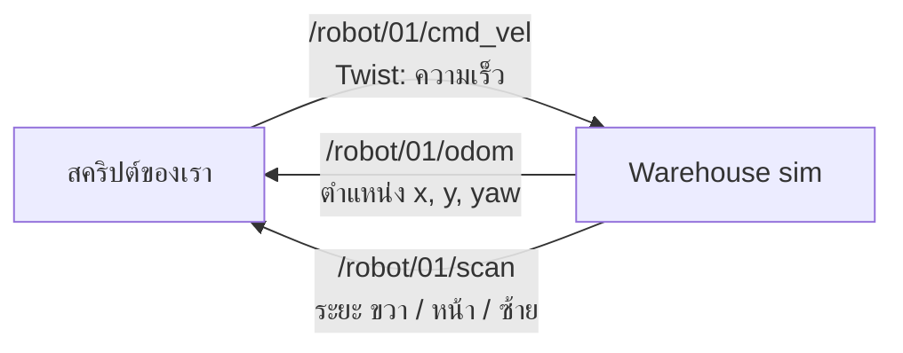
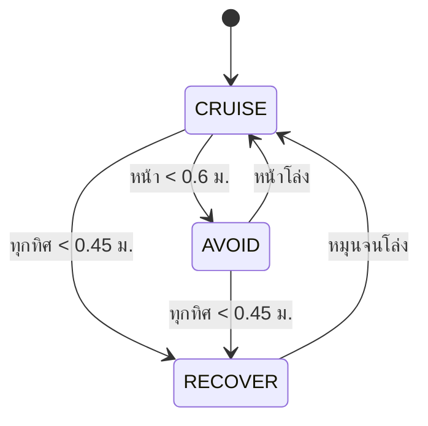
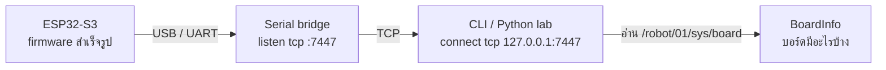

# บทที่ 4 — Workshop Onsite: robotos กับ warehouse simulation และบอร์ดจริง

🏠 [หน้าหลัก](../README.md) · 📚 [สารบัญ ND3](README.md) · ⬅ [บทที่ 3](03-robotos-hands-on.md) · ถัดไป ➡ [Git, GitHub และ Markdown](../common/git-github-markdown.md)

> **บทนี้เรียนอะไร:** 24 แบบฝึก 3 track — middleware บน laptop, ขับหุ่นยนต์ในโกดังจำลอง และต่อบอร์ด ESP32-S3 จริง พร้อมทฤษฎีที่ใช้ เช่น การควบคุมแบบ open/closed loop และ state machine

## ทำไมสำคัญ

เป็นครั้งแรกที่ใช้แนวคิดทั้งหมดกับ "หุ่นยนต์" จริง ๆ (ในโลกจำลอง) และกับฮาร์ดแวร์จริง และฝึกนิสัยสำคัญของวิศวกร: **ใช้หลักฐานที่วัดได้ ไม่ใช่แค่เห็นว่าโปรแกรมรันผ่าน**

## แนวคิดหลัก

### 3 track
| Track | แบบฝึก | เนื้อหา |
|---|---|---|
| **MW** (middleware) | MW-00–06 | pub/sub, service, action, parameter, record/replay, mini twin — บน laptop อย่างเดียว |
| **WH** (warehouse sim) | WH-00–08 | ขับหุ่นในโกดังจำลอง: Twist, odometry, scan, หลบสิ่งกีดขวาง, เดินตามผนัง, state machine, งานปิดท้าย |
| **HW** (hardware) | HW-00–07 | ต่อบอร์ด, ตรวจความสามารถ, อ่าน sensor, สั่ง actuator, parameter บนบอร์ด, sense → act |

### หุ่นยนต์ในโกดังจำลองคุยผ่าน 3 topic



- **Twist** = `linear.x` (เดินหน้า m/s) + `angular.z` (หมุน rad/s ค่าบวก = ทวนเข็ม)
- ต้องส่งคำสั่งต่อเนื่อง ~20 ครั้ง/วินาที ถ้าหยุดส่งเกิน ~0.5 วินาที หุ่นจะหยุดเอง (กันหุ่นวิ่งเตลิด)
- ต้องตั้ง sim เป็นโหมด **External** หุ่นถึงจะรับคำสั่งจากสคริปต์

### Open loop vs Closed loop

| | Open loop | Closed loop (feedback) |
|---|---|---|
| คำสั่งขึ้นกับ | เวลา | ค่าที่วัดได้ |
| ตัวอย่าง | เดินสี่เหลี่ยมโดยตั้งเวลา `t = ระยะ / ความเร็ว` | ถ้าระยะข้างหน้า < 0.6 ม. ให้เลี้ยว |
| ผล | สะสมความคลาดเคลื่อน กลับไม่ตรงจุดเริ่ม | ปรับตามสภาพจริง |

### เดินตามผนังด้วย state machine



การคุมระยะห่างจากผนัง: `error = target − ระยะด้านข้าง` แล้ว `ความเร็วหมุน = k × error` (จำกัดไม่เกิน ±1.2 rad/s)

### ต่อบอร์ดจริง



- อ่าน **BoardInfo** ก่อน เพื่อรู้ว่าบอร์ดมี LED, ไมค์, IMU หรือไม่ แล้วเลือกแบบฝึกที่รองรับ
- **ปิด warehouse sim ก่อนเปิด bridge** เพราะใช้พอร์ต 7447 เดียวกัน

### หลักฐาน ไม่ใช่แค่ "รันผ่าน"
- **ได้รับค่าที่ decode แล้ว** เป็นหลักฐานที่ดีกว่าแค่เห็นชื่อ topic
- บันทึก (record) ข้อมูลที่ใช้ยืนยันสิ่งที่อ้าง เช่น อ้างว่าหุ่นหลบสิ่งกีดขวางได้ → ต้องมีทั้ง scan และ odometry
- การ replay คือหลักฐานที่บันทึกไว้ ไม่ใช่การทดสอบสดใหม่

## ขั้นตอนลงมือ (Windows PowerShell)
```powershell
git clone https://github.com/drsanti/robotos-workshop.git
cd robotos-workshop
# ครั้งแรก: ดับเบิลคลิก scripts\start-here.cmd (สร้าง .venv ติดตั้ง SDK และเปิด sim)
$env:PATH = "$PWD\code\robotos-v0.3.0-windows-x64\bin;$env:PATH"
.\.venv\Scripts\Activate.ps1
robotos topic list          # ต้องเห็น /robot/01/cmd_vel, odom, scan
scripts\run.cmd wh-01       # ขับหุ่นเดินหน้า ~1 ม. แล้วหยุด
```
macOS ใช้ `scripts/start-here.command` และ `./scripts/run wh-01` · มีเอกสารแบบ interactive ที่ [drsanti.github.io/robotos-workshop-docs](https://drsanti.github.io/robotos-workshop-docs/)

## ปัญหาที่พบบ่อย

| อาการ | วิธีแก้ |
|---|---|
| `topic list` ว่าง | sim ยังไม่ได้รัน หรือยังไม่ Connected |
| หุ่นไม่ขยับ | sim อยู่โหมด Manual ให้ตั้งเป็น External |
| เปิด terminal ใหม่แล้วหา `robotos` ไม่เจอ | ต้องวางคำสั่งตั้ง PATH และ activate `.venv` ใหม่ทุกครั้ง |
| ต่อบอร์ดไม่ได้ | ปิด sim ก่อน (พอร์ต 7447 ชนกัน) |
| แบบฝึก LED ไม่มีผล | บอร์ดรุ่นนั้นไม่มี LED — ตรวจ BoardInfo |

## คำศัพท์ในบท
[Twist / Odometry](../common/glossary.md#twist--odometry) · [Closed loop](../common/glossary.md#closed-loop) · [State machine](../common/glossary.md#state-machine) · [Capability gating](../common/glossary.md#capability-gating) · [Digital Twin](../common/glossary.md#digital-twin)

## แหล่งอ้างอิง
- repo workshop: [robotos-workshop](https://github.com/drsanti/robotos-workshop) · เอกสาร interactive: [robotos-workshop-docs](https://drsanti.github.io/robotos-workshop-docs/)

---
🏠 [หน้าหลัก](../README.md) · 📚 [สารบัญ ND3](README.md) · ⬅ [บทที่ 3](03-robotos-hands-on.md) · ถัดไป ➡ [บทที่ 5 — Git, GitHub และ Markdown](../common/git-github-markdown.md)
