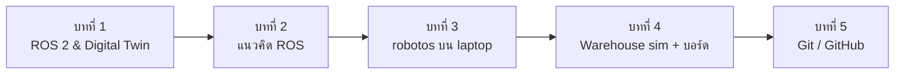

# ND3 — นักพัฒนา AI และ Digital Twin เชิงอุตสาหกรรม

🏠 [หน้าหลัก](../README.md) · 📖 [คำศัพท์](../common/glossary.md)

> สรุปสิ่งที่เรียนใน **ND3: อุตสาหกรรมอัจฉริยะด้วย Digital Twins และ AI** (KMUTT Non-Degree 2026) Week 01–05
> เขียนให้ **มือใหม่ที่ไม่เคยเรียนหลักสูตรนี้** — โดยเฉพาะคนสาย automation / PLC ที่อยากเข้าใจโลกหุ่นยนต์

## หลักสูตรนี้เกี่ยวกับอะไร

พาคนสาย automation จากโลก PLC ไปสู่ระบบกระจายแบบ **ROS 2** ที่หุ่นยนต์และ AI ใช้ — node, topic, service, action — แล้วลงมือกับ **robotos** (middleware แนวคิดเดียวกับ ROS ที่ติดตั้งง่าย) ขับหุ่นยนต์ในโกดังจำลอง ต่อบอร์ดจริง และสร้าง **Digital Twin**

## สารบัญ

| บท | หัวข้อ | สัปดาห์ | เรียนอะไร |
|---|---|---|---|
| 1 | [ROS 2, Digital Twin และ AI ในระบบอุตสาหกรรม](01-digital-twins-ai.md) | Week 01 | ระบบหุ่นยนต์จริง, ROS 2 vs OPC UA vs MQTT, 5 ทักษะ |
| 2 | [แนวคิดของ ROS และ Digital Twin](02-ros-concepts-digital-twin.md) | Week 02 | node/topic/service/action/parameter, TF, QoS, เทียบกับ PLC |
| 3 | [ลงมือกับ robotos](03-robotos-hands-on.md) | Week 03 | 7 workshop, service vs action, record & replay, mini twin |
| 4 | [Workshop Onsite: warehouse sim และบอร์ดจริง](04-onsite-robotos-workshop.md) | Week 04 | 24 แบบฝึก 3 track, open/closed loop, state machine |
| 5 | [Git, GitHub และ Markdown](../common/git-github-markdown.md) | Week 05 | เครื่องมือส่งงานและเขียนเอกสาร (ใช้ร่วมกันทุกหลักสูตร) |

## เครื่องมือที่ต้องติดตั้ง

| เครื่องมือ | ใช้ทำอะไร | ตรวจว่าพร้อม |
|---|---|---|
| Python ≥ 3.10 | รัน node และ SDK ของ robotos | `python --version` |
| PowerShell 7 (Windows) | terminal ที่ robotos รองรับ (ไม่ใช้ Git Bash) | `$PSVersionTable` |
| robotos (มากับ repo workshop) | middleware + CLI | `robotos doctor` |
| VS Code + Markdown Preview Enhanced | อ่านเอกสารและแก้โค้ด | — |
| Git | ดึงเอกสาร/โค้ดที่อัปเดตบ่อย และส่งงาน | `git --version` |

## ถ้ามีเวลาน้อย อ่านแค่นี้
1. ROS คือ **ภาษากลางในการส่งข้อความ** ของโลกหุ่นยนต์ ไม่ใช่ระบบ real-time และไม่รับประกัน safety
2. เลือกรูปแบบให้ถูก: **topic** = ข้อมูลต่อเนื่อง · **service** = ถาม-ตอบ · **action** = งานยาวที่ยกเลิกได้
3. **Digital Twin** ต้องใช้สัญญาข้อมูลเดียวกับเครื่องจริง ไม่ใช่แค่ภาพ 3D
4. ยืนยันผลด้วย **หลักฐานที่บันทึกได้** (record / replay) ไม่ใช่แค่เห็นว่าโปรแกรมรันผ่าน

## แหล่งอ้างอิงหลัก
- เอกสารของผู้สอน (ผศ.ดร.สันติ นุราช มจธ.): [github.com/drsanti/kmutt-nd69 — ND3](https://github.com/drsanti/kmutt-nd69/blob/main/nd3/README.md)

---
🏠 [หน้าหลัก](../README.md) · [ND1](../nd1/README.md) · [ND2](../nd2/README.md)
